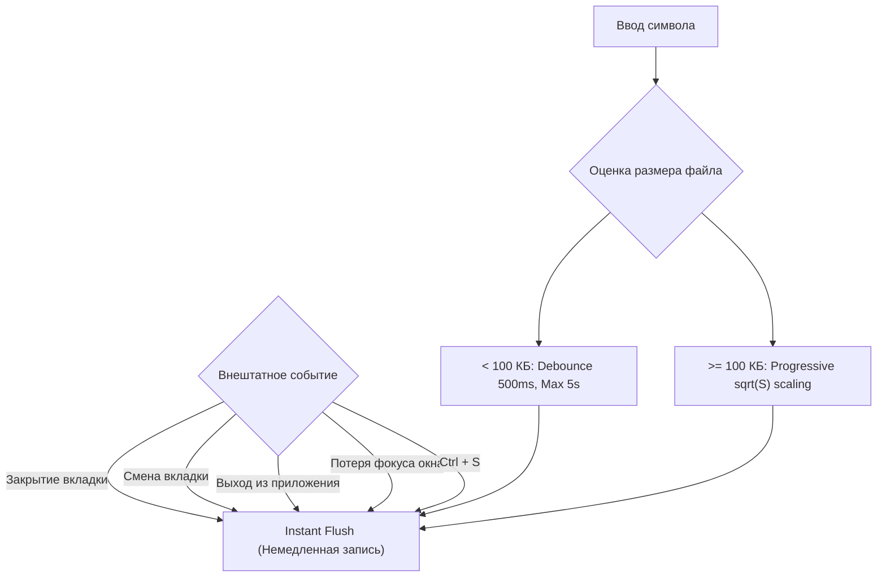

# План: Адаптивный менеджер сохранений (Adaptive Save Manager)

Связанные документы: 
- `TODO/perf-plan-aquilum.md`
- `TODO/perf-plan-large-file-open.md`

---

## 0. Проблема: текущее поведение автосохранения

В `src/views/app_view.rs::schedule_auto_save` реализован фиксированный дебаунс:
```rust
background.timer(std::time::Duration::from_millis(500)).await;
```

### Последствия для файлов разного размера:
1. **Маленькие заметки (1–50 КБ):**
   - 500 мс работает отлично: пользователь прекратил печатать, файл мгновенно сбросился на диск. Потери данных исключены.
2. **Огромные файлы (10–100+ МБ, логи, архивы, большие базы):**
   - При активном вводе текста каждая короткая пауза в 500 мс инициирует фоновый сброс всего файла целиком на диск.
   - Это приводит к непрерывной записи со скоростью 20–50+ МБ/с (`std::fs::write(&path, content)`).
   - Вызывает деградацию SSD, избыточную нагрузку на CPU/шину памяти при копировании буфера `content.clone()`, а также сброс кэша страниц операционной системы.

---

## 1. Цели адаптивного менеджера

1. **Динамический Debounce:** адаптировать задержку сохранения под размер файла и сложность разметки (от 500 мс для малых заметок до 10–15 секунд для файлов в десятки мегабайт).
2. **Гарантия немедленного сброса (Immediate Flush):** ни при каких обстоятельствах данные не должны потеряться при выходе из программы, закрытии вкладки или смене файла.
3. **Сохранение при потере фокуса (Save on Blur):** автоматический фоновый сброс при переключении пользователя в другое окно/приложение.
4. **Защита от потери при непрерывном вводе (Deadline / Max Delay):** ограничение максимального времени нахождения изменений в памяти без записи на диск.
5. **Атомарная запись (Atomic Write / Swap):** предотвращение повреждения файла при внезапном сбое питания во время записи больших объёмов данных.

---

## 2. Архитектура: уровни адаптивного таймера

### 2.1. Расчёт задержки (Прогрессивная нелинейная шкала)

Для исключения резких скачков между размерами и предотвращения непрерывного потока записи (в десятки МБ/с) при редактировании файлов в сотни мегабайт (например, 700 МБ) используется **прогрессивная степенная модель ($\sqrt{S}$)** от размера контента:

- **Обычные заметки ($< 100$ КБ):** фиксированные **500 мс** debounce и **5 с** max deadline (максимальная отзывчивость и сохранность).
- **Файлы $\ge 100$ КБ ($S_{\text{MB}} = \text{bytes} / 1024^2$):**
  $$\text{Debounce} = \text{clamp}\left(1.5 + 1.5 \times \sqrt{S_{\text{MB}}},\; 0.5\text{ с},\; 60.0\text{ с}\right)$$
  $$\text{Max Deadline} = \text{clamp}\left(10.0 + 8.5 \times \sqrt{S_{\text{MB}}},\; 5.0\text{ с},\; 300.0\text{ с}\right)$$

| Размер файла | Debounce (пауза ввода) | Max Deadline (дедлайн) | Нагрузка на диск при непрерывном вводе |
| :--- | :--- | :--- | :--- |
| **$< 100$ КБ** *(заметка)* | **500 мс** | **5 сек** | Мгновенно, нулевая нагрузка |
| **1 МБ** | **3.0 сек** | **18.5 сек** | ~55 КБ/с |
| **10 МБ** | **6.2 сек** | **36.9 сек** | ~270 КБ/с |
| **50 МБ** | **12.1 сек** | **70.1 сек (~1.1 мин)** | ~700 КБ/с |
| **100 МБ** | **16.5 сек** | **95.0 сек (~1.5 мин)** | ~1.0 МБ/с |
| **300 МБ** | **27.5 сек** | **157.2 сек (~2.6 мин)** | ~1.9 МБ/с |
| **700 МБ** | **41.2 сек** | **234.8 сек (~3.9 мин)** | ~2.9 МБ/с *(вместо 60 МБ/с!)* |
| **$\ge 1$ ГБ** | **60.0 сек (max)** | **300.0 сек (5 мин max)** | ~3.3 МБ/с |

---

## 3. Гарантии сохранности: точки принудительного сброса (Instant Flush)

При увеличении дебаунса для больших файлов принудительный синхронный/приоритетный сброс **обязан** срабатывать на следующие события:



### События немедленного сброса:
1. **Закрытие вкладки (`close_tab` / `Ctrl+W`):**
   - Если закрываемая вкладка помечена `is_dirty`, перед закрытием выполняется немедленная запись на диск.
2. **Переключение активной вкладки (`select_tab` / `open_note`):**
   - Предыдущая активная вкладка сбрасывается на диск перед загрузкой/отображением новой.
3. **Потеря фокуса окном приложения (`Window::on_blur` / `FocusOut`):**
   - Пользователь свернул окно или переключился в браузер/мессенджер — идеальный момент для тихого сброса на диск, пока приложение простаивает.
4. **Выход из приложения (`save_on_exit`, `on_window_should_close`, клик по крестику, `cx.quit()`):**
   - Проход по всем открытым вкладкам в `state.open_tabs` и сброс всех грязных заметок на диск.
5. **Ручное сохранение (`Ctrl + S`):**
   - Немедленный триггер фоновой записи с отображением индикатора в статусной строке.

---

## 4. Атомарная запись больших файлов (Safe Atomic Write)

Прямой вызов `std::fs::write(&path, content)` для файлов размером 50 МБ рискован: если во время записи произойдет аварийное завершение процесса или сбой питания, исходный файл на диске окажется усечённым.

### Механизм:
1. Для файлов размером $> 10$ МБ запись производится во временный файл в том же каталоге:
   `let tmp_path = path.with_extension(format!("tmp.{}.vibecodium", std::process::id()));`
2. Данные полностью сбрасываются на диск через фоновый поток.
3. Выполняется атомарное переименование:
   `std::fs::rename(&tmp_path, &path);`
   *(Операция `rename` в пределах одной файловой системы атомарна на NTFS и POSIX).*
4. При ошибке записи временный файл удаляется, а оригинальный документ остаётся неповрежденным.

---

## 5. Индикация в пользовательском интерфейсе

1. **Индикатор несохранённых изменений на вкладке:**
   - Пока документ находится в состоянии `is_dirty` (таймер автосохранения тикает), рядом с заголовком вкладки отображается точка `•`.
   - После успешного сброса на диск точка плавно гаснет.
2. **Индикатор статуса в Status Bar:**
   - Для больших документов во время записи на диск в строке состояния на 1–2 секунды отображается `💾 Сохранение...` $\rightarrow$ `✓ Сохранено`.

---

## 6. Конфигурация в настройках (`AppConfig`)

Добавление секции в `src/settings.rs`:

```rust
#[derive(Debug, Clone, Serialize, Deserialize)]
pub struct AutoSaveSettings {
    /// Режим автосохранения: Adaptive (по умолчанию), Fixed, OnlyOnBlur, Manual
    pub mode: AutoSaveMode,
    /// Дебаунс для малых файлов (< 100 KB) в миллисекундах (по умолчанию: 500)
    pub small_file_debounce_ms: u64,
    /// Дебаунс для средних файлов (100 KB .. 2 MB) в миллисекундах (по умолчанию: 2000)
    pub medium_file_debounce_ms: u64,
    /// Дебаунс для больших файлов (> 2 MB) в миллисекундах (по умолчанию: 5000)
    pub large_file_debounce_ms: u64,
    /// Дебаунс для огромных файлов (> 10 MB) в миллисекундах (по умолчанию: 15000)
    pub huge_file_debounce_ms: u64,
    /// Сохранять ли немедленно при потере фокуса окном
    pub save_on_blur: bool,
}
```

---

## 7. Этапы реализации (Roadmap)

- [x] **Этап 1: Структура `AutoSaveManager` и расчёт задержки.**
  - Реализовать функцию вычисления `debounce_duration` и `max_deadline` по размеру контента (`src/save_manager.rs`).
- [x] **Этап 2: Поддержка Throttle Deadline.**
  - Хранить в состоянии заметки `first_dirty_time: Option<Instant>` для принудительного сохранения по дедлайну при непрерывном вводе.
- [x] **Этап 3: Точки гарантированного сброса (Flush Points).**
  - Немедленный сброс в `save_on_exit`, `close_tab`, смене активной заметки (`select_note`), `create_new_note` и обработчике потери фокуса окном `save_on_blur`.
- [x] **Этап 4: Атомарная запись через временный файл для больших объёмов.**
  - Добавить безопасный swap `tmp -> sync_all -> rename` в `save_manager::safe_write` при записи файлов крупнее 10 МБ с fallback-защитой.
- [x] **Этап 5: UI-индикация и тесты.**
  - Индикатор `●` на вкладке при `is_dirty`, статус `Saved: ...` в статусной строке, модульные тесты для интервалов и записи.