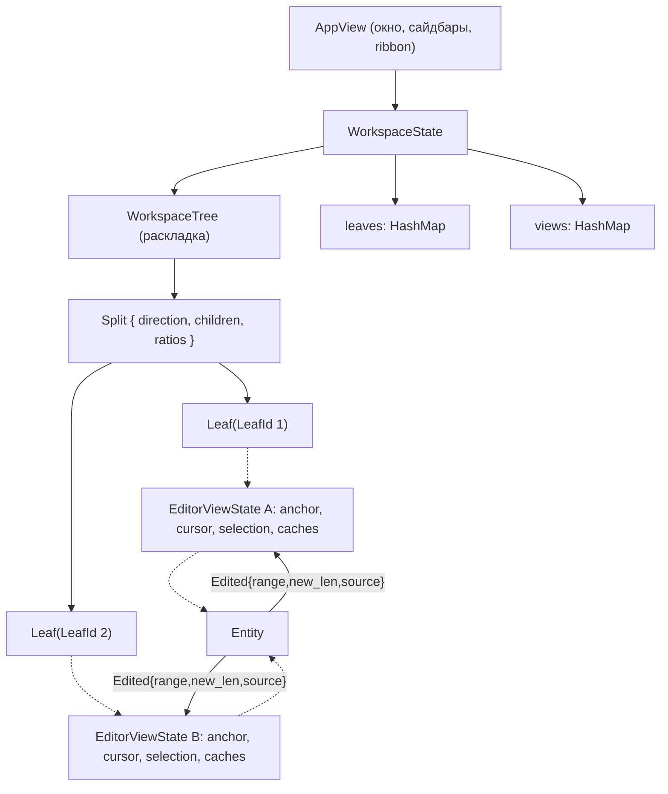

# План: Workspace, сплиты и одновременное редактирование нескольких документов

> **Статус документа:** архитектурный план, редакция 2 (пересмотр с учётом анализа).
> **Целевой проект:** `aquilum-gpui` (`vibecodium`)
> **Основа:** докинг/сплиты из `operator-panel` (`DockArea` / `PaneTree`), модель Leaves/Splits из Obsidian, буферы и мультибуферность из Zed/VSCode.

---

## 0. Как читать документ и текущий статус

Документ разделён на четыре слоя, чтобы не смешивать цели и факты:

1. **Требования** (раздел 2): что должно работать, независимо от реализации.
2. **Архитектурные решения** (раздел 3): принятые решения и их обоснование.
3. **Спецификации** (разделы 4-9): структуры данных, правила, схемы.
4. **Фазы и статус** (раздел 10): что сделано, что сделано иначе, что предстоит.

### 0.1. Сводка статусов

| Фаза | Содержание | Статус |
|---|---|---|
| 1 | `DocumentBuffer` и реестр документов | **Сделано иначе:** вместо общего буфера используются клоны в `open_documents` с ручной синхронизацией. Требует миграции (фаза 8). |
| 2 | Выделение `MarkdownEditorView` в отдельный `Entity` | **Не делалось:** редактор остаётся в `AppView::render_central_editor`, переиспользуется для всех листов. |
| 3 | `WorkspaceTree`, сплиты, разделители | Сделано |
| 4 | Единый верхний таб-бар, контекстные меню, изоляция скролла | Сделано и протестировано. Таб-бар нижних панелей: решение в 8.2. |
| 5 | Синхронизация одного файла между сплитами | Сделано **клонированием**. Не даёт дельт правок, поэтому не может обеспечить стабильность вьюпорта (раздел 5). Заменяется в фазе 8. |
| 6 | Персистентность `workspace.json` | Сделано. Схема требует исправлений (раздел 9). |
| 7 | Независимые таб-бары нижних панелей, точные координаты драга разделителей, снятие ограничения ширины вкладок | Сделано и протестировано (из исходного документа). Замечания в 10.1. |
| 8 | **Общий буфер, события правок, якоря вьюпорта** | Предстоит. **Критический путь.** |
| 9 | Политика открытия и дублирования файлов | Предстоит |
| 10 | Жизненный цикл буфера, переименование, внешние изменения | Предстоит |
| 11 | Единый `LeafTabBar`, схлопывание панелей, drag-and-drop вкладок | Предстоит (частично: таб-бары нижних панелей уже есть, фаза 7) |
| 12 | Горячие клавиши и навигация фокуса | Предстоит |
| 13 | Персистентность `workspace.json` v2 | Предстоит (сразу после фазы 8) |
| 14 | Тесты и бенчмарки (раздел 11) | Идёт параллельно с 8-13 |

---

## 1. Контекст и проблематика

### 1.1. Исходное состояние `aquilum-gpui`

- **Монолитный `AppView.rs` (~8700 строк):** рендеринг редактора, расчёты вьюпорта (`EDITOR_OVERSCAN_PX`), мигание курсора, скроллбар и обработка мыши встроены в корневой View.
- **Один активный документ:** `AppState.active_note: Option<OpenedNote>`; при переключении вкладок документ выгружается, вьюпорт сбрасывается.
- **Смешение данных документа и отображения:** `OpenedNote` объединяет поля файла (`content`, `line_index`, `code_checkpoints`, `is_dirty`, `undo_stack`) и состояние отображения (`cursor_offset`, `selection_anchor`, `window: EditorWindow`).
- **Один глобальный таб-бар** `tab_list.rs` с плоским `open_tabs: Vec<PathBuf>`.

### 1.2. Целевое поведение (ориентир: Obsidian)

1. Произвольные сплиты (слева/справа, сверху/снизу), любое количество панелей (Leaves).
2. Независимые группы вкладок в каждой панели.
3. Разные документы рядом.
4. Один документ в нескольких панелях: общий текст и общая история правок, **независимые** курсор, выделение и позиция просмотра.
5. Стабильность вьюпорта: правка в одной панели не сдвигает то, что пользователь видит в другой (раздел 5).
6. Персистентность раскладки, пропорций, открытых файлов и позиций просмотра.

---

## 2. Требования

### 2.1. Функциональные

| ID | Требование |
|---|---|
| R1 | Окно делится на любое число панелей по обеим осям, включая вложенные сплиты. |
| R2 | У каждой панели свой список вкладок и своя активная вкладка. |
| R3 | Один файл может быть открыт в нескольких панелях одновременно с общим буфером. |
| R4 | Курсор, выделение и вьюпорт каждой панели независимы. |
| R5 | **Правка в одной панели не меняет положение видимого текста в других панелях** (раздел 5). |
| R6 | Если у панелей есть общая видимая строка, правка в ней видна в обеих панелях сразу. |
| R7 | Открытие файла подчиняется явной политике дублирования (раздел 6). |
| R8 | Один буфер, одно сохранение, одна история undo/redo. |
| R9 | Раскладка и позиции просмотра восстанавливаются при запуске. |
| R10 | Единственный редактор Markdown: активные и неактивные панели рендерятся одним кодом (`render_central_editor`), без упрощённых превью. |

### 2.2. Нефункциональные

| ID | Требование |
|---|---|
| N1 | Ввод в файле размером в несколько МБ при двух панелях не вызывает заметных задержек. Целевой бюджет: кадр не более 8 мс (120 FPS) на эталонной машине. Подтверждается бенчмарком (раздел 11). |
| N2 | Запись `workspace.json` атомарна и не блокирует UI. |
| N3 | Повреждённый или устаревший `workspace.json` никогда не приводит к падению: откат к раскладке по умолчанию. |
| N4 | Операции над `WorkspaceTree` и пересчёт якорей реализуются как чистые функции без GPUI-зависимостей, чтобы тестироваться юнит-тестами. |

---

## 3. Архитектурные решения (ADR)

### ADR-1. Общий буфер: `Entity<DocumentBuffer>` с событиями правок

- **Решение:** документ хранится в `Entity<DocumentBuffer>`. Виды (панели) подписываются на его события через `cx.subscribe`.
- **Отвергнуто:** `Arc<RwLock<DocumentBuffer>>` (не идиоматично для GPUI, нет уведомлений) и текущая схема «клон + ручная синхронизация» (нет дельт, возможны два конкурирующих сохранения, рассинхронизация `version` / `is_dirty` / `undo_stack`).
- **Следствие:** все мутации идут через методы буфера, которые эмитят `Edited { range, new_len, source }`. Это единственная точка истины для курсоров, якорей и кэшей.

### ADR-2. Идентичность документа: `DocumentId`, а не `PathBuf`

- **Решение:** `DocumentId(Uuid)` в рантайме; путь является изменяемым атрибутом буфера.
- **Причина:** переименование (инлайн-заголовок по Enter), перемещение и удаление ломают ключ-путь во всех вкладках и в `workspace.json`. На Windows добавляются различия регистра и слешей.
- **Реестр:** `documents: HashMap<DocumentId, Entity<DocumentBuffer>>` плюс индекс `by_path: HashMap<NormalizedPath, DocumentId>` (нормализация: регистр на Windows, разделители, канонизация).
- **Персистентность:** на диск пишутся пути (относительно vault), при загрузке они превращаются в `DocumentId` через реестр.

### ADR-3. Позиция просмотра: якорь в тексте, а не пиксели

- **Решение:** источником истины для вьюпорта является `ViewportAnchor` (позиция в тексте + пиксельное смещение внутри строки). Пиксельный `scroll_top` вычисляется из якоря и индекса высот.
- **Причина:** единственный способ выполнить R5 и сделать позицию устойчивой к внешним правкам файла.
- **Подробно:** раздел 5.

### ADR-4. Содержимое вкладки: `enum`, а не путь

```rust
pub enum TabContent {
    Document(DocumentId),
    Empty,                       // open_empty_tab
    Plugin(PluginViewId),        // граф, панели плагинов
}
```

`LeafState.tabs: Vec<TabContent>`. Это покрывает пустые вкладки и не-markdown виды, которые появятся с системой плагинов.

### ADR-5. Именование направлений сплита

Вместо `Horizontal` / `Vertical` (семантика обратна ожидаемой) использовать `Row` (панели в ряд, слева направо) и `Column` (панели в колонку, сверху вниз).

### ADR-6. Редактор остаётся в `AppView` на этом этапе

Извлечение `MarkdownEditorView` в отдельный `Entity` (исходная фаза 2) **откладывается**: оно не нужно для R1-R10 и рискованно для 8700-строчного файла. Требуется лишь, чтобы всё per-leaf состояние редактора жило в `EditorViewState`, а не в полях `AppView`. Полное извлечение возможно позже отдельной задачей, но обещание «разгрузить `AppView` на тысячи строк» из первой редакции снимается как цель этого плана.

---

## 4. Модель данных

### 4.1. Схема сущностей



### 4.2. Разделение ответственности

| Сущность | Ответственность |
|---|---|
| `DocumentBuffer` | Текст, `LineIndex`, `CodeCheckpoints`, undo/redo, `version`, `is_dirty`, путь, таймер автосохранения. Эмитит события. |
| `EditorViewState` | Всё, что принадлежит одной панели: курсор, выделение, `ViewportAnchor`, кэши раскладки, скроллбар, инерция колеса, перетаскивание. |
| `LeafState` | Группа вкладок: `tabs`, `active_tab_index`, `pinned`. |
| `WorkspaceTree` | Геометрия: `Split` и `Leaf(LeafId)`. |

### 4.3. Структуры

```rust
// src/document_buffer.rs
pub struct DocumentId(pub Uuid);

pub struct DocumentBuffer {
    pub id: DocumentId,
    pub path: PathBuf,
    pub title: String,
    pub content: String,
    pub version: u64,
    pub is_dirty: bool,
    pub first_dirty_time: Option<Instant>,
    pub line_index: LineIndex,
    pub code_checkpoints: CodeCheckpoints,
    pub undo_stack: Vec<UndoStep>,   // UndoStep хранит дельту и позиции курсора источника
    pub redo_stack: Vec<UndoStep>,
}

/// Описание одной правки в координатах ДО правки.
#[derive(Clone, Copy, Debug)]
pub struct Edit {
    pub start: usize,       // байтовое смещение начала заменяемого диапазона
    pub old_len: usize,     // длина заменённого фрагмента
    pub new_len: usize,     // длина вставленного фрагмента
}

pub enum BufferEvent {
    Edited { edit: Edit, source: Option<LeafId>, version: u64 },
    Reloaded,                       // внешнее изменение на диске
    PathChanged { old: PathBuf, new: PathBuf },
    Deleted,
    DirtyChanged(bool),
}
```

```rust
// src/views/editor_view.rs
pub struct EditorViewState {
    pub doc: DocumentId,
    pub cursor_offset: usize,
    pub selection_anchor: Option<usize>,
    pub viewport: ViewportAnchor,           // раздел 5
    pub layout: LeafLayoutCache,            // visual_rows, height_index, code_states, привязаны к ширине
    pub scrollbar: ScrollbarState,          // drag, overview ruler
    pub wheel_ease: Cell<Option<WheelEase>>,
    pub editor_window: EditorWindow,        // виртуализированный срез
    pub focus_handle: FocusHandle,
    pub blink: BlinkManager,
    pub is_mouse_selecting: bool,
}
```

```rust
// src/workspace/tree.rs
#[derive(Clone, Copy, Debug, PartialEq, Eq, Hash, Serialize, Deserialize)]
pub struct LeafId(pub Uuid);

#[derive(Clone, Copy, Debug, PartialEq, Eq, Serialize, Deserialize)]
pub enum SplitDirection { Row, Column }

#[derive(Clone, Debug, Serialize, Deserialize)]
#[serde(tag = "type", rename_all = "lowercase")]
pub enum WorkspaceNode {
    Split { direction: SplitDirection, children: Vec<WorkspaceNode>, ratios: Vec<f32> },
    Leaf { id: LeafId },
}

pub struct LeafState {
    pub id: LeafId,
    pub tabs: Vec<TabContent>,
    pub active_tab_index: usize,
    pub pinned: bool,
}
```

### 4.4. Кэши раскладки зависят от ширины панели

`visual_rows`, `height_index` и `code_states` зависят от ширины панели (перенос строк). Они хранятся **по панелям** в `LeafLayoutCache` и инвалидируются при:

- изменении ширины панели (перетаскивание разделителя, ресайз окна, открытие/закрытие сайдбара);
- изменении шрифта или масштаба;
- событии `Edited` (инкрементально, только затронутый диапазон).

При перетаскивании разделителя пересчёт откладывается (debounce) с использованием последних известных высот, а якорь вьюпорта защищает от прыжков содержимого.

---

## 5. Стабильность вьюпорта при правках из другого окна

### 5.1. Принцип

Каждая панель хранит позицию просмотра как **якорь в тексте**. Правки из других панелей сдвигают якорь вместе с текстом, поэтому видимое содержимое не меняется. Меняются только производные величины: номера строк, высота документа, размер и положение ползунка скроллбара.

### 5.2. Правила

| Где правка относительно видимой области панели | Результат |
|---|---|
| **Выше** | Видимый текст остаётся на месте. Номера строк пересчитываются, общая высота растёт, ползунок скроллбара уменьшается и смещается. `scroll_top` увеличивается на высоту вставки. Вставленное видно, только если пролистать вверх. |
| **Ниже** | Ничего не сдвигается. Обновляются высота документа и скроллбар. |
| **Внутри** (общая строка) | Изменение отображается сразу (общий буфер, перерисовка обеих панелей). |
| **Удаление**, захватившее якорную позицию | Якорь схлопывается к началу удалённого диапазона. |
| **Своя правка** (панель-источник) | Обычное поведение: каретка следует за вводом, при необходимости автоскролл. **Автоскролл только в панели-источнике.** |

### 5.3. Якорь

```rust
#[derive(Clone, Copy, Debug)]
pub enum Bias { Left, Right }

#[derive(Clone, Copy, Debug)]
pub struct ViewportAnchor {
    pub offset: usize,      // позиция начала первой (частично) видимой строки, байты
    pub bias: Bias,         // для вьюпорта всегда Right
    pub px_in_line: f32,    // на сколько пикселей строка «заехала» за верхний край
}
```

Производный пиксельный скролл: `scroll_top = layout.prefix_height(line_of(anchor.offset)) + anchor.px_in_line`.

### 5.4. Пересчёт позиции при правке

Единая чистая функция для якоря, курсора, выделения и любых других позиций вида:

```rust
pub fn transform_offset(offset: usize, e: Edit, bias: Bias) -> usize {
    let old_end = e.start + e.old_len;
    if offset < e.start || (offset == e.start && matches!(bias, Bias::Left)) {
        return offset;                                   // до правки
    }
    if offset >= old_end {
        return offset + e.new_len - e.old_len;           // после правки: сдвиг
    }
    // внутри заменённого диапазона: схлопывание
    e.start + if matches!(bias, Bias::Right) { e.new_len } else { 0 }
}
```

Следствия выбора `Bias::Right` для якоря: вставка ровно в позицию якоря уходит **выше** экрана, как и требуется.

### 5.5. Обработка `BufferEvent::Edited` в виде

Для каждого вида, **кроме источника** (источник обрабатывает свою правку обычным путём ввода):

1. `viewport.offset = transform_offset(viewport.offset, edit, Right)`.
2. `cursor_offset` и `selection_anchor` пересчитываются через `transform_offset` (Left для каретки, чтобы вставка в позицию каретки другого вида не утаскивала её; для выделения: начало Left, конец Right).
3. `layout.height_index` инкрементально обновляется на затронутом диапазоне.
4. `scroll_top` пересчитывается из якоря.
5. Обновляются gutter (номера строк), `EditorWindow`, scrollbar и overview ruler.
6. Если правка пересекает видимую область, запрашивается перерисовка.

### 5.6. Нюанс: неизмеренные строки

Для вставки в тысячи строк точные высоты (с учётом переноса) могут быть неизвестны. Поэтому:

- новым строкам сначала присваивается оценочная высота (`estimated_row_height`), якорь и `scroll_top` строятся на оценке;
- по мере измерения (лениво, при приближении к видимой области) оценка заменяется точным значением;
- если уточняется высота строк **выше** якоря, `scroll_top` корректируется на разницу (scroll anchoring, как в браузерах), чтобы видимое содержимое не двигалось.

### 5.7. Пример

Левая панель показывает строки 3000-3040, в правой пользователь пишет в строке 10 и вставляет 5000 строк.

- Левая: на экране тот же текст (теперь это строки 8000-8040), `scroll_top` вырос, ползунок уменьшился. Прокрутка вверх показывает вставленное.
- Правая: каретка и ввод как обычно.

### 5.8. Критерии приёмки

- Вставка N строк над вьюпортом: тот же текст на экране, экранный сдвиг контента равен 0 px.
- Вставка ровно в позицию якоря: экран не меняется.
- Удаление над вьюпортом: то же в обратную сторону.
- Правка в общей строке: обновляются обе панели.
- Курсор и выделение неактивной панели указывают на тот же текст после любых правок в другой панели.
- Автоскролл срабатывает только в панели-источнике.
- Undo в панели B откатывает правку и ставит каретку B на место отката; позиции в панели A пересчитываются по дельте.

---

## 6. Политика открытия и дублирования файлов

### 6.1. Режимы открытия

```rust
pub enum OpenMode {
    Reuse,              // обычный клик
    ForceNewTab,        // Ctrl+Click, средняя кнопка
    Split(SplitDirection), // «Открыть справа / снизу», «Разделить»
}

impl WorkspaceTree {
    pub fn open_file(&mut self, doc: DocumentId, target: LeafId, mode: OpenMode) -> OpenOutcome;
}
```

### 6.2. Таблица поведения

Правило: **обычное открытие всегда происходит в активной панели и переиспользует вкладку этой же панели, если она есть; явное действие (`Ctrl+Click`, «Разделить») создаёт дубль внутри панели или новый сплит.**

| Действие | Поведение |
|---|---|
| Клик по файлу, уже открыт **в активной панели** | Переключиться на существующую вкладку. |
| Клик, открыт **в другой панели** (или в нескольких) | Открыть в **активной** панели новой вкладкой (второй вид того же буфера). Другие панели не затрагиваются, фокус не переключается. |
| Клик, нигде не открыт | Новая вкладка в активной панели. |
| `Ctrl+Click` / средняя кнопка | Всегда новая вкладка в активной панели, даже если дубль. |
| «Открыть справа» / «Открыть снизу» | Если в нужном направлении уже есть панель, открыть в ней. Иначе создать сплит и открыть дубль вида. |
| «Разделить справа / снизу» на вкладке | Всегда дубль: второй вид того же буфера. |
| Ссылка `[[note]]` в заметке | Как обычный клик; `Ctrl+Click` открывает в новой вкладке. |

Дубль одного документа **в одной панели** возможен только через `ForceNewTab`. Закреплённые (`pinned`) вкладки не заменяются при `Reuse` и не закрываются командой «Закрыть остальные».

---

## 7. Жизненный цикл буфера

| Событие | Поведение |
|---|---|
| Открытие | `get_or_open_document(path)` ищет по `by_path`; если буфера нет, читает с диска и создаёт `Entity<DocumentBuffer>`. |
| Закрытие вида | Буфер остаётся, пока жив хотя бы один вид. |
| Закрытие **последнего** вида | При `is_dirty` запрос «Сохранить / Не сохранять / Отмена»; затем буфер выгружается. |
| Автосохранение | `SaveManager` обходит `documents` и сохраняет буферы с `is_dirty`. Один буфер даёт одну запись. |
| Переименование | Обновляются `path` буфера, `by_path`, заголовки вкладок во всех панелях, запись в `workspace.json`. Событие `PathChanged`. |
| Удаление файла | Вкладки с этим документом закрываются во всех панелях (событие `Deleted`); панели, оставшиеся без вкладок, схлопываются по 8.3. Если у буфера были несохранённые изменения, перед закрытием один раз предлагается «Сохранить как…» либо «Закрыть без сохранения». |
| Внешнее изменение на диске | Один раз перечитать буфер, а не по разу на вид. При `is_dirty` показать диалог конфликта. После перезагрузки якоря и курсоры восстанавливаются по построчному сопоставлению либо схлопываются; событие `Reloaded`. |
| Undo/redo | Один стек на буфер. `UndoStep` хранит дельту и позицию каретки источника. Каретка устанавливается в виде, где вызван undo; остальные виды пересчитываются через `transform_offset`. |

---

## 8. Таб-бар и раскладка

### 8.1. Принятые решения (из исходного плана)

- Правило фазы 4: под уже существующей полосой вкладок не создаётся вторая, дублирующая строка вкладок для той же панели (`render_leaf_header` удалён именно как такой дубль). У панелей верхнего ряда вкладки находятся в верхнем таб-баре окна; панели ниже верхнего края имеют **одну** собственную полосу того же компонента (8.2). Инвариант: у каждого листа ровно одна полоса вкладок.
- Разделитель сплита начинается в верхней полосе вкладок и непрерывно продолжается вниз через область редактора. Перетаскивание синхронно меняет ширину групп вкладок вверху и панелей внизу.
- Единый `render_central_editor` для активных и неактивных панелей. Неактивная панель отличается только скрытой кареткой; клик активирует её (`switch_to_leaf`) и переносит каретку в точку клика.
- Используются существующие компоненты: `#note-title-panel`, `#note-title-input`, `commit_title_rename_internal`, `create_new_note_at_front`, `create_new_note`, `open_empty_tab`.
- Контекстные меню вкладок и файлов, `Ctrl+Click`/средняя кнопка: реализованы.

### 8.2. Вкладки в панелях ниже верхнего края (решено)

**Решение:** вкладки нижних и вложенных панелей выглядят и работают **так же, как верхние**: тот же компонент `LeafTabBar` (Chrome-дизайн, SVG-скругления, кнопки `+` новой заметки и новой вкладки, закрытие `×`, контекстное меню). Различается только место: для панелей у верхнего края он находится в верхнем таб-баре окна, для остальных в верхней части самой панели. Отдельного упрощённого рендера нет, компонент один.

**Статус:** размещение реализовано в фазе 7; компонент пока рендерится двумя путями (`render_titlebar_workspace_tabs` и `leaf-tab-header-ID`), унификация в фазе 11.

**Правила размещения:**

- Верхний таб-бар окна показывает вкладки всех листьев, касающихся верхнего края (слева направо), с разделителем между группами.
- Лист, **не касающийся верхнего края** (`Split down`, сетка 2×2, вложенные сплиты), получает полосу `LeafTabBar` в верхней части своей панели с идентичным видом и поведением. Разделители между панелями продолжают проходить сквозь все полосы вкладок.
- Везде одно поведение: `+` создаёт вкладку в **этой** панели, `×` закрывает, есть контекстное меню вкладки и перетаскивание.
- Минимальная ширина группы вкладок и панели задаётся константой; при сжатии ниже минимума разделитель блокируется.
- Переполнение вкладок: горизонтальная прокрутка группы и выпадающий список скрытых вкладок.

### 8.3. Закрытие вкладок и схлопывание панелей (решено)

- Когда в панели закрывается **последняя** вкладка, панель удаляется из дерева, освободившееся место занимает соседняя (пропорции перераспределяются).
- `Split`-узел, у которого остался один ребёнок, заменяется этим ребёнком. Когда в дереве остаётся единственный лист, рабочая область переходит в **однооконный режим**: разделитель исчезает, верхний таб-бар показывает вкладки одного листа, в `workspace.json` сохраняется раскладка из одного листа.
- Фокус и активный лист переходят к соседней панели (ближайшей по порядку обхода дерева).
- Команда «Закрыть остальные» оставляет в панели одну вкладку и саму панель не удаляет.
- Единственный оставшийся лист при закрытии его последней вкладки ведёт себя как нынешний однооконный режим (пустое состояние); `LeafState` при этом не удаляется.

---

## 9. Персистентность (`.vibecodium/workspace.json`)

### 9.1. Пути

- Vault открыт: `<vault_root>/.vibecodium/workspace.json`.
- Vault не открыт: глобальная директория данных (`%APPDATA%/.vibecodium/workspace.json`).

### 9.2. Исправленная схема

Вкладки и скролл принадлежат листу, поэтому схема файла отражает `LeafState` и позицию просмотра в виде якоря, а не пикселей.

```json
{
  "version": 2,
  "active_leaf": "c2b5e1a4-...",
  "layout": {
    "type": "split",
    "direction": "row",
    "ratios": [0.5, 0.5],
    "children": [
      {
        "type": "leaf",
        "id": "c2b5e1a4-...",
        "tabs": [
          { "kind": "document", "path": "Notes/Tasks.md" },
          { "kind": "document", "path": "Notes/Inbox.md" },
          { "kind": "empty" }
        ],
        "active_tab_index": 0,
        "pinned": false,
        "views": {
          "Notes/Tasks.md": {
            "anchor_line": 118,
            "px_in_line": 4.0,
            "cursor_line": 120,
            "cursor_col": 3
          }
        }
      },
      {
        "type": "leaf",
        "id": "d8f4e2b1-...",
        "tabs": [{ "kind": "document", "path": "Notes/Project.md" }],
        "active_tab_index": 0,
        "pinned": false,
        "views": {}
      }
    ]
  }
}
```

Позиции хранятся как **строка + смещение**, а не как пиксели и не как байтовые смещения: так они переживают внешние изменения файла и смену ширины панели.

### 9.3. Запись

- Запись по факту изменения структуры (`split_leaf`, `close_tab`, `close_leaf`, смена активной вкладки) с debounce (например, 300-500 мс) и принудительная запись при выходе (`on_window_should_close` / `save_on_exit`).
- Запись атомарна: временный файл в той же директории, затем `rename`.
- Запись выполняется вне UI-потока.

### 9.4. Валидация при загрузке (обязательна)

- `ratios.len() == children.len()`; сумма нормализуется к 1.0, значения ниже минимума поднимаются до минимума.
- Узел `Split` без детей или с одним ребёнком схлопывается.
- `active_leaf` существует; иначе первый лист.
- `active_tab_index` в границах; иначе 0.
- Несуществующие файлы: вкладка помечается «файл не найден» либо удаляется (политика из раздела 7).
- Дубли `LeafId` перегенерируются.
- Любая неустранимая ошибка: логирование и откат к раскладке по умолчанию (один лист), исходный файл сохраняется как `workspace.json.bak`.

### 9.5. Версионирование

`version` обязателен. Версия выше поддерживаемой: открыть раскладку по умолчанию, не перезаписывать файл. Версия ниже: миграция по цепочке (`v1 → v2`: `scroll` в пикселях отбрасывается или переводится в `anchor_line` приближённо, вкладки преобразуются из `Vec<String>` в `Vec<{kind, path}>`).

---

## 10. Поэтапный план

### Фазы 1-7 (выполнены): краткая сводка

Выполнены: дерево раскладки и сплиты, интерактивные разделители, единый верхний таб-бар, контекстные меню вкладок и файлов, изоляция скролла (`leaf_scroll_top`, `visible_range`, `slice_shift`, обработка колеса и скроллбара по `leaf_id`), синхронизация клонов, сохранение и восстановление `workspace.json`. Изоляция скролла между панелями протестирована. Отклонения от первоначальной архитектуры перечислены в 0.1 и ADR-1/ADR-6.

**Фаза 7 (выполнена, добавлена из исходного документа):** независимые таб-бары в любых сплитах. Реализовано:

- `WorkspaceTree::top_leaves()` и `is_leaf_in_titlebar(leaf_id)`: листья верхнего ряда рисуются в заголовке окна (`render_titlebar_workspace_tabs`), остальные получают собственный заголовок (`leaf-tab-header-ID`) над редактором;
- исправлен конфликт двух `.flex_1()` в правой части заголовка (`titlebar-split-leaf-right` и `titlebar-split-drag-region`): правые вкладки больше не обрезаются на 50% ширины;
- `set_split_ratio_at(path, divider_index, ratio)` и расширенное состояние драга `is_resizing_workspace_split` позволяют менять пропорции любого вложенного узла; вертикальный драг не затрагивает горизонтальные пропорции.

Это закрывает большую часть решения 8.2 (вкладки нижних панелей). Остаётся унификация компонента (фаза 11).

#### 10.1. Замечания к фазе 7

1. **Нумерация.** В исходном документе «Фаза 7» уже занята этой выполненной работой, поэтому новые фазы плана сдвинуты: 8 (общий буфер и якоря), 9 (политика открытия), 10 (жизненный цикл буфера), 11 (`LeafTabBar`), 12 (горячие клавиши), 13 (персистентность v2), 14 (тесты).
2. **Уточнение фазы 4.** Фраза «никаких дополнительных полос вкладок внутри панелей» означает запрет на вторую строку вкладок под уже готовой, а не запрет на полосу у нижних панелей. С фазой 7 противоречия нет. Формулировку в исходном тексте стоит уточнить: «у каждого листа ровно одна полоса вкладок; под готовой полосой вторая не создаётся». Инвариант проверяется тестом: для любой раскладки число полос вкладок равно числу листьев.
3. **Два пути рендера.** `render_titlebar_workspace_tabs` и `leaf-tab-header-ID` рискуют разойтись по поведению и дизайну. Свести к одному `LeafTabBar` с параметром размещения (`Titlebar` / `InPane`).
4. **Ручной расчёт ширины.** `right_avail_tab_w` и `.max_w(px(..))` считаются для правой группы вручную. Для верхнего ряда из N > 2 листьев формулу нужно обобщить: ширина группы определяется долей из `ratios`, у последней группы вычитаются системные кнопки окна. Добавить переполнение вкладок (прокрутка и список скрытых).
5. **Состояние драга.** Кортеж `(Vec<usize>, SplitDirection, usize, f32, f32)` заменить именованной структурой `SplitDragState { path, direction, divider_index, origin, span }`: читаемость и место для минимальных размеров и курсора.
6. **Адресация путём индексов.** Путь `&[usize]` верен, только пока дерево не меняется. Если во время драга закрылась панель или загрузилась раскладка, драг отменять; альтернатива: стабильные `NodeId`.
7. **Границы и тесты `set_split_ratio_at`.** Доля зажимается между минимальными размерами панелей (пиксели переводятся в доли), сумма остаётся 1.0, крайние `divider_index` обрабатываются корректно. Нужны юнит-тесты: вложенные `Row`/`Column`, вертикальный драг не меняет горизонтальные доли, узлы с N > 2 детьми.
8. **Правило `TopLeaves`.** Лист касается верхнего края, если в каждом `Column`-предке он находится в первом ребёнке (для `Row`-предков подходит любой). Тесты: 2×2, `Row[Column[a,b], c]`, `Column[Row[a,b], c]`, три колонки.
9. **Один источник геометрии.** Разделитель в заголовке и в теле редактора должны считаться одной функцией (`split_geometry(tree, bounds)`), чтобы совпадать при любых вложенных пропорциях и дробных пикселях.
10. **Тесты фазы 7.** В документе стоит «протестировано», но список тестов не приведён. Подкрепить пунктами 7-8 либо ручным чек-листом.

### Фаза 8. Общий буфер, события правок, якоря вьюпорта (критический путь)

**Цель:** выполнить R3, R5, R6, R8.

1. Ввести `DocumentId` и реестр `documents` + `by_path` (ADR-2). Заменить `open_documents` (клоны).
2. Перевести все мутации текста на методы `DocumentBuffer`, эмитящие `BufferEvent::Edited` с `Edit` и `source`. Это единственный путь изменения `content`.
3. Реализовать `transform_offset` как чистую функцию и покрыть тестами (раздел 11).
4. Ввести `EditorViewState` со всем per-leaf состоянием; убрать оставшиеся глобальные поля вьюпорта из `AppView`.
5. Реализовать `ViewportAnchor`: `scroll_top` как производная; миграция `leaf_scroll_top` на якорь.
6. Подписка видов на `Edited`: пересчёт якоря, курсора, выделения, инкрементальное обновление `height_index`, gutter, скроллбара, `EditorWindow`.
7. Реализовать оценочные высоты и scroll anchoring (5.6).
8. Перевести `SaveManager` на обход `documents`; убрать конкурирующие записи.
9. Перенести undo/redo на буфер; `UndoStep` с дельтой и позицией каретки источника.
10. Удалить код клонирования и ручной синхронизации фазы 5.

**Критерий завершения:** все пункты 5.8 проходят автоматическими тестами; бенчмарк N1 в пределах бюджета.

### Фаза 9. Политика открытия и дублирования

1. Реализовать `WorkspaceTree::open_file(doc, target, OpenMode)` как чистую функцию с результатом `OpenOutcome` (`FocusedExisting`, `OpenedNewTab`, `Split`).
2. Подключить к дереву файлов, ссылкам `[[...]]`, контекстным меню, `Ctrl+Click`/средней кнопке. Обычный клик всегда открывает файл в активной панели (6.2).
3. Дедупликация внутри листа, логика `pinned`.
4. Покрыть тестами все строки таблицы 6.2.

### Фаза 10. Жизненный цикл буфера

1. Закрытие вида/последнего вида, диалог несохранённых изменений.
2. Переименование: `PathChanged`, обновление вкладок и `by_path`.
3. Удаление файла: закрытие вкладок во всех панелях и схлопывание пустых панелей (7, 8.3).
4. Файловый watcher: единая перезагрузка буфера, конфликт с `is_dirty`, восстановление якорей.
5. Нормализация путей (Windows: регистр и слеши).

### Фаза 11. Единый `LeafTabBar`, схлопывание панелей и drag-and-drop

1. Свести два пути рендера (`render_titlebar_workspace_tabs` и `leaf-tab-header-ID`) к единому компоненту `LeafTabBar` (8.2), реализовать схлопывание панелей и переход в однооконный режим (8.3).
2. Перетаскивание вкладок между листами и порядок вкладок.
3. Drop-зоны по краям панели для создания сплита перетаскиванием.
4. Минимальные размеры панелей, переполнение вкладок.

### Фаза 12. Горячие клавиши и фокус

1. Сплит вправо/вниз, закрытие панели/вкладки, следующая/предыдущая вкладка.
2. Переход фокуса между панелями по направлению.
3. Куда уходит фокус после удаления листа (соседний лист по порядку обхода дерева).

### Фаза 13. Персистентность v2

1. Схема раздела 9.2, `serde(tag = "type")`, переименование `Row`/`Column`.
2. Валидация (9.4), атомарная запись с debounce (9.3), миграция `v1 → v2` (9.5).
3. Позиции в виде строка + смещение.

Порядок работ: **8 → 13 → 9 → 10 → 11 → 12**. Фаза 13 идёт сразу после 8, чтобы новая схема не закреплялась на старой модели вкладок.

---

## 11. Тестирование и бенчмарки

### 11.1. Юнит-тесты (без GPUI)

- `WorkspaceTree`: `split_leaf`, `close_tab`, схлопывание единственного ребёнка, `resize_split`, `open_file` для всех режимов и всех строк 6.2.
- `transform_offset`: вставка до/в/после, вставка ровно в позицию (Left и Right), удаление, замена, граничные случаи (пустой документ, конец файла).
- Round-trip сериализации `workspace.json`; загрузка повреждённых файлов (неверные `ratios`, пустые узлы, отсутствующие листы, версия из будущего).
- Миграция `v1 → v2`.

### 11.2. Property-тесты

Случайные последовательности правок в одном виде: инвариант «текст под якорем и под курсором другого вида не меняется» (сравнение содержимого под позицией до и после, с учётом смещения).

### 11.3. Интеграционные тесты

Сценарии из 5.8 и 5.7 (две панели, один буфер, большая вставка выше вьюпорта): проверка `first_visible_line`, экранного сдвига (0 px), номеров строк, размера ползунка.

### 11.4. Бенчмарк (подтверждение N1)

Файл несколько МБ в двух панелях, непрерывный ввод и вставка больших блоков; замер времени кадра и пересчёта `height_index`. Без измерений заявление «60-120 FPS» не считается выполненным.

---

## 12. Вне scope и открытые вопросы

**Вне scope:**

- Несколько окон ОС (`Window` GPUI) с общим `AppState`. Архитектура с `Entity<DocumentBuffer>` это допускает, но `workspace.json` хранит одно дерево; поддержка требует отдельного плана.
- Совместное редактирование по сети (CRDT).
- Извлечение `MarkdownEditorView` в отдельный `Entity` (ADR-6).

**Решено:** вкладки нижних панелей идентичны верхним (8.2); обычный клик открывает файл в активной панели (6.2); при удалении файла вкладки закрываются (раздел 7); закрытие последней вкладки панели схлопывает её, а при одном листе наступает однооконный режим (8.3).

**Открытые вопросы:**

1. Диалог при удалении файла с несохранёнными изменениями («Сохранить как…» / «Закрыть без сохранения») введён как предложение (раздел 7): подтвердить или заменить тихим закрытием. *Фаза 10.*
2. Что показывать в единственном листе без вкладок: пустое состояние, список недавних или пустую вкладку. *Фаза 11.*

---

## 13. Риски

| Риск | Влияние | Снижение |
|---|---|---|
| Миграция с клонов на общий буфер затрагивает весь ввод в `AppView` | Регрессии редактирования | Единый путь мутации через `DocumentBuffer`; фаза 8 сопровождается тестами до удаления старого кода. |
| Неточные оценочные высоты при огромных вставках | Прыжки скролла | Scroll anchoring (5.6), ленивое измерение. |
| Пересчёт кэшей во всех панелях на каждую правку | Падение FPS | Инкрементальное обновление по диапазону, пересчёт только затронутых видов, бенчмарк N1. |
| Рассинхронизация путей при переименовании | Потерянные вкладки | `DocumentId` (ADR-2), событие `PathChanged`. |
| Повреждённый `workspace.json` | Невозможность запуска | Валидация, откат к умолчанию, `.bak`. |
| Дрейф требований внутри плана | Неясно, что сделано | Раздел 0 со статусами обновляется при завершении каждой фазы. |