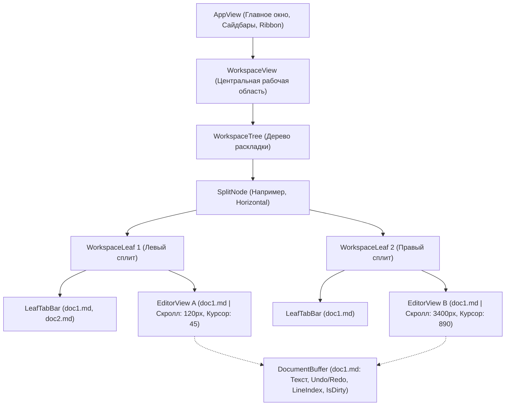

# План: Многооконный режим и одновременное редактирование нескольких документов (Workspace, Splits & Multi-Doc Tabs)

> **Статус:** Черновик архитектурного плана  
> **Основа:** Архитектурные решения докинга/сплитов из `operator-panel` (`DockArea` / `PaneTree`) + модель разделения Leaves/Splits из **Obsidian** и буферов из **Zed/VSCode**.  
> **Целевой проект:** `aquilum-gpui` (`vibecodium`)

---

## 1. Контекст и проблематика

### 1.1. Текущее состояние `aquilum-gpui`
* **Монолитный `AppView.rs` (~8700 строк):** Рендеринг редактора, расчеты вьюпорта (`EDITOR_OVERSCAN_PX`), мигание курсора, скроллбар и обработка мыши жестко вшиты в корневой View главного окна.
* **Один активный документ:** В `AppState` определен только один `active_note: Option<OpenedNote>`. При переключении вкладок текущий документ выгружается, а вьюпорт сбрасывается.
* **Смешение данных документа и окна просмотра:** В структуре `OpenedNote` совмещены поля файла (`content`, `line_index`, `code_checkpoints`, `is_dirty`, `undo_stack`) и состояние отображения (`cursor_offset`, `selection_anchor`, `window: EditorWindow`).
* **Одиночный глобальный таб-бар:** Существует только одна полоса вкладок `tab_list.rs`, отображающая плоский список `open_tabs: Vec<PathBuf>`.

### 1.2. Что есть в Obsidian и что требуется реализовать
1. **Произвольные сплиты (Splits):** Окно можно делить по вертикали (слева/справа) и по горизонтали (сверху/снизу) на любое количество независимых панелей (Leaves).
2. **Независимые группы вкладок в каждом сплите:** Каждый Leaf имеет свой локальный заголовок/таб-бар, кнопку `+` для создания вкладки в этой же группе, кнопки закрытия `×` и выпадающее меню действий.
3. **Редактирование разных документов рядом:** Возможность держать открытыми два и более разных файла (например, заметка и справочник) и работать с ними параллельно.
4. **Редактирование одного и того же документа в нескольких окнах:**
   - Если один файл открыт в двух сплитах (Split Right / Duplicate) — текст и история правок синхронизированы в реальном времени.
   - Курсоры, выделение текста и позиция скролла у каждого сплита **полностью независимы** (можно смотреть начало длинной заметки в левом окне и писать в конец в правом).
5. **Полноценная персистентность:** Раскладка сплитов, пропорции разделителей, открытые файлы и позиции скролла сохраняются в файл сессии (`workspace.json`) и автоматически восстанавливаются при запуске.

---

## 2. Архитектурная модель: Buffer vs View vs Leaf



### 2.1. Разделение ответственности

| Сущность | Ответственность | Где хранится |
|---|---|---|
| **`DocumentBuffer`** | Содержимое файла, индекс строк `LineIndex`, `CodeCheckpoints`, история `undo_stack`/`redo_stack`, флаги сохранения `is_dirty`, таймер автосохранения. | В реестре открытых буферов `AppState.documents: HashMap<PathBuf, Arc<RwLock<DocumentBuffer>>>` |
| **`EditorViewState`** | Позиция каретки `cursor_offset`, якорь выделения `selection_anchor`, скролл `editor_scroll: Cell<f64>`, инерция колеса `wheel_ease`, виртуализированный срез строк `EditorWindow`, собственный `FocusHandle`. | Внутри каждого экземпляра панели/сплита |
| **`WorkspaceLeaf`** | Группа вкладок одного сплита: список путей файлов `tabs: Vec<PathBuf>`, индекс активной вкладки `active_tab`, закрепление `pinned`. | В узле дерева `WorkspaceTree` |
| **`WorkspaceTree`** | Геометрия сплитов: узлы `Split` (направление, дети, пропорции `ratios`) и листья `Leaf(LeafId)`. | В `WorkspaceState` |

---

## 3. Детальные структуры данных

### 3.1. Разделяемый буфер документа (`src/document_buffer.rs`)

```rust
use std::path::PathBuf;
use std::time::Instant;
use crate::line_index::LineIndex;
use crate::code_scan::CodeCheckpoints;
use crate::state::UndoStep;

pub struct DocumentBuffer {
    pub path: PathBuf,
    pub title: String,
    pub content: String,
    pub version: u64,
    pub is_dirty: bool,
    pub first_dirty_time: Option<Instant>,
    pub line_index: LineIndex,
    pub code_checkpoints: CodeCheckpoints,
    pub undo_stack: Vec<UndoStep>,
    pub redo_stack: Vec<UndoStep>,
}

impl DocumentBuffer {
    pub fn from_file(path: PathBuf, content: String) -> Self {
        let line_index = LineIndex::new(&content);
        let code_checkpoints = CodeCheckpoints::scan(&content);
        let title = path.file_stem()
            .map(|s| s.to_string_lossy().into_owned())
            .unwrap_or_else(|| "Untitled".to_string());
            
        Self {
            path,
            title,
            content,
            version: 1,
            is_dirty: false,
            first_dirty_time: None,
            line_index,
            code_checkpoints,
            undo_stack: Vec::new(),
            redo_stack: Vec::new(),
        }
    }
}
```

### 3.2. Состояние отображения редактора (`src/views/editor_view.rs`)

```rust
use std::cell::Cell;
use gpui::{FocusHandle, Pixels};
use crate::editor_window::EditorWindow;
use crate::blink_manager::BlinkManager;
use crate::views::app_view::WheelEase;

pub struct EditorViewState {
    pub cursor_offset: usize,
    pub selection_anchor: Option<usize>,
    pub editor_scroll: Cell<f64>,
    pub wheel_ease: Cell<Option<WheelEase>>,
    pub editor_window: EditorWindow,
    pub focus_handle: FocusHandle,
    pub blink: BlinkManager,
    pub is_mouse_selecting: bool,
    pub is_dragging_scrollbar: bool,
    pub scrollbar_drag_start_y: f32,
    pub scrollbar_drag_start_scroll_y: f64,
}
```

### 3.3. Модель раскладки Workspace (`src/workspace/tree.rs`)

```rust
use serde::{Deserialize, Serialize};
use std::path::PathBuf;
use uuid::Uuid;

#[derive(Clone, Copy, Debug, PartialEq, Eq, Hash, Serialize, Deserialize)]
pub struct LeafId(pub Uuid);

#[derive(Clone, Copy, Debug, PartialEq, Eq, Serialize, Deserialize)]
pub enum SplitDirection {
    Horizontal, // Сплит слева направо (вертикальный разделитель)
    Vertical,   // Сплит сверху вниз (горизонтальный разделитель)
}

#[derive(Clone, Debug, Serialize, Deserialize)]
pub enum WorkspaceNode {
    Split {
        direction: SplitDirection,
        children: Vec<WorkspaceNode>,
        ratios: Vec<f32>, // Пропорции размеров дочерних панелей (сумма = 1.0)
    },
    Leaf(LeafId),
}

#[derive(Clone, Debug, Serialize, Deserialize)]
pub struct LeafState {
    pub id: LeafId,
    pub tabs: Vec<PathBuf>,
    pub active_tab_index: usize,
    #[serde(default)]
    pub pinned: bool,
}
```

---

## 4. Поэтапный план реализации

### Фаза 1. Выделение `DocumentBuffer` и реестра документов в `AppState`
**Цель:** Отвязать текст и историю изменений файла от конкретного окна.

1. **Создание модуля `document_buffer.rs`:**
   - Вынести поля `content`, `line_index`, `code_checkpoints`, `undo_stack`, `redo_stack`, `is_dirty` из `OpenedNote` в `DocumentBuffer`.
2. **Реестр документов в `AppState`:**
   - Добавить поле `pub documents: HashMap<PathBuf, Arc<RwLock<DocumentBuffer>>>`.
   - Реализовать метод `get_or_open_document(path: &Path) -> Arc<RwLock<DocumentBuffer>>`.
   - Если документ уже открыт в другом сплите — возвращается существующий `Arc`, без повторного чтения с диска.
3. **Адаптация `SaveManager`:**
   - Перевести периодическое автосохранение с единственного `active_note` на итерацию по `documents.values()` с сохранением всех буферов, у которых `is_dirty == true`.

---

### Фаза 2. Компонентизация редактора (`MarkdownEditorView`)
**Цель:** Изолировать логику вьюпорта, отрисовки строк и обработки ввода в отдельный GPUI View.

1. **Создание `MarkdownEditorView` (`src/views/editor_view.rs`):**
   - Реализовать структуру как самостоятельный `Entity<MarkdownEditorView>`.
   - Включить в неё `leaf_id: LeafId`, слабую ссылку на `AppState`, `Arc<RwLock<DocumentBuffer>>` и локальный `EditorViewState`.
2. **Перенос отрисовки текста и виртуализации из `AppView.rs`:**
   - Перенести метод расчета среза строк `EDITOR_OVERSCAN_PX`, каретки, выделения текста и рендеринга код-блоков в `impl Render for MarkdownEditorView`.
3. **Собственный `FocusHandle`:**
   - Каждому `MarkdownEditorView` выделяется собственный `FocusHandle`.
   - По клику на редактор он запрашивает фокус и уведомляет `Workspace` о том, что стал активным листом (`active_leaf`).

---

### Фаза 3. Менеджер сплитов и панелей (`WorkspaceView`)
**Цель:** Создать контейнер рабочей области (по аналогии с `Workspace` из `operator-panel`).

1. **Реализация дерева `WorkspaceTree`:**
   - Добавить методы манипуляции деревом:
     * `split_leaf(target: LeafId, direction: SplitDirection, new_path: PathBuf)`: заменяет узел `Leaf` на `Split` с двумя дочерними листьями.
     * `close_tab(leaf_id: LeafId, index: usize)`: закрывает вкладку; если в листе не осталось вкладок (и это не единственный лист), лист удаляется из дерева, а соседний расширяется.
     * `resize_split(node_path, new_ratios)`: обработка перетаскивания разделителей мышью.
2. **Интерактивные разделители (Split Dividers):**
   - Разделители между панелями с обработчиками `MouseDown` / `MouseMove` для изменения ширины/высоты колонок курсором (с индикатором курсора `ResizeLeftRight` / `ResizeUpDown`).
3. **Замена центральной зоны в `AppView`:**
   - В `AppView::render` вместо жесткой отрисовки редактора вызывать рендеринг `WorkspaceView`.

---

### Фаза 4. Таб-бары сплитов и контекстные меню (Obsidian-Style)
**Цель:** Обеспечить удобный UX управления вкладками и окнами.

1. **Компонент `LeafTabBar`:**
   - Рендерится над каждым сплитом:
     * Список вкладок текущего листа с названиями заметок, иконками и маркером несохраненных изменений `*`.
     * Кнопка `+` справа от вкладок: открывает новую пустую заметку (`__new_tab__`) в текущем листе.
     * Кнопка выпадающего меню `···` с операциями над окном.
2. **Контекстное меню вкладки (Tab Context Menu):**
   - *«Разделить справа»* (`Split right`) — дублирует текущую заметку в новом сплите справа.
   - *«Разделить снизу»* (`Split down`) — открывает текущую заметку в сплите снизу.
   - *«Закрыть вкладку»* (`Close tab`) / *«Закрыть остальные»* (`Close other tabs`).
3. **Контекстное меню файлов в сайдбаре (File Tree):**
   - Добавить в меню клика правой кнопкой по файлу:
     * *«Открыть в новой вкладке»* (в активном листе).
     * *«Открыть справа»* (создает сплит справа).
     * *«Открыть снизу»* (создает сплит снизу).
   - Поддержка `Ctrl+Click` (или клик колесиком мыши) по файлу в дереве — быстрое открытие в новой вкладке.

---

### Фаза 5. Синхронизация при одновременном редактировании одного файла
**Цель:** Корректное поведение двух открытых представлений одного документа.

1. **Шина уведомлений об изменениях буфера:**
   - При вводе символа в одном `MarkdownEditorView` изменения записываются в общий `DocumentBuffer`.
   - Буфер рассылает сигнал обновления всем подписанным `MarkdownEditorView`, связанным с данным `PathBuf`.
2. **Сохранение независимости вьюпорта:**
   - При получении сигнала обновления соседний `MarkdownEditorView` пересчитывает виртуализированный срез строк своего окна `editor_window` на основе новой длины документа, но **не меняет** свой `editor_scroll` и `cursor_offset`.

---

### Фаза 6. Персистентность сессии (`workspace.json`)
**Цель:** Сохранение структуры окон при закрытии и перезапуске приложения.

1. **Формат `workspace.json`:**
   ```json
   {
     "version": 1,
     "active_leaf": "c2b5e1a4-...",
     "layout": {
       "type": "split",
       "direction": "Horizontal",
       "ratios": [0.5, 0.5],
       "children": [
         {
           "type": "leaf",
           "id": "c2b5e1a4-...",
           "tabs": ["Notes/Tasks.md", "Notes/Inbox.md"],
           "active_tab_index": 0,
           "scroll": 120.0
         },
         {
           "type": "leaf",
           "id": "d8f4e2b1-...",
           "tabs": ["Notes/Project.md"],
           "active_tab_index": 0,
           "scroll": 0.0
         }
       ]
     }
   }
   ```
2. **Дебаунс сохранения:**
   - При любом изменении раскладки (сплит, закрытие таба, перетаскивание разделителя) планируется отложенное сохранение через 800 мс (`SAVE_DEBOUNCE`).
   - При закрытии приложения через `window.on_window_should_close` сохранение сбрасывается на диск немедленно.

---

## 5. Ожидаемый результат

* **Гибкая рабочая область:** Пользователь может организовать удобную рабочую среду с любым количеством колонок и строк заметок.
* **Производительность:** Благодаря изоляции `EditorView` и виртуализированному рендерингу строк (`EditorWindow`), отображение нескольких документов рядом не снижает плавность UI (сохраняются стабильные 60–120 FPS).
* **Модульность кодовой базы:** Монолитный `AppView.rs` разгружается на тысячи строк за счет выноса редактора и логики вкладок в специализированные модули `src/workspace/` и `src/views/editor_view.rs`.
