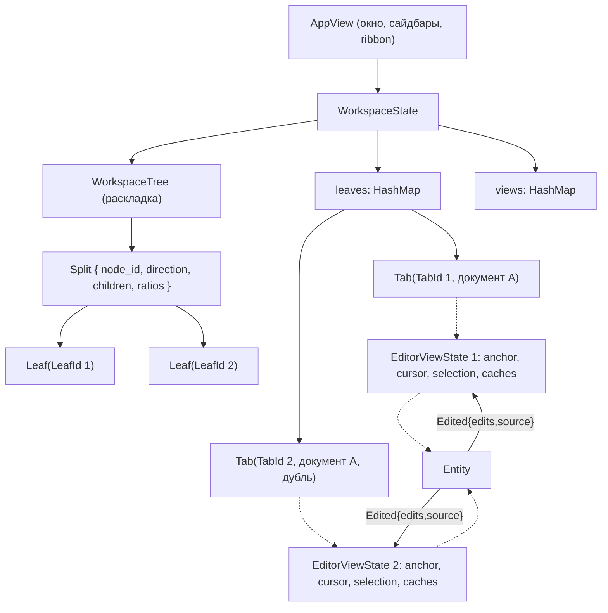

# План: Workspace, сплиты и одновременное редактирование нескольких документов

> **Статус документа:** архитектурный план, **редакция 4** (учтены замечания ревизии редакции 3: разбиение фазы 8, транзакции правок, нормализация якоря, `NodeId`, схема для `Empty`/`Plugin`, baseline памяти, жёсткие правила — см. «Что изменилось в редакции 4» в конце документа).
> **Целевой проект:** `aquilum-gpui` (`vibecodium`)
> **Основа:** докинг/сплиты из `operator-panel` (`DockArea` / `PaneTree`), модель Leaves/Splits из Obsidian, буферы и мультибуферность из Zed/VSCode.

---

> ## ⛔ ЖЁСТКИЕ ПРАВИЛА (обязательны для каждой фазы, читать до начала работы)
>
> **1. НОВЫЕ КОМПОНЕНТЫ НЕ СОЗДАЮТСЯ.** Вкладки, полоса вкладок, редактор, скроллбар,
> gutter, чипы кода, заголовок документа, контекстные меню, иконки, стили — всё это
> **уже существует**. Использовать только его:
>
> | Что | Использовать (не копировать, не переписывать) |
> |---|---|
> | Тело редактора | `AppView::render_central_editor` |
> | Полоса вкладок (заголовок окна и панель) | `render_leaf_tab_bar_strip(leaf_id, in_titlebar, …)` |
> | Имя файла над редактором | `#note-title-panel` / `#note-title-input`, `commit_title_rename_internal` |
> | Новая заметка / пустая вкладка | `create_new_note_at_front`, `create_new_note`, `open_empty_tab` |
> | Панель и узел раскладки | `render_workspace_leaf`, `render_workspace_node` |
> | Стили и иконки | `theme.rs`, `icons.rs` |
>
> Панель — это **состояние** (`EditorViewState`), а не новый код. Новая панель = новый
> экземпляр состояния, который рисует тот же `render_central_editor`.
>
> **2. ДИЗАЙН И ФУНКЦИОНАЛ НЕ МЕНЯЮТСЯ.** Те же `id`, размеры, отступы, цвета, хитбоксы,
> поведение. Новое визуально — только разделители между панелями и полосы вкладок у
> нижних панелей. Любое другое визуальное отличие от однооконного режима — дефект.
> Никаких «упрощённых», «компактных» или «превью»-вариантов для неактивных панелей.
>
> **3. ПАМЯТЬ НЕ РАСТЁТ.** Текст документа хранится **ровно один раз** — в
> `DocumentBuffer`. Запрещены: `content.clone()` / `to_string()` тела документа, копии
> текста в `OpenedNote`, `EditorViewState`, кэше неактивных панелей, второй `LineIndex`,
> вторая история undo. Одна панель потребляет не больше памяти, чем сейчас; каждая
> дополнительная панель добавляет только состояние вида и окно рендера.
>
> **4. ОПТИМИЗАЦИИ ОДНООКОННОГО РЕЖИМА СОХРАНЯЮТСЯ ВСЕГДА** — в одной панели и в N:
> оконный рендер (`EditorWindow`), разреженный `LineIndex`, `f64`-индекс высот, слайс от
> `y≈0`, кламп offset до нарезки, отсутствие O(`content.len()`) в `render()`, кэши
> статистики и раскладки. Ничего не отключать, не заменять «временным» решением, не
> дублировать по панелям.
>
> **ПЕРЕД ЛЮБЫМ НОВЫМ `render_*`, СТРУКТУРОЙ ИЛИ СТИЛЕМ:** найти существующее по имени и
> по `id`. Если подходящее есть — использовать его. Если не подходит — **остановиться и
> описать, чего не хватает**, предложить минимальное расширение существующего. Обход
> копией запрещён.
>
> **ПРОВЕРКА ПЕРЕД СДАЧЕЙ:** нет новых `render_*` для уже нарисованного; нет второго
> таб-бара/редактора/скроллбара; существующие `id` не переименованы; скриншот-дифф
> однооконного режима пустой; нет копий тела документа; RSS на файлах 10/100/600 МБ не
> выше baseline (8.0); `cargo check` проходит.
>
> **Копировать этот блок слово в слово в `aquilum-gpui/AGENTS.md` и в начало промпта
> каждой фазы.** Нарушение любого пункта — повод остановиться и спросить, а не обойти.

---

## 0. Как читать документ и текущий статус

Документ разделён на четыре слоя, чтобы не смешивать цели и факты:

1. **Требования** (раздел 2): что должно работать, независимо от реализации.
2. **Архитектурные решения** (раздел 3): принятые решения и их обоснование.
3. **Спецификации** (разделы 4-9): структуры данных, правила, схемы.
4. **Фазы и статус** (раздел 10): что сделано, что сделано иначе, что предстоит.

### 0.1. Сводка статусов

| Фаза | Содержание | Статус |
|---|---|---|
| 1 | `DocumentBuffer` и реестр документов | **Сделано иначе:** вместо общего буфера используются клоны в `open_documents` с ручной синхронизацией. Заменяется в 8a. |
| 2 | Выделение `MarkdownEditorView` в отдельный `Entity` | **Не делалось** (ADR-6): редактор остаётся в `AppView::render_central_editor`, переиспользуется для всех листов. |
| 3 | `WorkspaceTree`, сплиты, разделители | Сделано |
| 4 | Единый верхний таб-бар, контекстные меню, изоляция скролла | Сделано и протестировано. Формулировку «никаких дополнительных полос» уточнить — 10.1 п.2. |
| 5 | Синхронизация одного файла между сплитами | Сделано **клонированием**. Не даёт дельт правок, не обеспечивает стабильность вьюпорта (раздел 5). Заменяется в 8a/8c. |
| 6 | Персистентность `workspace.json` | Сделано. Схема требует исправлений (раздел 9). |
| 7 | Независимые таб-бары нижних панелей, точные координаты драга, снятие ограничения ширины вкладок | Сделано. Замечания в 10.1. |
| **8.0** | **Baseline: замеры памяти, скриншоты-эталоны, профиль кадра** | **Предстоит. Делается ДО любого кода фазы 8** (10, «Фаза 8.0»). |
| **8a** | **Единый владелец текста: `DocumentBuffer`, единственный путь мутации, транзакции правок, удаление теневых копий** | Предстоит. **Критический путь, первый шаг.** Закрывает 10.2 п.5. |
| **8b** | **`EditorViewState` на вкладку, `TabId`, заморозка модели вкладок, перенос по `content_w`, состояние имени файла** | Предстоит. Закрывает 10.2 п.1 и п.3. |
| **8c** | **Якоря вьюпорта, подписка на события, scroll anchoring, миграция `leaf_scroll_top`** | Предстоит. Закрывает R5, R6 и критерии 5.8. |
| 9 | Политика открытия и дублирования файлов | Предстоит |
| 10 | Жизненный цикл буфера, переименование, внешние изменения | Предстоит |
| 11 | Единый `LeafTabBar`: drag-and-drop, схлопывание, переполнение (компонент уже один) | Предстоит. Здесь же: ведущая кнопка заметки (10.2 п.2) и хитбоксы на всю высоту (10.2 п.4). |
| 12 | Горячие клавиши и навигация фокуса | Предстоит |
| 13 | Персистентность `workspace.json` v2 | Предстоит (сразу после 8c) |
| 14 | Тесты и бенчмарки (раздел 11) | Предстоит; сквозная, идёт параллельно с 8-13 |

### 0.2. Связанные документы

План не самодостаточен: часть решений живёт в соседних документах, здесь только ссылки.

| Документ | Что берётся оттуда |
|---|---|
| `TODO/adaptive-save-manager-plan.md` | Дебаунс, дедлайн и атомарная запись автосохранения. В этом плане — только правило «один буфер → одна запись» (раздел 7). |
| `TODO/perf-plan-aquilum.md`, `TODO/perf-plan-large-file-open.md` | Бюджет кадра (N1) и инварианты геометрии больших документов: индекс высот в `f64`, слайс строк от `y≈0`, кламп offset **до** нарезки среза (4.4, 5.6). |
| `TODO/search-index-plan.md` | Результат поиска открывается по правилу 6.2 (в активной панели). |
| `TODO/plugins-00-core.md` и далее | `TabContent::Plugin` (ADR-4): определение `PluginViewId`, состояние и жизненный цикл плагин-видов. Персистентность плагин-вкладок — вне v2 (9.2). |
| `TODO/tables-plan.md` | Таблицы — контент одного буфера, а не отдельный вид вкладки. |
| `TODO/LOCALIZATION_PLAN.md` | Все новые пользовательские строки (N6). |

Ревизия этого плана: `TODO/multi-document-workspace-plan-review.md`.
Постановка «что нужно» простыми словами (с рисунками 4-панельной раскладки): `TODO/workspace-4-panels-spec.md`.

### 0.3. Правила для исполнителя: переиспользование, а не новые компоненты

Краткая обязательная версия — блок **«ЖЁСТКИЕ ПРАВИЛА»** в начале документа. Здесь — детали. Полная версия — `aquilum-gpui/AGENTS.md` (указатель для агентов, открывших корень монорепозитория, — `Aquilum-NP/AGENTS.md`).

1. **Новый компонент не создаётся, если существует подходящий.** Сначала поиск по имени и по `id`, потом код.
2. **Что именно запрещено:** второй `render_*` для той же сущности; второй таб-бар; второй редактор/скроллбар/gutter/чипы кода; дублирующая структура состояния; дублирующие `id`; копия стиля или иконки вместо `theme.rs` / `icons.rs`.
3. **Инвентарь, который переиспользуется:**

   | Что | Где |
   |---|---|
   | Тело редактора | `AppView::render_central_editor` |
   | Styled-строка | `render_live_styled_row` |
   | Синтаксические спаны | `render_syntax_spans` |
   | Навигация-путь | `render_navigation_bar` |
   | Полоса вкладок (заголовок окна и панель) | `render_leaf_tab_bar_strip(leaf_id, in_titlebar, …)` |
   | Панель и узел раскладки | `render_workspace_leaf`, `render_workspace_node` |
   | Заголовок документа | `id = ("note-title-panel", leaf)`, `("note-title-input", leaf)` |
   | Коммит переименования | `commit_title_rename_internal` |
   | Создание заметки / пустая вкладка | `create_new_note`, `create_new_note_at_front`, `open_empty_tab` |
   | Список вкладок | `src/views/tab_list.rs` |
   | Контекстные меню | `src/views/tab_context_menu.rs`, `tabs_menu.rs`, `editor_context_menu.rs`, `src/views/sidebar/*` |

4. **Полоса вкладок — одна реализация.** `render_leaf_tab_bar_strip` получает параметр размещения (заголовок окна / внутри панели). Вторая копия не создаётся (10.1 п.3).
5. **Панель — это состояние, а не код.** Новая панель = новый `EditorViewState`, а не новый рендерер.
6. **Вид не меняется.** Те же `id`, размеры, стили и отступы; новое визуально — только разделители и дополнительные полосы вкладок (R13).
7. **Чек-лист перед сдачей:** поиск выполнен; нет новых `render_*` для нарисованного; нет второго таб-бара/редактора/скроллбара; существующие `id` не переименованы; однооконный режим визуально не изменился (скриншот-дифф); строки — через i18n; комментарии — по-английски; нет копий тела документа (N8); оптимизации однооконного режима на месте (R18, N9); RSS не выше baseline (8.0); `cargo check` проходит.

**Механические проверки (запускать перед сдачей каждой фазы, результат — в описание ревью):**

```text
# 1. Copies of document body (must find nothing in open/switch/save/render paths)
rg -n 'content\.clone\(\)|content\(\)\.to_string\(\)|\.content\.to_owned\(\)' src/

# 2. New render_* functions in the diff (each one needs a written justification)
git diff -U0 | rg '^\+.*fn render_'

# 3. Body text owned outside DocumentBuffer (must find nothing)
rg -n 'content:\s*String' src/ --glob '!src/document_buffer.rs'

# 4. Duplicate element ids / renamed ids
git diff -U0 | rg '^[-+].*(note-title-panel|note-title-input|leaf-tab-header|titlebar-group)'
```

**Если правило мешает:** не обходить копией. Описать, почему существующее не подходит, и предложить минимальное расширение существующего.

---

## 1. Контекст и проблематика

### 1.1. Исходное состояние `aquilum-gpui`

- **Монолитный `AppView.rs` (~8700 строк):** рендеринг редактора, расчёты вьюпорта (`EDITOR_OVERSCAN_PX`), мигание курсора, скроллбар и обработка мыши встроены в корневой View.
- **Один активный документ:** `AppState.active_note: Option<OpenedNote>`; при переключении вкладок документ выгружается, вьюпорт сбрасывается.
- **Смешение данных документа и отображения:** `OpenedNote` объединяет поля файла (`content`, `line_index`, `code_checkpoints`, `is_dirty`, `undo_stack`) и состояние отображения (`cursor_offset`, `selection_anchor`, `window: EditorWindow`).
- **Один глобальный таб-бар** `tab_list.rs` с плоским `open_tabs: Vec<PathBuf>`.

### 1.2. Целевое поведение (ориентир: Obsidian)

1. Произвольные сплиты (слева/справа, сверху/снизу), любое количество панелей (Leaves).
2. Независимые группы вкладок в каждой панели.
3. Разные документы рядом.
4. Один документ в нескольких панелях: общий текст и общая история правок, **независимые** курсор, выделение и позиция просмотра.
5. Стабильность вьюпорта: правка в одной панели не сдвигает то, что пользователь видит в другой (раздел 5).
6. Персистентность раскладки, пропорций, открытых файлов и позиций просмотра.

---

## 2. Требования

### 2.1. Функциональные

| ID | Требование |
|---|---|
| R1 | Окно делится на любое число панелей по обеим осям, включая вложенные сплиты. |
| R2 | У каждой панели свой список вкладок и своя активная вкладка. |
| R3 | Один файл может быть открыт в нескольких панелях одновременно с общим буфером. |
| R4 | Курсор, выделение и вьюпорт каждой панели независимы. |
| R5 | **Правка в одной панели не меняет положение видимого текста в других панелях** (раздел 5). |
| R6 | Если у панелей есть общая видимая строка, правка в ней видна в обеих панелях сразу. |
| R7 | Открытие файла подчиняется явной политике дублирования (раздел 6). |
| R8 | Один буфер, одно сохранение, одна история undo/redo. |
| R9 | Раскладка и позиции просмотра восстанавливаются при запуске. |
| R10 | Один код рендера редактора Markdown: активные и неактивные панели рендерятся `render_central_editor` с **независимым состоянием на панель**, без упрощённых превью. Прочие виды — только `TabContent::Plugin` (ADR-4). |
| R11 | **Панель — независимая единица отображения:** собственные вьюпорт, скроллбар, инерция колеса, каретка, выделение, кэши раскладки и собственная полоса вкладок. Независимость не зависит от того, какой документ открыт в панели и открыт ли он ещё где-то. |
| R12 | **Переиспользуется существующий редактор** (`render_central_editor` и его компоненты: скроллбар, gutter, чипы кода, заголовок, контекстные меню). Второй редактор и второй путь рендера тела редактора не создаются: одна реализация — N независимых состояний (`EditorViewState`). |
| R13 | **Внешний вид не меняется.** Панель в любом режиме (одна панель, N панелей, активная и неактивная) отрисовывается тем же кодом и выглядит идентично текущему однооконному редактору. Единственное визуальное отличие — компоновка: разделители и дополнительные полосы вкладок. |
| R14 | **Перенос строк считается от фактической ширины содержимого панели** — панель минус разделитель, gutter, скроллбар и горизонтальные отступы, — а не от ширины окна. Появление или исчезновение разделителя немедленно инвалидирует раскладку этой панели; во время перетаскивания разделителя текст не выходит за границы панели (4.4). |
| R15 | **Полоса вкладок сохраняется целиком и в исходном порядке:** кнопка создания заметки **слева от вкладок** (`create_new_note_at_front` — новая вкладка встаёт в начало), сами вкладки, `×` закрытия, завершающий `+`, меню/шеврон скрытых вкладок, контекстное меню и перетаскивание. Ни один элемент не переставляется, не переименовывается и не заменяется другим; «упрощённая» полоса без ведущей кнопки — дефект (10.2 п.2). |
| R16 | **Инпут с именем файла над редактором сохраняется в исходном виде:** тот же элемент (`#note-title-panel` / `#note-title-input`), тот же вид, размеры и поведение (клик — фокус, Enter — переименование через `commit_title_rename_internal`). Он присутствует **в каждой панели**, а состояние редактирования (текст, каретка, выделение, фокус) — **своё на вкладку** (ключ состояния — `TabId`, ADR-8), не глобальное (10.2 п.3). |
| R17 | **Хитбокс вкладки выше самой вкладки.** Нажимаемая область вкладки — **вся высота полосы** (38 px в заголовке окна, 34 px в полосе панели), а не только нарисованное тело вкладки (32 px). Нарисованное тело прижато к низу полосы, хитбокс доходит до её верхней кромки. То же для ведущей кнопки создания заметки и завершающего `+`: нажимаемая область — на всю высоту полосы, нарисованный элемент меньше (28 / 26 px). Хитбоксы не уменьшаются и не обрезаются при разделении на панели (10.2 п.4). |
| R18 | **Оптимизации и поведение редактора однооконного режима действуют всегда** — и в одной панели, и в N панелях, без «упрощённого» пути: оконный рендер (`EditorWindow`, срез вокруг вьюпорта), разреженный `LineIndex` (чекпоинт каждые 1024 строки), индекс высот в `f64` (`VisualRowHeightIndex`), слайс строк от `y≈0` со сдвигом вместо спейсеров, кламп offset **до** нарезки среза, отсутствие O(`content.len()`) в `render()`, кэш статистики `text_stats`, чекпоинты код-фенсов, ключ кэша раскладки. Ни одна оптимизация не отключается, не переписывается и не дублируется по панелям; разделение добавляет только состояние вида, а не второй экземпляр документа (10.2 п.5). |

### 2.2. Нефункциональные

| ID | Требование |
|---|---|
| N1 | Ввод в файле размером в несколько МБ при двух панелях не вызывает заметных задержек. Целевой бюджет: кадр не более 8 мс (120 FPS) на эталонной машине. Подтверждается бенчмарком (раздел 11). |
| N2 | Запись `workspace.json` атомарна и не блокирует UI. |
| N3 | Повреждённый или устаревший `workspace.json` никогда не приводит к падению: откат к раскладке по умолчанию. |
| N4 | Операции над `WorkspaceTree` и пересчёт якорей реализуются как чистые функции без GPUI-зависимостей, чтобы тестироваться юнит-тестами. Мутирующие операции (`open_file`, `close_tab`) возвращают результат и не выполняют ввод-вывод. |
| N5 | **Запрет дублирования рендера:** в коде существует ровно одна реализация тела редактора, скроллбара, gutter и чипов кода. Появление второго пути рендера считается регрессией (R12). |
| N6 | Все новые пользовательские строки проходят через i18n (в проекте 20 локалей; см. `TODO/LOCALIZATION_PLAN.md`). Литералов в UI-коде не добавляется. |
| N7 | Ошибка записи файла не приводит к потере данных: `is_dirty` сохраняется, пользователь получает уведомление, буфер не выгружается (раздел 7). |
| N8 | **Текст документа хранится в памяти ровно один раз** — в `DocumentBuffer`. Копии в `OpenedNote`, в кэше неактивных листьев, в `EditorViewState` и в путях открытия/переключения/сохранения запрещены (4.5). Потребление памяти в **однооконном** режиме не растёт относительно baseline (8.0); каждая дополнительная панель с тем же документом добавляет только состояние вида и окно рендера, а не текст. |
| N9 | **Паритет оптимизаций (R18):** любой путь рендера и правки обязан сохранять существующие оптимизации однооконного режима — оконную виртуализацию, разреженный `LineIndex`, `f64`-индекс высот, слайс от `y≈0`, кламп до нарезки, отсутствие O(n) в кадре, кэши статистики и раскладки. Отключение или «временная» замена любой из них — регрессия, а не допустимый компромисс. |

---

## 3. Архитектурные решения (ADR)

### ADR-1. Общий буфер: `Entity<DocumentBuffer>` с событиями правок

- **Решение:** документ хранится в `Entity<DocumentBuffer>`. Виды (панели) подписываются на его события через `cx.subscribe`.
- **Отвергнуто:** `Arc<RwLock<DocumentBuffer>>` (не идиоматично для GPUI, нет уведомлений) и текущая схема «клон + ручная синхронизация» (нет дельт, возможны два конкурирующих сохранения, рассинхронизация `version` / `is_dirty` / `undo_stack`).
- **Следствие:** все мутации идут через методы буфера, которые эмитят `Edited { edits, source, version }`. Это единственная точка истины для курсоров, якорей и кэшей.
- **Единица события — транзакция (ADR-9).**

### ADR-2. Идентичность документа: `DocumentId`, а не `PathBuf`

- **Решение:** `DocumentId(Uuid)` в рантайме; путь является изменяемым атрибутом буфера.
- **Причина:** переименование (инлайн-заголовок по Enter), перемещение и удаление ломают ключ-путь во всех вкладках и в `workspace.json`. На Windows добавляются различия регистра и слешей.
- **Реестр:** `documents: HashMap<DocumentId, Entity<DocumentBuffer>>` плюс индекс `by_path: HashMap<NormalizedPath, DocumentId>` (нормализация: регистр на Windows, разделители, канонизация).
- **Персистентность:** на диск пишутся пути (относительно vault), при загрузке они превращаются в `DocumentId` через реестр.

### ADR-3. Позиция просмотра: якорь в тексте, а не пиксели

- **Решение:** источником истины для вьюпорта является `ViewportAnchor` (позиция в тексте + пиксельное смещение внутри строки). Пиксельный `scroll_top` вычисляется из якоря и индекса высот.
- **Причина:** единственный способ выполнить R5 и сделать позицию устойчивой к внешним правкам файла.
- **Подробно:** раздел 5.

### ADR-4. Содержимое вкладки: `enum`, а не путь

```rust
pub enum TabContent {
    Document(DocumentId),
    Empty,                       // open_empty_tab
    Plugin(PluginViewId),        // граф, панели плагинов
}
```

`LeafState.tabs: Vec<Tab>`, где `Tab.content: TabContent`. Это покрывает пустые вкладки и не-markdown виды, которые появятся с системой плагинов. `PluginViewId` определяется в `TODO/plugins-00-core.md`. **Персистентность:** в v2 сохраняются только `Document` и `Empty`; `Plugin` не персистится (9.2).

### ADR-5. Именование направлений сплита

Вместо `Horizontal` / `Vertical` (семантика обратна ожидаемой) использовать `Row` (панели в ряд, слева направо) и `Column` (панели в колонку, сверху вниз).

### ADR-6. Редактор остаётся в `AppView` на этом этапе

Извлечение `MarkdownEditorView` в отдельный `Entity` (исходная фаза 2) **откладывается**: оно не нужно для R1-R13 и рискованно для 8700-строчного файла. Требуется лишь, чтобы всё per-panel состояние редактора жило в `EditorViewState`, а не в полях `AppView`. Полное извлечение возможно позже отдельной задачей, но обещание «разгрузить `AppView` на тысячи строк» из первой редакции снимается как цель этого плана.

**Следствие (R12, N5):** пока извлечение не сделано, редактор существует ровно в одном экземпляре кода; второй путь рендера тела редактора запрещён. Откладывание извлечения — не разрешение написать «второй редактор для панелей».

### ADR-7. Масштаб (zoom) — глобальный

- **Решение:** масштаб шрифта один на окно (как сейчас); per-pane масштаб — вне scope (раздел 12).
- **Причина:** R13 (внешний вид не меняется) и упрощение кэшей раскладки: инвалидация по масштабу остаётся общей, а не по панели.
- **Подтвердить:** открытый вопрос 12.4.

### ADR-8. Ключ состояния вида: `TabId`, а не `LeafId` и не путь

- **Решение:** `EditorViewState` адресуется идентификатором **экземпляра вкладки** (`TabId`).
- **Причина:** §6.2 разрешает дубль одного документа в одной панели (`ForceNewTab`), а R4/R11 требуют независимых курсоров и вьюпортов. При ключе `LeafId` два таба в одном листе делили бы состояние; при ключе-пути не адресуются вкладки `Empty` и `Plugin`, а переименование файла ломает ключ (ADR-2).
- **Следствие:** `Tab` получает `id`; `views: HashMap<TabId, EditorViewState>`; в `workspace.json` состояние вьюпорта хранится внутри записи вкладки (9.2).

### ADR-9. Единица события правки — транзакция

- **Проблема:** replace-all, мультикурсор, автоформатирование и составной шаг undo меняют текст в нескольких местах за одно действие пользователя. Если эмитить по событию на каждую элементарную правку, виды видят промежуточные состояния, версия растёт скачками, а одному шагу undo соответствует несколько событий.
- **Решение:** буфер эмитит **одно** событие на транзакцию: `Edited { edits: Vec<Edit>, source, version }`. `version` увеличивается на 1 на транзакцию. Один шаг undo/redo = одна транзакция.
- **Соглашение о координатах:** `edits` перечислены **в порядке применения**; координаты каждой правки заданы относительно текста **после** применения предыдущих правок той же транзакции. Виды обрабатывают `edits` последовательным применением `transform_offset` (5.4) — результат тот же, что при последовательных одиночных правках, но перерисовка и пересчёт кэшей выполняются **один раз** по итогам транзакции.
- **Объединение:** непрерывный набор символов склеивается в один шаг undo по правилам буфера (таймаут/граница слова); это деталь буфера и на контракт события не влияет.

### ADR-10. Идентификатор узла сплита: `NodeId` существует только в рантайме

- **Решение:** узлы `Split` получают `NodeId(u64)` из монотонного счётчика дерева. Драг разделителя адресуется `NodeId`; при несовпадении ожидаемого `NodeId` драг отменяется. Путь индексов `&[usize]` допустим только внутри одного кадра (10.1 п.6).
- **В `workspace.json` не пишется** (поле `#[serde(skip)]`, при загрузке присваивается заново). Причина: идентичность узла нужна только на время жизни дерева; персистентность усложнила бы схему и миграции без пользы.

---

## 4. Модель данных

### 4.1. Схема сущностей



### 4.2. Разделение ответственности

| Сущность | Ответственность |
|---|---|
| `DocumentBuffer` | Текст (приватное поле, чтение через `content()`), `LineIndex`, `CodeCheckpoints`, undo/redo, `version`, `is_dirty`, путь, таймер автосохранения. Живёт внутри `Entity<DocumentBuffer>` (ADR-1) и эмитит события. |
| `EditorViewState` | Всё, что принадлежит **одному экземпляру вкладки**: курсор, выделение, `ViewportAnchor`, кэши раскладки, скроллбар, инерция колеса, перетаскивание, состояние инпута имени файла. Ключ — `TabId`, не лист и не путь (ADR-8). |
| `Tab` | Вкладка: `id: TabId`, `content: TabContent`, `pinned: bool`. Закрепление — свойство вкладки, а не панели. |
| `LeafState` | Группа вкладок: `tabs: Vec<Tab>`, `active_tab_index`. |
| `WorkspaceTree` | Геометрия: `Split` и `Leaf(LeafId)`. |
| `OpenedNote` | **Владельцем текста не является** (N8, 4.5): либо удаляется, либо остаётся тонкой обёрткой над буфером без собственного `content`, `LineIndex` и истории undo. |

### 4.3. Структуры

```rust
// src/document_buffer.rs
pub struct DocumentId(pub Uuid);

/// Lives inside `Entity<DocumentBuffer>` (ADR-1); fields of the entity are listed below.
/// `content` is PRIVATE: the only way to change text is through the methods below,
/// each of which emits exactly one `BufferEvent::Edited` per transaction (ADR-9).
pub struct DocumentBuffer {
    id: DocumentId,
    path: PathBuf,
    title: String,
    content: String,                  // private; read via `content() -> &str`
    version: u64,
    is_dirty: bool,
    first_dirty_time: Option<Instant>,
    line_index: LineIndex,
    code_checkpoints: CodeCheckpoints,
    undo_stack: Vec<UndoStep>,        // UndoStep stores the delta and the source caret
    redo_stack: Vec<UndoStep>,
}

impl DocumentBuffer {
    pub fn content(&self) -> &str;                       // read-only access, never cloned
    pub fn apply_transaction(&mut self, edits: &[Edit], text: &[&str],
                             source: Option<TabId>, cx: &mut Context<Self>);
    pub fn undo(&mut self, source: Option<TabId>, cx: &mut Context<Self>);
    pub fn redo(&mut self, source: Option<TabId>, cx: &mut Context<Self>);
}

/// One edit in coordinates AFTER the previous edits of the same transaction (ADR-9).
#[derive(Clone, Copy, Debug)]
pub struct Edit {
    pub start: usize,       // byte offset of the replaced range
    pub old_len: usize,     // length of the replaced fragment
    pub new_len: usize,     // length of the inserted fragment
}

pub enum BufferEvent {
    /// One event per transaction. `edits` are applied in order (ADR-9).
    Edited { edits: Vec<Edit>, source: Option<TabId>, version: u64 },
    Reloaded,                       // external change on disk
    PathChanged { old: PathBuf, new: PathBuf },
    Deleted,
    DirtyChanged(bool),
}
```

```rust
// src/views/editor_view.rs
pub struct EditorViewState {
    pub tab_id: TabId,                      // state key (ADR-8)
    pub doc: DocumentId,
    pub cursor_offset: usize,
    pub selection_anchor: Option<usize>,
    pub viewport: ViewportAnchor,           // section 5
    pub layout: LeafLayoutCache,            // visual_rows, height_index, code_states; keyed by content_w
    pub scrollbar: ScrollbarState,          // drag, overview ruler
    pub wheel_ease: Cell<Option<WheelEase>>,
    pub editor_window: EditorWindow,        // bounded virtualized slice, O(visible), NOT O(document)
    pub focus_handle: FocusHandle,
    pub blink: BlinkManager,
    pub is_mouse_selecting: bool,
    // File name input above the editor (R16): per tab, not in AppView
    pub title_edit_text: String,
    pub title_cursor_pos: usize,
    pub title_selection_anchor: Option<usize>,
    pub title_is_focused: bool,
}
```

```rust
// src/workspace/tree.rs
#[derive(Clone, Copy, Debug, PartialEq, Eq, Hash, Serialize, Deserialize)]
pub struct LeafId(pub Uuid);

/// Runtime-only identifier of a split node (ADR-10). Never serialized.
#[derive(Clone, Copy, Debug, PartialEq, Eq, Hash)]
pub struct NodeId(pub u64);

#[derive(Clone, Copy, Debug, PartialEq, Eq, Serialize, Deserialize)]
pub enum SplitDirection { Row, Column }

#[derive(Clone, Debug, Serialize, Deserialize)]
#[serde(tag = "type", rename_all = "lowercase")]
pub enum WorkspaceNode {
    Split {
        #[serde(skip, default = "NodeId::fresh")]
        node_id: NodeId,                 // assigned on load, not persisted
        direction: SplitDirection,
        children: Vec<WorkspaceNode>,
        ratios: Vec<f32>,
    },
    Leaf { id: LeafId },
}

#[derive(Clone, Copy, Debug, PartialEq, Eq, Hash, Serialize, Deserialize)]
pub struct TabId(pub Uuid);

/// One tab: stable id, content and pin state.
/// View state is addressed by `TabId` (ADR-8), not by leaf and not by path.
pub struct Tab {
    pub id: TabId,
    pub content: TabContent,
    pub pinned: bool,
}

pub struct LeafState {
    pub id: LeafId,
    pub tabs: Vec<Tab>,
    pub active_tab_index: usize,
}

/// Named drag state instead of a tuple (10.1 п.5).
pub struct SplitDragState {
    pub node_id: NodeId,                // drag is cancelled if the node no longer exists
    pub direction: SplitDirection,
    pub divider_index: usize,
    pub origin: f32,
    pub span: f32,
}
```

### 4.4. Кэши раскладки зависят от ширины панели

`visual_rows`, `height_index` и `code_states` зависят от ширины панели (перенос строк). Они хранятся **по вкладкам** (`LeafLayoutCache` внутри `EditorViewState`, ADR-8) и инвалидируются при:

- изменении ширины панели (перетаскивание разделителя, ресайз окна, открытие/закрытие сайдбара);
- **появлении или исчезновении разделителя** (сплит, схлопывание панели) — немедленно, без ожидания debounce;
- изменении шрифта или масштаба;
- событии `Edited` (инкрементально, только затронутые диапазоны транзакции).

**Ширина переноса (R14).** Источник истины — фактическая ширина **содержимого** панели, а не ширина окна и не «ширина панели без учёта разделителя»:

```
content_w = pane_rect.w
          − divider_w × (число разделителей по оси X, попадающих в панель: 0 или 1)
          − gutter_w
          − scrollbar_w
          − horizontal_padding
```

- считается в логических пикселях и округляется **вниз до сетки устройства**, иначе 0.5 px даёт разный перенос в панелях одинаковой ширины;
- **ключ кэша раскладки = `(TabId, content_w, font_size, zoom)`**, а не «ширина панели» и не «ширина окна». Если ключ не содержит `content_w`, появление разделителя кэш не инвалидирует, и строки переносятся по старой ширине — это текущий дефект (10.2 п.1);
- ширина берётся из того же расчёта геометрии, что и положение разделителей (`split_geometry`, 10.1 п.9), чтобы заголовок, полоса вкладок и тело редактора не расходились.

**Перетаскивание разделителя (отдельный случай).** При перетаскивании пересчёт откладывается (debounce, ориентир — **120 мс**; уточняется бенчмарком) с использованием последних известных высот; якорь вьюпорта защищает от прыжков содержимого. Чтобы R14 не нарушался в это окно:

- содержимое панели **обрезается по её границам** (`overflow: hidden` на контейнере тела редактора), поэтому до пересчёта текст не наезжает на разделитель и соседнюю панель;
- **ширина переноса уже новая** для строк, попавших в `EditorWindow` (видимый срез пересчитывается сразу, дебаунсится только пересчёт индекса высот всего документа);
- после отпускания разделителя кэши пересчитываются точно.

**Масштаб.** Масштаб шрифта глобальный (ADR-7), поэтому инвалидация кэшей по масштабу общая для всех панелей.

### 4.5. Владение текстом и память: один экземпляр

**Инвариант (N8).** Текст документа существует в памяти **ровно один раз** — в `DocumentBuffer.content`. Всё остальное — производные и позиции: `EditorViewState` (курсор, якорь, кэши раскладки), `EditorWindow` (материализованный срез), `LeafState` (список вкладок). Ни одна структура не держит `String` с телом документа.

**Почему это отдельное требование.** Сейчас текст живёт дважды, причём **и в однооконном режиме** — разделение панелей тут ни при чём:

| Место | Что хранит | Судьба |
|---|---|---|
| `AppView::active_note: Option<OpenedNote>` | полный `content: String` + свой `LineIndex` + свой `EditorWindow` + свои `undo_stack`/`redo_stack` | активный документ; **сюда пишет ввод** |
| `AppState::documents: HashMap<DocumentId, DocumentBuffer>` | полный `content: String` + свой `LineIndex` + свой `undo_stack` | теневая копия: `DocumentBuffer::apply_edit` в приложении **не вызывается**, буфер синхронизируется через `doc.reload(note_content)` при переключении вкладки/панели и при сохранении |
| `AppView::inactive_leaf_notes: HashMap<LeafId, OpenedNote>` | ещё один полный `content: String` на каждую неактивную панель | копия №3 при нескольких панелях или вкладках |

Отсюда и удвоение: `2N` на текст в покое, `3N` в момент переключения (`note.content.clone()` перед `reload`), плюс второй `LineIndex` и заготовка второй истории undo (она пуста, пока ввод идёт мимо буфера, — то есть и undo сейчас живёт не там, где ему место). Для файла 100 МБ это лишние ~100 МБ, для 600 МБ — ~600 МБ; в однооконном режиме — те же цифры, потому что `OpenedNote` создаётся при любом открытии.

**Целевое состояние:**

- `DocumentBuffer` — единственный владелец текста; ввод, вставка, undo/redo и сохранение идут через его методы (`apply_transaction`, `undo`, `redo`), которые эмитят `BufferEvent::Edited` (ADR-1, ADR-9).
- `OpenedNote` перестаёт быть владельцем текста: либо удаляется, либо становится тонкой обёрткой над `&str` из буфера, которая держит только то, чего нет в `EditorViewState` (например, `EditorWindow`). Второй `LineIndex` и вторая история undo не нужны ни в каком виде.
- `content.clone()` и `content().to_string()` для тела документа **запрещены** в путях открытия, переключения вкладки/панели, сохранения и рендера. Сохранение читает `doc.content()`; файл читается один раз в `String`, который сразу становится `content` буфера (без промежуточной копии в `OpenedNote`).
- `inactive_leaf_notes` удаляется: состояние неактивной панели — это `EditorViewState` + окно, а не копия документа.
- `EditorWindow` остаётся **по вкладке** и ограничен по размеру (срез вокруг вьюпорта) — это допустимый per-view кэш, потому что он O(видимое), а не O(документ).

**Бюджет (проверяется в 11.4, baseline — 8.0):**

- однооконный режим: RSS не выше baseline на том же файле (регресс — дефект);
- N панелей с одним документом: `1 × текст + N × (состояние вида + окно)`;
- N панелей с N документами: сумма текстов, без теней и без копий при переключении.

---

## 5. Стабильность вьюпорта при правках из другого окна

### 5.1. Принцип

Каждая панель хранит позицию просмотра как **якорь в тексте**. Правки из других панелей сдвигают якорь вместе с текстом, поэтому видимое содержимое не меняется. Меняются только производные величины: номера строк, высота документа, размер и положение ползунка скроллбара.

### 5.2. Правила

| Где правка относительно видимой области панели | Результат |
|---|---|
| **Выше** | Видимый текст остаётся на месте. Номера строк пересчитываются, общая высота растёт, ползунок скроллбара уменьшается и смещается. `scroll_top` увеличивается на высоту вставки. Вставленное видно, только если пролистать вверх. |
| **Ниже** | Ничего не сдвигается. Обновляются высота документа и скроллбар. |
| **Внутри** (общая строка) | Изменение отображается сразу (общий буфер, перерисовка обеих панелей). |
| **Удаление**, захватившее якорную позицию | Якорь схлопывается к началу удалённого диапазона. |
| **Своя правка** (панель-источник) | Обычное поведение: каретка следует за вводом, при необходимости автоскролл. **Автоскролл только в панели-источнике.** |

### 5.3. Якорь

```rust
#[derive(Clone, Copy, Debug)]
pub enum Bias { Left, Right }

#[derive(Clone, Copy, Debug)]
pub struct ViewportAnchor {
    pub offset: usize,      // start of the first (partially) visible LOGICAL line, bytes
    pub bias: Bias,         // always Right for the viewport
    pub px_in_line: f32,    // how many pixels the line has scrolled past the top edge
}
```

Производный пиксельный скролл: `scroll_top = layout.prefix_height(line_of(anchor.offset)) + anchor.px_in_line`.

**Логическая строка или визуальный ряд?** `offset` — начало **логической** строки (первой, чей визуальный ряд виден хотя бы частично). `px_in_line` отсчитывается от верха **первого визуального ряда** этой строки. При переносе строки и смене ширины панели меняется число визуальных рядов, но `offset` остаётся валидным; `px_in_line` при смене ширины пересчитывается по визуальному ряду, а не по строке.

**Инвариант якоря:** после любой обработки события `anchor.offset` **всегда начало логической строки** (`line_index.line_start(line_of(offset)) == offset`). Нарушение инварианта — дефект: `px_in_line` теряет смысл. Поддерживается шагом нормализации (5.5, п. 2).

### 5.4. Пересчёт позиции при правке

Единая чистая функция для якоря, курсора, выделения и любых других позиций вида. Принимает **одну** правку; транзакция применяется последовательным вызовом по `edits` (ADR-9):

```rust
pub fn transform_offset(offset: usize, e: Edit, bias: Bias) -> usize {
    let old_end = e.start + e.old_len;
    if offset < e.start || (offset == e.start && matches!(bias, Bias::Left)) {
        return offset;                                   // before the edit
    }
    if offset >= old_end {
        return offset + e.new_len - e.old_len;           // after the edit: shift
    }
    // inside the replaced range: collapse
    e.start + if matches!(bias, Bias::Right) { e.new_len } else { 0 }
}

pub fn transform_through(mut offset: usize, edits: &[Edit], bias: Bias) -> usize {
    for e in edits { offset = transform_offset(offset, *e, bias); }
    offset
}
```

Следствия выбора `Bias::Right` для якоря: вставка ровно в позицию якоря уходит **выше** экрана, как и требуется.

### 5.5. Обработка `BufferEvent::Edited` в виде

Для каждого вида, **кроме источника** (источник обрабатывает свою правку обычным путём ввода). Событие содержит всю транзакцию; шаги выполняются **один раз** на транзакцию:

1. `viewport.offset = transform_through(viewport.offset, &edits, Right)`.
2. **Нормализация якоря (инвариант 5.3):** `viewport.offset` приводится к началу логической строки, которая его содержит: `offset = line_index.line_start(line_of(offset))`. `px_in_line` **не меняется**. Это нужно, потому что `Bias::Right` ставит якорь *после* вставленного текста: если вставка без перевода строки пришлась на начало строки, якорь оказывается в середине строки; нормализация возвращает его к началу той же логической строки, где теперь живёт прежний видимый текст. Если вставка содержала переводы строк, якорь уже указывает на начало сдвинутой строки и нормализация ничего не меняет.
3. `cursor_offset` и `selection_anchor` пересчитываются через `transform_through`. Каретка — `Bias::Left` (вставка ровно в позицию каретки другого вида её не утаскивает). Выделение задаётся парой `[min(cursor, anchor), max(cursor, anchor)]`: **начало** диапазона пересчитывается с `Bias::Left`, **конец** — с `Bias::Right`; правило применяется к границам диапазона, а не к полю `selection_anchor` (оно может быть как началом, так и концом в зависимости от направления протяжки).
4. `layout.height_index` инкрементально обновляется на объединении затронутых диапазонов.
5. `scroll_top` пересчитывается из нормализованного якоря.
6. Обновляются gutter (номера строк), `EditorWindow`, scrollbar и overview ruler.
7. Если транзакция пересекает видимую область, запрашивается перерисовка (одна на транзакцию).

### 5.6. Нюанс: неизмеренные строки

Для вставки в тысячи строк точные высоты (с учётом переноса) могут быть неизвестны. Поэтому:

- новым строкам сначала присваивается оценочная высота (`estimated_row_height`), якорь и `scroll_top` строятся на оценке;
- по мере измерения (лениво, при приближении к видимой области) оценка заменяется точным значением;
- если уточняется высота строк **выше** якоря, `scroll_top` корректируется на разницу (scroll anchoring, как в браузерах), чтобы видимое содержимое не двигалось.

### 5.7. Пример

Левая панель показывает строки 3000-3040, в правой пользователь пишет в строке 10 и вставляет 5000 строк.

- Левая: на экране тот же текст (теперь это строки 8000-8040), `scroll_top` вырос, ползунок уменьшился. Прокрутка вверх показывает вставленное.
- Правая: каретка и ввод как обычно.

### 5.8. Критерии приёмки

- Вставка N строк над вьюпортом: тот же текст на экране, экранный сдвиг контента равен 0 px.
- Вставка ровно в позицию якоря: экран не меняется.
- **Вставка без перевода строки в начало якорной строки:** `viewport.offset` остаётся началом логической строки (инвариант 5.3), видимая строка не прыгает.
- Удаление над вьюпортом: то же в обратную сторону.
- Правка в общей строке: обновляются обе панели.
- **Транзакция из нескольких правок (replace-all, мультикурсор):** результат для вида совпадает с последовательным применением правок; перерисовка и пересчёт кэшей — один раз.
- Курсор и выделение неактивной панели указывают на тот же текст после любых правок в другой панели.
- Автоскролл срабатывает только в панели-источнике.
- Undo в панели B откатывает правку и ставит каретку B на место отката; позиции в панели A пересчитываются по дельте.

---

## 6. Политика открытия и дублирования файлов

### 6.1. Режимы открытия

```rust
pub enum OpenMode {
    Reuse,                          // ordinary click: active pane
    ForceNewTab,                    // Ctrl+Click, middle button: duplicate in the active pane
    OpenInDirection(SplitDirection),// "Open to the right / below", "Split"
}

/// `target` is the leaf for explicit actions (`ForceNewTab`, `OpenInDirection`).
/// Ignored for `Reuse`: an ordinary click always goes to the active pane (6.2).
impl WorkspaceTree {
    pub fn open_file(&mut self, doc: DocumentId, target: LeafId, mode: OpenMode) -> OpenOutcome;
}
```

Имя `OpenInDirection` вместо `Split`: режим может открыть файл в уже существующей панели нужного направления, не создавая сплит (6.2).

### 6.2. Таблица поведения

Правило: **обычное открытие всегда происходит в активной панели и переиспользует вкладку этой же панели, если она есть; явное действие (`Ctrl+Click`, «Разделить») создаёт дубль внутри панели или новый сплит.**

| Действие | Поведение |
|---|---|
| Клик по файлу, уже открыт **в активной панели** | Переключиться на существующую вкладку. |
| Клик, открыт **в другой панели** (или в нескольких) | Открыть в **активной** панели новой вкладкой (второй вид того же буфера). Другие панели не затрагиваются, фокус не переключается. |
| Клик, нигде не открыт | Новая вкладка в активной панели. |
| `Ctrl+Click` / средняя кнопка | Всегда новая вкладка в активной панели, даже если дубль. |
| «Открыть справа» / «Открыть снизу» | Если в нужном направлении уже есть панель, открыть в ней. Иначе создать сплит и открыть дубль вида. |
| «Разделить справа / снизу» на вкладке | Всегда дубль: второй вид того же буфера. |
| Ссылка `[[note]]` в заметке | Как обычный клик; `Ctrl+Click` открывает в новой вкладке. |

Дубль одного документа **в одной панели** возможен только через `ForceNewTab`. Закреплённые (`pinned`) вкладки не заменяются при `Reuse` и не закрываются командой «Закрыть остальные».

### 6.3. Активная панель, сайдбар и порядок вкладок

- `active_leaf` — единственный «фокусный» лист; все операции открытия адресуются ему (6.2).
- **Подсветка текущего файла в дереве** = активная вкладка активного листа. Если активная вкладка `Empty` или `Plugin` — подсветки нет.
- Операции дерева, панели поиска и быстрого переключателя действуют на **активную** панель.
- **Порядок вкладок:** новая вкладка вставляется в конец `tabs`. При закрытии активной вкладки активной становится следующая; если закрыта последняя — предыдущая; при закрытии неактивной вкладки `active_tab_index` сдвигается так, чтобы активная вкладка не менялась.
- **`pinned` — свойство вкладки** (ADR-8), а не панели: закреплённая вкладка не заменяется при `Reuse` и не закрывается командой «Закрыть остальные», даже если она не активна. Если закреплены все вкладки панели, «Закрыть остальные» не делает ничего.

---

## 7. Жизненный цикл буфера

| Событие | Поведение |
|---|---|
| Открытие | `get_or_open_document(path)` ищет по `by_path`; если буфера нет, читает с диска и создаёт `Entity<DocumentBuffer>`. Прочитанная `String` сразу становится `content` буфера (без промежуточной копии, 4.5). |
| Закрытие вида | Буфер остаётся, пока жив хотя бы один вид. |
| Закрытие **последнего** вида | При `is_dirty` запрос «Сохранить / Не сохранять / Отмена»; затем буфер выгружается. |
| Закрытие окна с несколькими грязными буферами | Диалог по каждому грязному буферу (или один список) в порядке обхода `documents`. Отмена отменяет закрытие окна. |
| Автосохранение | `SaveManager` обходит `documents` и сохраняет буферы с `is_dirty`. Один буфер даёт одну запись. Дебаунс, дедлайн и атомарная запись — из `adaptive-save-manager-plan.md` (0.2). Сохранение читает `doc.content()` без копирования. |
| Переименование | Обновляются `path` буфера, `by_path`, заголовки вкладок во всех панелях, запись в `workspace.json`. Событие `PathChanged`. |
| Удаление файла | Вкладки с этим документом закрываются во всех панелях (событие `Deleted`); панели, оставшиеся без вкладок, схлопываются по 8.3. Если у буфера были несохранённые изменения, перед закрытием один раз предлагается «Сохранить как…» либо «Закрыть без сохранения». |
| Файл отсутствует при загрузке | Вкладка сохраняется и помечается «файл не найден»; редактор доступен только для чтения, сохранение недоступно. Вкладка **не** удаляется автоматически (на это указывает 9.4). |
| Ошибка записи (нет прав, read-only, диск полон) | `is_dirty` сохраняется, буфер не выгружается, пользователь получает уведомление (N7). Повтор — при следующем автосохранении или вручную. |
| Конфликт при сохранении | Файл изменился на диске после последнего чтения, а буфер грязный → диалог «Перезаписать / Сохранить как / Отменить». Гонка с watcher-ом разрешается порядком «запись → затем перезагрузка» (фаза 10, п. 4). |
| Внешнее изменение на диске | Один раз перечитать буфер, а не по разу на вид. При `is_dirty` показать диалог конфликта. После перезагрузки якоря и курсоры восстанавливаются **по построчному сопоставлению**: изменённый регион локализуется по общей префиксной/суффиксной части строк, строки вне региона сохраняют позиции; при неудачном сопоставлении позиция схлопывается в начало документа. Якорь после восстановления нормализуется к началу строки (5.3). Событие `Reloaded`. |
| Смена vault | Грязные буферы сначала сохраняются (или спрашивается по каждому). Текущий `workspace.json` дописывается, реестр `documents` и `views` очищаются, `WorkspaceTree` строится заново из файла нового vault (9.1). |
| Выгрузка неиспользуемых буферов | Буфер без видов выгружается по LRU при превышении бюджета памяти. Позиция просмотра и курсор сохраняются в `workspace.json` (9.2) и восстанавливаются при повторном открытии. Бюджет — открытый вопрос 12.5. |
| Undo/redo | Один стек на буфер; шаг = транзакция (ADR-9). `UndoStep` хранит дельту и позицию каретки источника. Каретка ставится в панели, где вызван undo: позиция берётся из `UndoStep` и пересчитывается для этой панели; если панель-источник закрыта, позиция пересчитывается по дельте, а при невозможности каретка ставится в начало отката. Остальные виды пересчитываются через `transform_through`. |

---

## 8. Таб-бар и раскладка

### 8.1. Принятые решения (из исходного плана)

- Правило фазы 4: под уже существующей полосой вкладок не создаётся вторая, дублирующая строка вкладок для той же панели (`render_leaf_header` удалён именно как такой дубль). У панелей верхнего ряда вкладки находятся в верхнем таб-баре окна; панели ниже верхнего края имеют **одну** собственную полосу того же компонента (8.2). Инвариант: у каждого листа ровно одна полоса вкладок.
- Разделитель сплита начинается в верхней полосе вкладок и непрерывно продолжается вниз через область редактора. Перетаскивание синхронно меняет ширину групп вкладок вверху и панелей внизу.
- Единый `render_central_editor` для активных и неактивных панелей. Неактивная панель отличается только скрытой кареткой; клик активирует её (`switch_to_leaf`) и переносит каретку в точку клика.
- Используются существующие компоненты: `#note-title-panel`, `#note-title-input`, `commit_title_rename_internal`, `create_new_note_at_front`, `create_new_note`, `open_empty_tab`, а также **сам редактор** (`render_central_editor`) со скроллбаром, gutter и чипами кода (R12, N5).
- Контекстные меню вкладок и файлов, `Ctrl+Click`/средняя кнопка: реализованы.
- **Внешний вид не меняется (R13):** новая вёрстка ограничена компоновкой — разделителями и полосами вкладок; вид панели и её элементов остаётся текущим. Проверяется скриншот-диффом (11.5) против эталонов из 8.0.

### 8.2. Вкладки в панелях ниже верхнего края (решено)

**Решение:** вкладки нижних и вложенных панелей выглядят и работают **так же, как верхние**: тот же компонент (Chrome-дизайн, SVG-скругления, кнопки `+` новой заметки и новой вкладки, закрытие `×`, контекстное меню). Различается только место: для панелей у верхнего края он находится в верхнем таб-баре окна, для остальных в верхней части самой панели. Отдельного упрощённого рендера нет, компонент один.

**Статус:** размещение реализовано в фазе 7. В рабочей копии (2026-10-17) два пути уже сведены к одному: `render_leaf_tab_bar_strip(leaf_id, in_titlebar, …)`; прежних `titlebar-group-*` и `leaf-tab-header-*` больше нет. Закрепить тестом (11.5, R15); фаза 11 доводит поведение (drag-and-drop, переполнение).

**Правила размещения:**

- Верхний таб-бар окна показывает вкладки всех листьев, касающихся верхнего края (слева направо), с разделителем между группами.
- Лист, **не касающийся верхнего края** (`Split down`, сетка 2×2, вложенные сплиты), получает полосу в верхней части своей панели с идентичным видом и поведением. Разделители между панелями продолжают проходить сквозь все полосы вкладок.
- **Состав полосы (R15), слева направо:** кнопка создания заметки (`create_new_note_at_front` — новая вкладка встаёт в начало полосы), вкладки, `×` у вкладки, завершающий `+` (новая пустая вкладка в этой панели), меню/шеврон скрытых вкладок. Порядок, вид и поведение — как в однооконном режиме; в панелях ниже верхнего края набор тот же. `×` закрывает вкладку, есть контекстное меню вкладки и перетаскивание.
- **Хитбоксы (R17):** нажимаемая область вкладки — на всю высоту полосы, а не по нарисованному телу. В заголовке окна (38 px) это значит: вкладка срабатывает, даже если курсор ударился в самую верхнюю кромку экрана. Реализация — внешний элемент во всю высоту полосы держит события и `cursor_pointer`, а нарисованное тело (фон, рамки, hover-заливка, подпись) — абсолютный ребёнок, прижатый к низу (`bottom_0`, высота 32 px). Растягивать фон вместе с хитбоксом нельзя: вид изменится (R13). То же для ведущей кнопки заметки (хитбокс на всю высоту, кнопка 28 px) и завершающего `+` (хитбокс на всю высоту, кнопка 26 px).
- Минимальная ширина группы вкладок и панели задаётся константой; при сжатии ниже минимума разделитель блокируется. Поведение при нехватке места определяется здесь (см. также 9.4).
- Переполнение вкладок: горизонтальная прокрутка группы и выпадающий список скрытых вкладок. Определяется здесь; фаза 11 только реализует.

### 8.3. Закрытие вкладок и схлопывание панелей (решено)

- Когда в панели закрывается **последняя** вкладка, панель удаляется из дерева, освободившееся место занимает соседняя (пропорции перераспределяются).
- `Split`-узел, у которого остался один ребёнок, заменяется этим ребёнком. Когда в дереве остаётся единственный лист, рабочая область переходит в **однооконный режим**: разделитель исчезает, верхний таб-бар показывает вкладки одного листа, в `workspace.json` сохраняется раскладка из одного листа.
- Фокус и активный лист переходят к соседней панели (ближайшей по порядку обхода дерева).
- Команда «Закрыть остальные» оставляет в панели одну вкладку и саму панель не удаляет. Закреплённые вкладки не закрываются (6.3): если после её выполнения остаётся больше одной вкладки, панель сохраняется.
- Единственный оставшийся лист при закрытии его последней вкладки ведёт себя как нынешний однооконный режим (пустое состояние); `LeafState` при этом не удаляется.

### 8.4. Заголовки

- Поле заголовка документа (`#note-title-panel` / `#note-title-input`, `commit_title_rename_internal`) — **по одному на панель**, в том же виде, что сейчас (R13, R16): тот же элемент, те же размеры и отступы, тот же клик по нему, тот же Enter. Не заменять его заголовком вкладки, хлебными крошками или «компактным» вариантом.
- **Состояние редактирования — на вкладку:** `title_edit_text`, `title_cursor_pos`, `title_selection_anchor`, `title_is_focused` живут в `EditorViewState` (4.3, ключ — `TabId`), а не в полях `AppView`. Иначе набор имени в одной панели виден в поле другой (10.2 п.3).
- Если один документ открыт в нескольких панелях, все поля правят **один** заголовок буфера (`DocumentBuffer.title`); после `PathChanged` заголовки обновляются во всех панелях.
- Заголовок окна ОС показывает заголовок документа **активной** панели; при активной вкладке `Empty`/`Plugin` — имя приложения (или vault), без имени документа. Подтвердить: открытый вопрос 12.3.

### 8.5. Активная вкладка `Empty` / `Plugin`

| Активная вкладка | Что рендерит панель | «Активный документ» | Панель навигации / статистика | `Ctrl+S` |
|---|---|---|---|---|
| `Document(id)` | `render_central_editor` | этот документ | по этому документу | сохраняет его |
| `Empty` | пустое состояние панели | нет | пусто / прочерк | no-op |
| `Plugin(v)` | вид плагина | нет | пусто / прочерк | no-op (или делегируется плагину — уточнить в `plugins-*`) |

---

## 9. Персистентность (`.vibecodium/workspace.json`)

### 9.1. Пути

- Vault открыт: `<vault_root>/.vibecodium/workspace.json`.
- Vault не открыт: глобальная директория данных (`%APPDATA%/.vibecodium/workspace.json`).
- Пути **документов** в раскладке хранятся относительно vault. Файл вне vault хранится абсолютным путём и помечается `"external": true`; при недоступности он ведёт себя как «файл не найден» (раздел 7).

### 9.2. Исправленная схема (v2)

Вкладки принадлежат листу, а состояние вьюпорта — **вкладке** (ADR-8), поэтому схема отражает `LeafState` с его вкладками и позицию просмотра в виде якоря, а не пикселей.

```json
{
  "version": 2,
  "active_leaf": "c2b5e1a4-...",
  "layout": {
    "type": "split",
    "direction": "row",
    "ratios": [0.5, 0.5],
    "children": [
      {
        "type": "leaf",
        "id": "c2b5e1a4-...",
        "active_tab_index": 0,
        "tabs": [
          {
            "id": "1f0a7c33-...",
            "kind": "document",
            "path": "Notes/Tasks.md",
            "pinned": false,
            "view": { "anchor_line": 118, "px_in_line": 4.0, "cursor_line": 120, "cursor_col": 3 }
          },
          {
            "id": "2b71d8e0-...",
            "kind": "document",
            "path": "Notes/Inbox.md",
            "pinned": true,
            "view": null
          },
          { "id": "3c92a5f1-...", "kind": "empty", "pinned": false, "view": null }
        ]
      },
      {
        "type": "leaf",
        "id": "d8f4e2b1-...",
        "active_tab_index": 0,
        "tabs": [
          {
            "id": "4d03b6a2-...",
            "kind": "document",
            "path": "Notes/Project.md",
            "pinned": false,
            "view": { "anchor_line": 0, "px_in_line": 0.0, "cursor_line": 0, "cursor_col": 0 }
          }
        ]
      }
    ]
  }
}
```

Позиции хранятся как **строка + смещение**, а не как пиксели и не как байтовые смещения: так они переживают внешние изменения файла и смену ширины панели.

Состояние вьюпорта принадлежит **вкладке** (`id` = `TabId`, ADR-8), а не листу: два таба с одним документом в одной панели (6.2) имеют независимые курсор и вьюпорт (R4, R11). `view: null` означает «позиция не сохранялась» (для неактивных вкладок это норма). **Выделение (`selection`) не персистится** — осознанное решение: после перезапуска восстанавливаются только каретка и позиция просмотра.

**Поля вкладки по видам:**

| `kind` | Обязательные поля | Примечание |
|---|---|---|
| `document` | `id`, `path`, `pinned`, `view` (может быть `null`), опционально `external` | основной случай |
| `empty` | `id`, `pinned`, `view: null` | `pinned` присутствует у **всех** видов вкладок, потому что это свойство `Tab` (ADR-8); пустую вкладку тоже можно закрепить |
| `plugin` | — | **В v2 не персистится.** При записи плагин-вкладки пропускаются (`active_tab_index` корректируется так, чтобы указывать на ближайшую сохранённую вкладку); при чтении запись с `kind: "plugin"` или неизвестным `kind` **игнорируется** с логированием, а не считается ошибкой всего файла. Персистентность плагин-видов проектируется вместе с `plugins-*` и вводится версией v3, если потребует новых полей. |

**Рантайм-идентификаторы не пишутся:** `NodeId` узлов `Split` (ADR-10) в файл не попадает.

### 9.3. Запись

- Запись по факту изменения структуры (`split_leaf`, `close_tab`, `close_leaf`, смена активной вкладки) с debounce (например, 300-500 мс) и принудительная запись при выходе (`on_window_should_close` / `save_on_exit`). При аварийном завершении теряется не более последнего debounce-окна — это принято осознанно (раскладка восстанавливается в состоянии до сбоя, данные документов не теряются).
- Запись атомарна: временный файл в той же директории, затем `rename`.
- Запись выполняется вне UI-потока.

### 9.4. Валидация при загрузке (обязательна)

- `ratios.len() == children.len()`; сумма нормализуется к 1.0, значения ниже минимума поднимаются до минимума. Если суммарные минимальные размеры детей превышают доступное место (окно или панель слишком малы), панель схлопывается по 8.3 с приоритетом активного листа, а `ratios` пересчитываются.
- Узел `Split` без детей или с одним ребёнком схлопывается.
- `active_leaf` существует; иначе первый лист.
- `active_tab_index` в границах; иначе 0.
- Несуществующие файлы: политика раздела 7 — вкладка **сохраняется** и помечается «файл не найден», автоматически не удаляется.
- Дубли `LeafId` и `TabId` перегенерируются.
- Записи `view` для вкладок, которых нет в `tabs`, отбрасываются.
- Вкладки с `kind: "plugin"` или неизвестным `kind` пропускаются (9.2); лист, оставшийся без вкладок, получает одну `Empty`-вкладку.
- Любая неустранимая ошибка: логирование и откат к раскладке по умолчанию (один лист), исходный файл сохраняется как `workspace.json.bak`.

### 9.5. Версионирование

`version` обязателен. Версия выше поддерживаемой: открыть раскладку по умолчанию, не перезаписывать файл. Версия ниже: миграция по цепочке (`v1 → v2`: `scroll` в пикселях отбрасывается или переводится в `anchor_line` приближённо; вкладки преобразуются из `Vec<String>` в `Vec<Tab>`, каждой вкладке выдаётся новый `TabId`, листовое `pinned` переносится на первую вкладку листа, а `views` по пути раскладываются по вкладкам).

**Граница изменений формы данных.** Форма данных (`Tab`, `TabId`, `pinned`, схема 9.2) **фиксируется в 8b** и не меняется в фазах 9, 10, 11, 12: они меняют только логику и интерфейс. Любое изменение формы после фазы 13 требует версии v3.

---

## 10. Поэтапный план

### Фазы 1-7 (выполнены): краткая сводка

Выполнены: дерево раскладки и сплиты, интерактивные разделители, единый верхний таб-бар, контекстные меню вкладок и файлов, изоляция скролла (`leaf_scroll_top`, `visible_range`, `slice_shift`, обработка колеса и скроллбара по `leaf_id`), синхронизация клонов, сохранение и восстановление `workspace.json`. Изоляция скролла между панелями протестирована. Отклонения от первоначальной архитектуры перечислены в 0.1 и ADR-1/ADR-6.

**Фаза 7 (выполнена, добавлена из исходного документа):** независимые таб-бары в любых сплитах. Реализовано:

- `WorkspaceTree::top_leaves()` и `is_leaf_in_titlebar(leaf_id)`: листья верхнего ряда рисуются в заголовке окна (`render_titlebar_workspace_tabs`), остальные получают собственную полосу над редактором;
- исправлен конфликт двух `.flex_1()` в правой части заголовка (`titlebar-split-leaf-right` и `titlebar-split-drag-region`): правые вкладки больше не обрезаются на 50% ширины;
- `set_split_ratio_at(path, divider_index, ratio)` и расширенное состояние драга `is_resizing_workspace_split` позволяют менять пропорции любого вложенного узла; вертикальный драг не затрагивает горизонтальные пропорции.

Это закрывает большую часть решения 8.2 (вкладки нижних панелей). Остаётся доводка поведения (фаза 11).

#### 10.1. Замечания к фазе 7

1. **Нумерация.** В исходном документе «Фаза 7» уже занята этой выполненной работой, поэтому новые фазы плана сдвинуты: 8 (общий буфер и якоря, разбита на 8.0/8a/8b/8c), 9 (политика открытия), 10 (жизненный цикл буфера), 11 (`LeafTabBar`), 12 (горячие клавиши), 13 (персистентность v2), 14 (тесты).
2. **Уточнение фазы 4.** Фраза «никаких дополнительных полос вкладок внутри панелей» означает запрет на вторую строку вкладок под уже готовой, а не запрет на полосу у нижних панелей. С фазой 7 противоречия нет. Формулировку в исходном тексте уточнить: «у каждого листа ровно одна полоса вкладок; под готовой полосой вторая не создаётся». Инвариант проверяется тестом: для любой раскладки число полос вкладок равно числу листьев.
3. **Два пути рендера — сведены.** В рабочей копии остался один `render_leaf_tab_bar_strip(leaf_id, in_titlebar, …)` с параметром размещения; прежние `titlebar-group-*` и `leaf-tab-header-*` больше не существуют. Закрепить тестом (11.5, R15).
4. **Ручной расчёт ширины.** `right_avail_tab_w` и `.max_w(px(..))` считаются для правой группы вручную. Для верхнего ряда из N > 2 листьев формулу нужно обобщить: ширина группы определяется долей из `ratios`, у последней группы вычитаются системные кнопки окна. Добавить переполнение вкладок (прокрутка и список скрытых).
5. **Состояние драга.** Кортеж `(Vec<usize>, SplitDirection, usize, f32, f32)` заменить именованной структурой `SplitDragState { node_id, direction, divider_index, origin, span }` (4.3): читаемость и место для минимальных размеров и курсора.
6. **Адресация узлов.** Путь `&[usize]` верен, только пока дерево не меняется. **Решение (ADR-10):** стабильные рантайм-`NodeId` для узлов `Split`, драг адресуется ими; при несовпадении ожидаемого `NodeId` драг отменяется. Путь по индексам допустим только внутри одного кадра. В `workspace.json` `NodeId` не пишется.
7. **Границы и тесты `set_split_ratio_at`.** Доля зажимается между минимальными размерами панелей (пиксели переводятся в доли), сумма остаётся 1.0, крайние `divider_index` обрабатываются корректно. Нужны юнит-тесты: вложенные `Row`/`Column`, вертикальный драг не меняет горизонтальные доли, узлы с N > 2 детьми.
8. **Правило `TopLeaves`.** Лист касается верхнего края, если в каждом `Column`-предке он находится в первом ребёнке (для `Row`-предков подходит любой). Тесты: 2×2, `Row[Column[a,b], c]`, `Column[Row[a,b], c]`, три колонки.
9. **Один источник геометрии.** Разделитель в заголовке и в теле редактора должны считаться одной функцией (`split_geometry(tree, bounds)`), чтобы совпадать при любых вложенных пропорциях и дробных пикселях. Та же функция даёт `content_w` (4.4).
10. **Тесты фазы 7.** В документе стоит «протестировано», но список тестов не приведён. Подкрепить пунктами 7-8 либо ручным чек-листом.

### 10.2. Известные дефекты (найдены в эксплуатации)

1. **Перенос строк не учитывает разделитель.** После появления разделителя ширина панели уменьшается на его толщину, но раскладка продолжает считаться по прежней ширине: строки переносятся позже, чем нужно, текст подходит вплотную к разделителю или обрезается по правому краю. Затрагивает любое деление по горизонтали (`Row`): вертикальный разделитель отнимает ширину у обеих панелей.
   **Причина (гипотеза, проверить при реализации):** ширина для переноса берётся не из фактического прямоугольника содержимого панели, и/или кэш раскладки не инвалидируется при появлении разделителя.
   **Исправление:** R14 и 4.4 — считать `content_w` и включать её в ключ кэша; тест в 11.1.
   **Фаза:** 8b (там же кэши раскладки переезжают в `EditorViewState`).

2. **В полосе вкладок нижних панелей отсутствует ведущая кнопка создания заметки.** В однооконном режиме слева от вкладок есть кнопка «новая заметка» (`create_new_note_at_front`: новая вкладка встаёт в начало полосы). В полосе панели сейчас есть только завершающий `+`, то есть полоса «упрощена» вопреки 8.2.
   **Исправление:** R15 и 8.2 — полный состав полосы в исходном порядке, включая ведущую кнопку.
   **Фаза:** 11, но состав проверять уже на текущей реализации.

3. **Состояние редактирования имени файла — глобальное, а не на вкладку.** Сам инпут рисуется по панели (`("note-title-panel", lid_tag)`, `("note-title-input", lid_tag)`), но его состояние живёт в полях `AppView`: `title_edit_text`, `title_cursor_pos`, `title_selection_anchor`, `title_is_focused`. В двух панелях набор имени в одной виден в поле другой; фокус и каретка тоже общие, Enter в одной панели коммитит текст, набранный в другой. В однооконном режиме дефект не наблюдаем — он проявляется только при разделении.
   **Исправление:** R16 и 8.4 — состояние переезжает в `EditorViewState` (4.3); сам элемент, его вид и `commit_title_rename_internal` не меняются.
   **Фаза:** 8b.

4. **Хитбокс вкладки сжался до нарисованного тела, и над вкладками появилась мёртвая полоса.** В прежней полосе элемент вкладки был `.h_full()` — на всю высоту заголовка (38 px), — а нарисованное тело (фон, рамки, hover, подпись) лежало абсолютным ребёнком внизу. После сведения полосы к `render_leaf_tab_bar_strip` элемент вкладки стал `.h(px(32.0))` в контейнере с `items_end()`, поэтому верхние 6 px над каждой вкладкой событий не получают: клик у верхней кромки окна больше не переключает вкладку, хотя визуально полоса там же. Кнопки полосы потеряли то же: ведущая кнопка заметки была `h_full()` с нарисованными 28 px, завершающий `+` — 26 px с `mb(3px)`.
   **Исправление:** R17 и 8.2 — внешний элемент вкладки на всю высоту полосы держит события и `cursor_pointer`, нарисованное тело — абсолютный ребёнок у нижней кромки; фон не растягивать (R13). Хитбокс не должен зависеть от места полосы (заголовок / панель).
   **Фаза:** 11, проверять на текущей реализации.

5. **Потребление памяти выросло примерно вдвое — и в однооконном режиме тоже.** Текст документа лежит одновременно в `AppView::active_note` (`OpenedNote.content`) и в `AppState::documents` (`DocumentBuffer.content`), хотя ввод по-прежнему идёт в `OpenedNote`, а `DocumentBuffer::apply_edit` из приложения не вызывается: буфер — тень, которую синхронизируют через `reload(note_content)` при переключении вкладки/панели. На переключении добавляется третья копия (`note.content.clone()`), а `inactive_leaf_notes` держит по копии на каждую неактивную панель. Плюс второй `LineIndex` (и вторая история undo, которая при этом пуста — правки идут мимо буфера). Разделение панелей тут ни при чём: копия создаётся при любом открытии файла, поэтому и одна панель стала есть вдвое больше. Цена переключения тоже растёт: `reload` заменяет `String` целиком и заново строит `LineIndex` (полный проход по тексту), а перед этим делается `content.clone()` — на файле 600 МБ это копия 600 МБ и лишний проход по всем строкам на каждое переключение вкладки.
   **Исправление:** N8, N9 и 4.5 — единственный владелец текста `DocumentBuffer`; убрать теневую синхронизацию `reload` из путей переключения, кэш `inactive_leaf_notes` и клоны тела документа; `OpenedNote` лишить `content` (или удалить), ввод перевести на методы буфера.
   **Фаза:** 8a. Критерий — RSS на эталонном файле до/после (11.4): в однооконном режиме не выше baseline из 8.0.

### Фаза 8 (критический путь): разбита на 8.0, 8a, 8b, 8c

Фаза 8 слишком велика для одной приёмки: миграция на общий буфер, якоря, undo, сохранение, перенос, состояние заголовка и удаление копий в одном проходе размывают причину любой регрессии ввода. Поэтому она делится на **четыре последовательных шага**; каждый заканчивается собственным критерием и **не начинается, пока не принят предыдущий**. Жёсткие правила (начало документа) действуют на каждом шаге.

#### Фаза 8.0. Baseline (до любого кода)

**Цель:** зафиксировать цифры и эталоны, без которых «не выше прежнего» и «вид не изменился» нечем проверить.

1. **Память.** Замерить RSS (рабочий набор процесса) в однооконном режиме на файлах ~10 МБ, ~100 МБ и ~600 МБ: после открытия, после переключения на другую вкладку и обратно, после 60 с набора. Записать цифры в таблицу 11.4 с указанием коммита и машины.
2. **Скриншоты-эталоны (R13).** Снять эталонные скриншоты однооконного режима: пустой документ, длинный документ, документ с кодом, активное поле имени файла, полоса вкладок с переполнением. Положить в репозиторий рядом с тестами.
3. **Профиль кадра (N1).** Замерить время кадра на файле несколько МБ при вводе и при прокрутке; записать как baseline для бенчмарка 11.4.
4. **Эталон оптимизаций (R18).** Составить список мест, где реализованы оптимизации из R18 (имена функций/структур), чтобы их присутствие проверялось по диффу.

**Критерий:** таблица baseline и эталоны закоммичены; фаза 8a не начинается без них.

#### Фаза 8a. Единый владелец текста и единственный путь мутации

**Цель:** выполнить R8, N8, закрыть 10.2 п.5. **Дизайн и поведение редактора не меняются.**

1. Ввести `DocumentId` и реестр `documents` + `by_path` (ADR-2). Заменить `open_documents` (клоны).
2. Реализовать `DocumentBuffer` с приватным `content` и методами `apply_transaction`, `undo`, `redo`, эмитящими **одно** `BufferEvent::Edited { edits, source, version }` на транзакцию (ADR-1, ADR-9). Это единственный путь изменения `content` (приватное поле — защита компилятором).
3. Перевести ввод, вставку, удаление, замену, автоформатирование и replace-all на `apply_transaction`; составные операции (replace-all, мультикурсор) формируют одну транзакцию.
4. Перенести undo/redo на буфер: `UndoStep` с дельтой транзакции и позицией каретки источника; удалить историю undo из `OpenedNote`.
5. Перевести `SaveManager` на обход `documents`; убрать конкурирующие записи; сохранение читает `doc.content()`.
6. **Убрать теневую копию текста (N8, 4.5):** удалить `OpenedNote.content`, второй `LineIndex`, `inactive_leaf_notes`, `reload(note_content)` и `content.clone()` из путей открытия/переключения/сохранения/рендера. `OpenedNote` удаляется либо остаётся обёрткой над `&str` без владения.
7. Удалить код клонирования и ручной синхронизации фазы 5.
8. Пока виды ещё не подписываются на события (это 8c), существующая изоляция скролла по `leaf_id` продолжает работать как есть.

**Критерий завершения 8a:**
- RSS на файлах 10/100/600 МБ в однооконном режиме **не выше baseline 8.0** (допуск ±5 %), а после переключения вкладок возвращается к исходному уровню;
- механические проверки 0.3 (пп. 1 и 3) ничего не находят;
- скриншот-дифф однооконного режима против эталонов 8.0 пуст;
- ввод, undo/redo, сохранение работают как раньше (ручной чек-лист + юнит-тесты буфера);
- структурный тест: у `OpenedNote`/`EditorViewState` нет поля с телом документа.

#### Фаза 8b. Состояние вида на вкладку, заморозка модели вкладок

**Цель:** выполнить R4, R11, R14, R16; закрыть 10.2 п.1 и п.3. **Зависит от 8a.**

1. Ввести `TabId` и `Tab { id, content, pinned }` (ADR-8, 4.3).
2. Ввести `EditorViewState` со всем состоянием **вкладки** (per-tab): курсор, выделение, скроллбар, инерция колеса, перетаскивание, `EditorWindow`, `FocusHandle`, мигание. Убрать из `AppView` оставшиеся глобальные поля вида. Сюда же переезжает состояние имени файла — `title_edit_text`, `title_cursor_pos`, `title_selection_anchor`, `title_is_focused` (R16, 10.2 п.3). Сам элемент `#note-title-panel`/`#note-title-input` и `commit_title_rename_internal` не меняются.
3. **Исправить перенос строк (R14, 10.2 п.1):** `content_w` по формуле 4.4 из `split_geometry`, ключ кэша `(TabId, content_w, font_size, zoom)`; появление и исчезновение разделителя инвалидируют кэш немедленно; при драге — обрезка по границам панели и немедленный пересчёт видимого среза, отложенный пересчёт индекса высот (4.4).
4. Ввести рантайм-`NodeId` и `SplitDragState` (ADR-10, 10.1 п.5-6).
5. **Заморозить модель вкладок и форму данных** (`TabId`, `Tab`, `pinned`, схема 9.2): до фазы 13 включительно не меняется; фазы 9-12 меняют только логику и интерфейс.

**Критерий завершения 8b:**
- тесты 11.1: независимые `EditorViewState` у двух табов одного документа в одном листе; перенос по `content_w`; инвалидация при появлении/исчезновении разделителя; состояние имени файла не протекает между панелями;
- тест драга: в промежутке до пересчёта текст не выходит за границу панели (11.1);
- скриншот-дифф однооконного режима пуст; RSS не выше baseline;
- модель вкладок зафиксирована и описана в 4.3.

#### Фаза 8c. Якоря вьюпорта и стабильность при правках из другой панели

**Цель:** выполнить R3, R5, R6; критерии 5.8, N1. **Зависит от 8b.**

1. Реализовать `transform_offset` и `transform_through` как чистые функции (5.4), покрыть тестами (11.1).
2. Реализовать `ViewportAnchor` с инвариантом «всегда начало логической строки» (5.3): `scroll_top` как производная; миграция `leaf_scroll_top` на якорь.
3. Подписка видов на `Edited`: последовательность шагов 5.5 (пересчёт якоря → **нормализация** → курсор/выделение → инкрементальный `height_index` → `scroll_top` → gutter/окно/скроллбар → одна перерисовка на транзакцию).
4. Оценочные высоты и scroll anchoring (5.6).
5. Автоскролл только в панели-источнике.
6. Подтвердить N1 бенчмарком 11.4 на файле несколько МБ в двух панелях.

**Критерий завершения 8c:** все пункты 5.8 проходят автоматическими тестами (включая нормализацию якоря и транзакции из нескольких правок); property-тесты 11.2 зелёные; бенчмарк N1 в пределах бюджета; RSS не выше baseline для одной панели и по формуле 4.5 для N панелей.

### Фаза 9. Политика открытия и дублирования

> Форма данных заморожена в 8b: фаза меняет только логику.

1. Реализовать `WorkspaceTree::open_file(doc, target, OpenMode)` как чистую функцию с результатом `OpenOutcome` (`FocusedExisting`, `OpenedNewTab`, `Split`).
2. Подключить к дереву файлов, ссылкам `[[...]]`, контекстным меню, `Ctrl+Click`/средней кнопке. Обычный клик всегда открывает файл в активной панели (6.2).
3. Дедупликация внутри листа, логика `pinned`.
4. Покрыть тестами все строки таблицы 6.2.

### Фаза 10. Жизненный цикл буфера

> Форма данных заморожена в 8b: фаза меняет только логику.

1. Закрытие вида/последнего вида, диалог несохранённых изменений.
2. Переименование: `PathChanged`, обновление вкладок и `by_path`.
3. Удаление файла: закрытие вкладок во всех панелях и схлопывание пустых панелей (7, 8.3).
4. Файловый watcher: единая перезагрузка буфера, конфликт с `is_dirty`, восстановление якорей с нормализацией (5.3).
5. Нормализация путей (Windows: регистр и слеши).

### Фаза 11. Единый `LeafTabBar`: drag-and-drop, схлопывание, переполнение

> Компонент полосы уже один (`render_leaf_tab_bar_strip`, `in_titlebar: bool`). Новых компонентов не создаётся; форма данных не меняется.

1. **[Выполнено]** Сведены два пути рендера к единому компоненту `render_leaf_tab_bar_strip`, реализована точная геометрия Obsidian с `top_columns()`, перетаскиваемым разделителем в заголовке, совпадающим со сплитом в редакторе, и независимыми таб-барами у всех панелей.
2. Перетаскивание вкладок между листами и порядок вкладок.
3. Drop-зоны по краям панели для создания сплита перетаскиванием.
4. Реализовать заданные в 8.2 минимальные размеры панелей и переполнение вкладок.
5. Перетаскивание файла из дерева в конкретную панель (открыть или добавить вкладку в ней).
6. **Вернуть хитбоксы полосы на всю высоту (R17, 10.2 п.4):** вкладка, ведущая кнопка заметки и `+` нажимаются по всей высоте полосы; нарисованные тела остаются прежних размеров и прижаты к низу.
7. **Восстановить ведущую кнопку создания заметки в полосе нижних панелей (R15, 10.2 п.2).**

### Фаза 12. Горячие клавиши и фокус

1. Сплит вправо/вниз, закрытие панели/вкладки, следующая/предыдущая вкладка.
2. Переход фокуса между панелями по направлению.
3. Куда уходит фокус после удаления листа (соседний лист по порядку обхода дерева).

### Фаза 13. Персистентность v2

1. Схема раздела 9.2 (включая правила для `empty`/`plugin`), `serde(tag = "type")`, переименование `Row`/`Column`; `NodeId` не пишется.
2. Валидация (9.4), атомарная запись с debounce (9.3), миграция `v1 → v2` (9.5).
3. Позиции в виде строка + смещение.

### Фаза 14. Тесты и бенчмарки (сквозная)

Идёт параллельно с фазами 8-13 (раздел 11). Фаза считается закрытой только вместе с тестами 11.1-11.3; бенчмарк N1 и замеры памяти (11.4) — критерии завершения 8a и 8c; визуальный паритет (R13, 11.5) проверяется на каждой фазе, меняющей вёрстку.

### Порядок работ

**8.0 → 8a → 8b → 8c → 13 → 9 → 10 → 11 → 12**; фаза 14 — сквозная.

Каждая подфаза 8 принимается по своему критерию до начала следующей. Фаза 13 идёт сразу после 8c, чтобы новая схема не закреплялась на старой модели вкладок. Границы: **модель вкладок и форма данных** (`TabId`, `Tab`, `pinned`, схема 9.2) фиксируются в 8b и далее не меняются; фазы 9-12 добавляют только логику, рендер и взаимодействие и схему не затрагивают. Любое изменение формы данных после фазы 13 требует версии v3.

Все новые пользовательские строки фаз 9-12 добавляются через i18n (N6); проверка — 11.5.

---

## 11. Тестирование и бенчмарки

### 11.1. Юнит-тесты (без GPUI)

Тесты размещаются в `#[cfg(test)]` рядом с модулем; интеграционные — в `tests/`. Внешние крейты: `proptest` (11.2), `criterion` (11.4).

- `WorkspaceTree`: `split_leaf`, `close_tab`, схлопывание единственного ребёнка, `resize_split`, `open_file` для всех режимов и всех строк 6.2.
- `NodeId`/драг: драг по несуществующему `NodeId` отменяется; `NodeId` не попадает в сериализованный JSON.
- `transform_offset` / `transform_through`: вставка до/в/после, вставка ровно в позицию (Left и Right), удаление, замена, граничные случаи (пустой документ, конец файла); транзакция из нескольких правок эквивалентна последовательному применению.
- **Нормализация якоря (5.3, 5.5):** вставка без перевода строки в начало якорной строки оставляет `viewport.offset` началом логической строки; вставка с переводами строк не нарушает инвариант; `px_in_line` при нормализации не меняется.
- **Транзакции буфера (ADR-9):** replace-all и мультикурсор дают одно событие `Edited` и одну версию; один шаг undo откатывает всю транзакцию.
- Ключ состояния вида: два таба с одним документом в одном листе имеют независимые `EditorViewState`; `views` не смешиваются при переключении вкладок и при закрытии соседней вкладки.
- **Перенос строк (R14):** после сплита каждая панель переносит по своей `content_w` (с учётом толщины разделителя); появление и исчезновение разделителя инвалидирует кэш; две панели одинаковой ширины дают одинаковый перенос; при любой ширине текст не выходит за правую границу панели.
- **Драг разделителя (R14, 4.4):** в промежутке между началом драга и отложенным пересчётом индекса высот текст не выходит за границы панели (обрезка + немедленный пересчёт видимого среза); после отпускания высоты точные.
- `pinned`: закрепление/снятие на уровне вкладки (включая `Empty`-вкладки); «Закрыть остальные» не закрывает закреплённые.
- **Имя файла (R16):** состояние редактирования (`title_edit_text`, каретка, выделение, фокус) принадлежит вкладке: набор в одной панели не виден в поле другой; переключение вкладки и закрытие соседней не сбрасывают чужой ввод; коммит меняет общий буфер (заголовок один на документ).
- **Один экземпляр текста (N8, 4.5):** после открытия файла, переключения вкладок и панелей в памяти ровно один `DocumentBuffer` на путь; у `EditorViewState`/`OpenedNote` нет собственного тела документа; кэш неактивных листьев не содержит `String` с текстом. Проверяется структурно (тип не имеет поля `content`) и по счётчику копий.
- Round-trip сериализации `workspace.json`; загрузка повреждённых файлов (неверные `ratios`, пустые узлы, отсутствующие листы, дубли `LeafId`/`TabId`, `view` для отсутствующей вкладки, версия из будущего).
- **Схема v2 (9.2):** `empty`-вкладка с `pinned`; запись с `kind: "plugin"` или неизвестным `kind` пропускается без отказа всего файла; лист без вкладок после фильтрации получает `Empty`; плагин-вкладки не пишутся, `active_tab_index` корректируется.
- Миграция `v1 → v2`.

### 11.2. Property-тесты (`proptest`)

Случайные последовательности правок (в том числе многоправочных транзакций) в одном виде: инварианты «текст под якорем и под курсором другого вида не меняется» (сравнение содержимого под позицией до и после, с учётом смещения) и «`viewport.offset` всегда начало логической строки».

### 11.3. Интеграционные тесты

Сценарии из 5.8 и 5.7 (две панели, один буфер, большая вставка выше вьюпорта): проверка `first_visible_line`, экранного сдвига (0 px), номеров строк, размера ползунка.

### 11.4. Бенчмарк (`criterion`, подтверждение N1) и память

Файл несколько МБ в двух панелях, непрерывный ввод и вставка больших блоков; замер времени кадра и пересчёта `height_index`. Без измерений заявление «60-120 FPS» не считается выполненным.

**Память (N8, 4.5).** Отдельный замер RSS (рабочий набор процесса) на файлах ~10 МБ, ~100 МБ и ~600 МБ в трёх конфигурациях: одна панель, две панели с одним документом, две панели с двумя документами. **Baseline фиксируется в фазе 8.0 до изменений кода** и записывается в таблицу:

| Файл | Конфигурация | Baseline (8.0), МБ | После 8a, МБ | После 8b, МБ | После 8c, МБ |
|---|---|---|---|---|---|
| ~10 МБ | одна панель | _замерить в 8.0_ | | | |
| ~100 МБ | одна панель | _замерить в 8.0_ | | | |
| ~600 МБ | одна панель | _замерить в 8.0_ | | | |
| ~100 МБ | две панели, один документ | — | | | |
| ~100 МБ | две панели, два документа | — | | | |

- Одна панель — **не выше baseline** (допуск на шум ±5 %). Рост означает, что копия текста осталась (10.2 п.5).
- Две панели с одним документом — не больше baseline + `O(видимое)` на панель; текст не удваивается.
- Переключение вкладок не оставляет пикового роста: после возврата к первой вкладке RSS возвращается к уровню до переключения.

### 11.5. Проверки паритета и запрета дублей

- **Визуальный паритет (R13):** панель в однооконном режиме пиксельно совпадает с эталонами из 8.0 (скриншот-дифф); отличие допускается только в разделителях и полосах вкладок.
- **Перенос и границы (R14):** при любом числе панелей текст переносится внутри своей панели — без горизонтальной обрезки и без наезда на разделитель, в том числе во время драга.
- **Полоса вкладок (R15):** в каждой панели на месте все элементы в исходном порядке — ведущая кнопка создания заметки, вкладки, `×`, завершающий `+`, меню; ни один не переставлен и не заменён. Число полос вкладок равно числу листьев.
- **Инпут имени файла (R16):** `#note-title-panel` / `#note-title-input` на месте в каждой панели, пиксельно те же, что в однооконном режиме; ввод в одной панели не отражается в поле другой.
- **Хитбоксы полосы (R17):** клик в 1–2 px от верхней кромки полосы попадает во вкладку (и в ведущую кнопку заметки, и в `+`); нарисованное тело вкладки при этом остаётся 32 px и прижато к низу. Проверяется и в заголовке окна, и в полосе нижней панели.
- **Нет копий тела документа (N8, R18):** механические проверки 0.3 (пп. 1 и 3) ничего не находят; нет второго `LineIndex` и второй истории undo для того же документа.
- **Паритет оптимизаций (R18, N9):** оптимизации из списка 8.0 п.4 на месте; в `render()` нет работы O(`content.len()`). Проверяется чтением диффа и профилем кадра.
- **Одна реализация (R12, N5):** механическая проверка 0.3 п.2 — новые `fn render_*` в диффе отсутствуют либо имеют письменное обоснование; нет второго пути рендера тела редактора, скроллбара, gutter и чипов кода; `id` не переименованы (0.3 п.4).
- **Единственный путь мутации (ADR-1):** прямые записи в `content` невозможны (приватное поле); все изменения идут через методы буфера.
- **i18n (N6):** новые пользовательские строки отсутствуют в коде как литералы.

---

## 12. Вне scope и открытые вопросы

**Вне scope:**

- Несколько окон ОС (`Window` GPUI) с общим `AppState`. Архитектура с `Entity<DocumentBuffer>` это допускает, но `workspace.json` хранит одно дерево; поддержка требует отдельного плана.
- Совместное редактирование по сети (CRDT).
- Извлечение `MarkdownEditorView` в отдельный `Entity` (ADR-6).
- Синхронная прокрутка панелей (sync scroll).
- Масштаб на панель (zoom per pane) — ADR-7.
- Персистентность истории undo/redo и выделения (сохраняются только каретка и позиция просмотра, 9.2).
- Персистентность плагин-вкладок (9.2): вводится вместе с `plugins-*` версией v3.
- Печать и экспорт (PDF/HTML) из многопанельного режима.

**Решено:** вкладки нижних панелей идентичны верхним (8.2); обычный клик открывает файл в активной панели (6.2); при удалении файла вкладки закрываются (раздел 7); закрытие последней вкладки панели схлопывает её, а при одном листе наступает однооконный режим (8.3); ключ состояния вида — вкладка, а не лист (ADR-8); `pinned` — свойство вкладки (6.3); внешний вид панелей не меняется (R13); текст документа хранится один раз в `DocumentBuffer`, оптимизации однооконного режима действуют всегда (N8, N9, R18, 4.5); событие правки — транзакция (ADR-9); `NodeId` — только рантайм (ADR-10); плагин-вкладки в v2 не персистятся (9.2); форма данных замораживается в 8b (9.5).

**Открытые вопросы:**

1. Диалог при удалении файла с несохранёнными изменениями («Сохранить как…» / «Закрыть без сохранения») введён как предложение (раздел 7): подтвердить или заменить тихим закрытием. *Фаза 10.*
2. Что показывать в единственном листе без вкладок: пустое состояние, список недавних или пустую вкладку. *Фаза 11.*
3. Заголовок окна ОС при нескольких открытых документах: имя активного документа, имя vault или список. *Фаза 11, 8.4.*
4. Масштаб: подтвердить глобальность (ADR-7) или ввести масштаб на панель.
5. Момент LRU-выгрузки неиспользуемых буферов (раздел 7); сам бюджет памяти задан в 4.5 и 11.4 — текст один раз, RSS в однооконном режиме не выше baseline.
6. Синхронная прокрутка: окончательно вне scope или всё-таки требование.
7. Правила склейки набора символов в один шаг undo (таймаут / граница слова) — деталь буфера; зафиксировать значения в 8a.

---

## 13. Риски

| Риск | Влияние | Снижение |
|---|---|---|
| Миграция с клонов на общий буфер затрагивает весь ввод в `AppView` | Регрессии редактирования | Единый путь мутации через `DocumentBuffer`; разбиение фазы 8 на 8a/8b/8c с отдельными критериями; тесты до удаления старого кода. |
| Неточные оценочные высоты при огромных вставках | Прыжки скролла | Scroll anchoring (5.6), ленивое измерение. |
| Якорь оказывается в середине строки после вставки без перевода строки | Прыжок вьюпорта, потеря смысла `px_in_line` | Нормализация к началу логической строки (5.3, 5.5 п.2), тест и property-тест. |
| Пересчёт кэшей во всех панелях на каждую правку | Падение FPS | Одно событие на транзакцию (ADR-9), инкрементальное обновление по диапазону, пересчёт только затронутых видов, бенчмарк N1. |
| Рассинхронизация путей при переименовании | Потерянные вкладки | `DocumentId` (ADR-2), событие `PathChanged`. |
| Повреждённый `workspace.json` | Невозможность запуска | Валидация, откат к умолчанию, `.bak`. |
| Дрейф требований внутри плана | Неясно, что сделано | Раздел 0 со статусами обновляется при завершении каждой фазы. |
| Попутный редизайн панели и второй путь рендера | Внешний вид расходится с текущим; две реализации редактора | Жёсткие правила, R12/R13, N5, механические проверки 0.3, скриншот-дифф против эталонов 8.0 (11.5), ревью диффа вёрстки. |
| Рост памяти при множестве больших буферов | Высокое потребление памяти, OOM | LRU-выгрузка буферов без видов (раздел 7), бюджет памяти (12.5). |
| Теневая копия текста (`OpenedNote` + `DocumentBuffer`, кэш неактивных листьев) | 2-3× памяти даже в однооконном режиме (10.2 п.5) | N8/4.5: единственный владелец — буфер; структурный тест (11.1), механические проверки 0.3, RSS-замер против baseline 8.0 (11.4). |
| Нет зафиксированного baseline памяти и вида до начала работ | Критерии «не выше прежнего» и «вид не изменился» непроверяемы | Фаза 8.0 обязательна до кода; таблица 11.4 и эталонные скриншоты. |
| Новые строки без перевода | Смесь языков в интерфейсе | N6, проверка отсутствия литералов (11.5). |
| Форма данных меняется после фиксации схемы v2 | Повторное версионирование `workspace.json` | Заморозка в 8b; фазы 9-12 меняют только логику (9.5, «Порядок работ»). |
| Плагин-вкладки теряются при перезапуске | Неожиданное исчезновение вкладок | Осознанное решение v2 (9.2); безопасная фильтрация при чтении, персистентность — вместе с `plugins-*` (v3). |
| Ошибка записи файла остаётся незамеченной | Потеря данных | N7, уведомление и сохранение `is_dirty` (раздел 7). |
| Перенос строк считается по ширине окна, а не содержимого панели | Обрезка текста, наезд на разделитель | R14, формула `content_w` и ключ кэша (4.4), обрезка по границам при драге, тесты 11.1. |

---

## Что изменилось в редакции 4

| # | Изменение | Где |
|---|---|---|
| 1 | Блок «ЖЁСТКИЕ ПРАВИЛА» вынесен в начало документа; добавлены механические проверки (grep) и требование копировать блок в `AGENTS.md` и в промпт каждой фазы | начало, 0.3 |
| 2 | Фаза 8 разбита на 8.0 (baseline), 8a (владелец текста), 8b (вид на вкладку), 8c (якоря) с отдельными критериями; порядок работ обновлён | 0.1, 10, «Порядок работ» |
| 3 | `DocumentBuffer.content` стал приватным в структуре 4.3 (устранено противоречие с «закрыть единственный путь мутации») | 4.3 |
| 4 | Событие `Edited` описывает транзакцию (`edits: Vec<Edit>`), добавлены `transform_through`, ADR-9, соглашение о координатах | ADR-9, 4.3, 5.4, 5.5 |
| 5 | Нормализация якоря к началу логической строки после пересчёта; инвариант якоря; критерий и тесты | 5.3, 5.5, 5.8, 11.1-11.2 |
| 6 | `NodeId` для узлов `Split`: только рантайм, не персистится; `SplitDragState` | ADR-10, 4.3, 10.1 |
| 7 | Схема 9.2: правила для `empty` (`pinned` у всех видов) и `plugin` (не персистится в v2, безопасная фильтрация) | 9.2, 9.4, 12 |
| 8 | Форма данных замораживается в 8b; фазы 9-12 меняют только логику | 9.5, 10, «Порядок работ» |
| 9 | Драг разделителя: обрезка по границам панели и немедленный пересчёт видимого среза; тест | 4.4, 11.1, 11.5 |
| 10 | Baseline памяти, эталонных скриншотов и профиля кадра фиксируется в фазе 8.0; таблица замеров | 8.0, 11.4 |