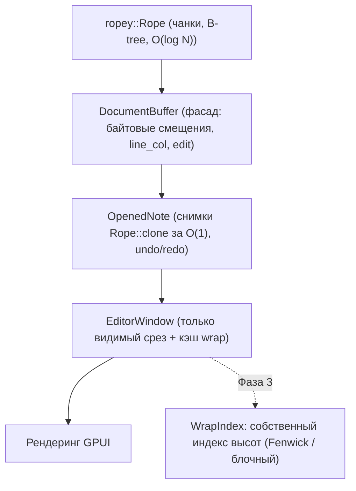

# План перехода на `ropey` для хранения текста (облегчённый вариант без крейтов Zed)

> **Статус документа:** Архитектурный план и техническое проектирование (редакция 2, заменяет `zed-buffer-architecture-migration-plan.md`)
> **Целевой проект:** `aquilum-gpui` (`vibecodium`)
> **Принятое решение:** не переносить `crates/sum_tree`, `crates/rope`, `crates/text` из Zed. Используем готовый крейт [`ropey`](https://crates.io/crates/ropey) (MIT). Zed остаётся только источником идей, кода оттуда мы не берём.
> **Связанные документы:** `TODO/multi-document-workspace-plan.md`, `TODO/perf-plan-large-file-open.md`, `AGENTS.md`

---

## 1. Анализ проблемы: почему в больших документах тормозит ввод

В текущей кодовой базе при вводе символа в большом документе (100-600 МБ или 500k-2M строк) на каждое нажатие выполняются **три $O(N)$ операции**:

| № | Узкое место | Где находится | Что происходит при каждом вводе |
|---|---|---|---|
| **1** | **`self.content: String` (единый сплошной буфер)** | `src/state.rs:892` (`replace_range`) | `memmove` всего хвоста после курсора. Для 600 МБ это **25-35 мс** чистого копирования. |
| **2** | **Линейный скан `LineIndex::splice`** | `src/line_index.rs:146-163` | При `Enter` или удалении `\n` запускается `memchr_iter(b'\n', tail)` от места правки до конца файла. Ещё **30-80 мс**. |
| **3** | **Полная перестройка окна редактора** | `src/state.rs:587`, `src/state.rs:652` (`visual_cache_dirty`) | `EditorWindow::build` на каждый символ: 6 000 аллокаций `String`, wrap всех строк, парсинг markdown-кодблоков. **15-25 мс**. |

**Итог:** задержка ввода **70-150 мс**, быстрая печать забивает очередь событий.

---

## 2. Почему `ropey`, а не порт Zed

| Критерий | Порт `sum_tree` + `rope` из Zed | `ropey` |
|---|---|---|
| Зависимости | Тянет за собой внутренние крейты Zed (`util`, трассировка и т. п.) | Практически нет (только `smallvec`, `str_indices`) |
| Лицензия | Нужно проверять по каждому крейту | MIT |
| Объём работы | Порт, адаптация, поддержка форка | `cargo add ropey` |
| Вставка / удаление | $O(\log N)$ | $O(\log N)$ |
| Индекс строк | В `TextSummary` | Встроен (`byte_to_line`, `line_to_byte`, `line_to_char`) |
| Снимки (`clone`) | $O(1)$ | $O(1)$ (COW на `Arc`) |
| Зрелость | Заточен под Zed | Широко используется (Helix, Lapce и др.) |

Чего у `ropey` нет: пользовательских сумм (высоты строк, wrap) и операций над деревом. Это нужно только в Фазе 3, и там хватит собственной лёгкой структуры (см. §4, Фаза 3).

### 2.1. Настройка крейта

```toml
[dependencies]
# Отключаем unicode_lines: считаем строками только \n и \r\n,
# иначе VT, FF, NEL, U+2028/2029 станут разрывами строк
# и разойдутся с текущей логикой LineIndex и markdown-парсером.
ropey = { version = "1", default-features = false, features = ["simd"] }
```

Эту настройку надо закрепить тестом: строка с `\u{2028}` внутри должна оставаться одной строкой.

### 2.2. Что нужно помнить про API `ropey`

- Основная адресация идёт по **символам (char)**, а не по байтам. В коде проекта везде байтовые смещения (`String`), поэтому `DocumentBuffer` остаётся фасадом с байтовыми смещениями и внутри конвертирует их через `byte_to_char` / `char_to_byte` ($O(\log N)$).
- `rope.line(i)` возвращает `RopeSlice`, строка может лежать в нескольких чанках. `as_str()` вернёт `Some` только для непрерывного среза, поэтому для отрисовки строку собирают в буфер **только для видимых строк**.
- Загрузка файла: `Rope::from_reader` / `RopeBuilder` (потоково, без промежуточного `String` на 600 МБ). Сохранение: `rope.write_to(writer)`.
- Файл обязан быть валидным UTF-8. Поведение для невалидных файлов определяется текущим путём открытия, его нужно сохранить.

---

## 3. Целевая архитектура



---

## 4. Поэтапный план

Проект должен компилироваться и проходить тесты на каждом шаге. Инварианты `AGENTS.md` (существующие компоненты и стили интерфейса) не нарушаются.

### Фаза 1. Инкрементальное обновление `EditorWindow`
*Цель: убрать пункт 3 из §1 (15-25 мс) и подготовить окно к работе поверх Rope.*

1. **Правка внутри существующей строки (без `\n`):**
   - не вызывать `rebuild_visual_cache_with_headings` для всех строк;
   - заменить только строку `window.lines[row.line_idx]`;
   - переразметить (wrap) **только эту строку**;
   - обновить `VisualRowHeightIndex` для изменённых строк.
2. **Правка с `\n` или удалением перевода строки:** локально вставить или удалить записи в `window.lines` и пересчитать только затронутый диапазон.
3. **Не делаем (сознательно):** локализацию `LineIndex::splice` и построчный буфер ввода. Первое исчезнет вместе с `LineIndex` в Фазе 2 (если Фаза 2 отменяется по итогам замеров, см. «Точку принятия решения», пункт возвращается в план), второе создаёт второй источник истины и риски для undo/redo и сохранения.

*Ожидание после Фазы 1: задержка падает примерно до 50-120 мс (остаются пункты 1 и 2). Фаза даёт выигрыш на документах любого размера и не пропадает после перехода на Rope.*

### Точка принятия решения: нужна ли Фаза 2 после Фазы 1

Фаза 1 убирает только пункт 3 из §1 (перестройка окна, 15-25 мс). Пункты 1 и 2 (`memmove` и скан `LineIndex::splice`) остаются, но их стоимость растёт линейно с размером файла. Оценка линейной экстраполяцией из цифр §1 (реальные значения проверяются бенчмарком):

| Размер файла | `memmove` на символ | Скан при `Enter` |
|---|---|---|
| 1-5 МБ | < 0.2 мс | < 0.5 мс |
| 10 МБ | ~0.5 мс | ~1-2 мс |
| 100 МБ | ~4-6 мс | ~5-13 мс |
| 600 МБ | 25-35 мс | 30-80 мс |

**Правило выбора:**

- **Файлы до ~10-20 МБ (обычные заметки).** После Фазы 1 задержка укладывается в 1-2 мс. Фаза 2 не нужна: она меняет ядро `DocumentBuffer` и затрагивает undo, сохранение и все места с байтовыми смещениями, а выигрыша для таких размеров нет.
- **Файлы от ~100 МБ и больше.** `memmove` и скан дают заметные миллисекунды на каждое нажатие, а на 600 МБ целевые < 2 мс недостижимы без Rope. Фаза 2 обязательна.
- **Промежуточный случай.** Если тормозит только `Enter` (скан хвоста), а обычный ввод нормален, и Rope не планируется, можно вернуть в Фазу 1 локальную правку `LineIndex::splice` (скан только до ближайшего чекпоинта `LINE_BLOCK`, остальные чекпоинты сдвигаются на смещение). Если Rope всё же будет, эта правка станет мусором, поэтому по умолчанию она не делается.

**Как принять решение:** после Фазы 1 прогнать `benchmark_typing_latency_large_note` на файлах 1, 10, 100 и 600 МБ и сравнить с бюджетом кадра. Если на нужных размерах задержка < 2 мс, остановиться. Если нет, переходить к Фазе 2.

**Независимые причины для `ropey`**, даже если ввод уже в норме:
- потоковая загрузка (`RopeBuilder` / `from_reader`) без промежуточного `String` на весь файл ускоряет открытие и снижает пик памяти (проверить в `TODO/perf-plan-large-file-open.md`, не упирается ли открытие в ту же проблему);
- снимки `Rope::clone` за $O(1)$ дают автосохранение в фоне без копирования файла.

### Фаза 2. `ropey` в `DocumentBuffer` (по результатам замеров, см. выше)
*Цель: убрать пункты 1 и 2 из §1.*

1. **Подключить `ropey`** с настройкой из §2.1.
2. **Заменить `content: String` на `content: Rope`** в `DocumentBuffer`. Публичный API остаётся на байтовых смещениях:

| Сейчас | Станет (внутри `DocumentBuffer`) |
|---|---|
| `content.replace_range(a..b, s)` | `ca = byte_to_char(a)`, `cb = byte_to_char(b)`, `remove(ca..cb)`, `insert(ca, s)` |
| `LineIndex::line_col(offset)` | `line = byte_to_line(offset)`, `col` через `line_to_byte` и расстояние в символах/байтах |
| `LineIndex::offset_for_line_col` | `line_to_byte(line)` + смещение внутри строки |
| `LineIndex::splice` | удаляется (индекс строк внутри `Rope`) |
| `content.len()` | `len_bytes()` |
| число строк | `len_lines()` |
| `&content[a..b]` | `byte_slice(a..b)` (`RopeSlice`), `String` создаётся только когда реально нужен |

3. **Удалить `line_index.rs`** после того, как тесты на `line_col` / `offset_for_line_col` проходят на новой реализации.
4. **Загрузка и сохранение:**
   - открытие: `RopeBuilder` / `from_reader` вместо чтения всего файла в `String` (согласовать с `TODO/perf-plan-large-file-open.md`);
   - автосохранение: `rope.clone()` за $O(1)$, запись `write_to` в фоновом потоке без блокировки ввода.
5. **Undo/redo:** хранить журнал правок (позиция, удалённый и вставленный текст), а не полные снимки. Снимки `Rope::clone` использовать для фонового сохранения и точек восстановления.
6. **Колонки:** `line_col` считается в символах или байтах так же, как сейчас. Это закрепить тестами на кириллице, эмодзи и CRLF.

*Ожидание после Фазы 2: ввод в файле 600 МБ укладывается в единицы миллисекунд, без $O(N)$ операций.*

### Фаза 3. Независимые окна и индекс переносов (по необходимости)
*Делать только когда понадобятся сплиты одного документа или wrap для огромных файлов.*

1. **Один `DocumentBuffer` на $N$ окон:** каждое окно держит свой лёгкий снимок `Rope` и собственный кэш разметки.
2. **Собственный индекс высот** вместо `SumTree`:
   - вариант A: **Fenwick-дерево** по высотам строк ($O(\log N)$ на обновление и поиск по Y; `VisualRowHeightIndex` уже близок к этому);
   - вариант B: **блочный индекс** (блоки по ~1024 строки с суммой высот), если нужна дешёвая вставка и удаление строк в середине.
3. **Точечная инвалидация:** правка в одном окне пересчитывает разметку только изменённых строк в остальных окнах того же документа.

---

## 5. Риски и меры

| Риск | Мера |
|---|---|
| Расхождение определения «строки» (Unicode-разрывы) | `default-features = false` + тест на `\u{2028}` |
| Ошибки конвертации байт ↔ символ на границах UTF-8 | Property-тесты: случайные правки сравниваются с эталоном на `String` |
| `RopeSlice` непрерывен не всегда (`as_str()` может вернуть `None`) | Собирать только видимые строки в переиспользуемый буфер |
| Регрессии undo/redo | Сначала фасад `DocumentBuffer` с прежним API, затем смена хранилища; прогон существующих тестов на каждом шаге |
| Память при открытии 600 МБ | Замер RSS до и после; потоковая загрузка без промежуточного `String` |

---

## 6. Критерии приёмки (Definition of Done)

1. **Задержка ввода:** ввод на строке 10 в файле 600 МБ (1 000 000 строк) занимает **< 2 мс** от нажатия до готовности кадра. Измерять бенчмарком `benchmark_typing_latency_large_note`.
2. **Стабильность вьюпорта:** при открытых верхе и низа файла ввод в одном окне не вызывает скачков в другом, номера строк в gutter обновляются мгновенно.
3. **Память (RSS):** открытие 600 МБ не превышает baseline более чем на ~10% (накладные расходы Rope); при закрытии окон и вкладок память освобождается.
4. **Тесты:** все существующие 295 тестов (`cargo test --bin vibecodium`) проходят; добавлены property-тесты фасада `DocumentBuffer` против эталона на `String` и стресс-тест скорости ввода.
