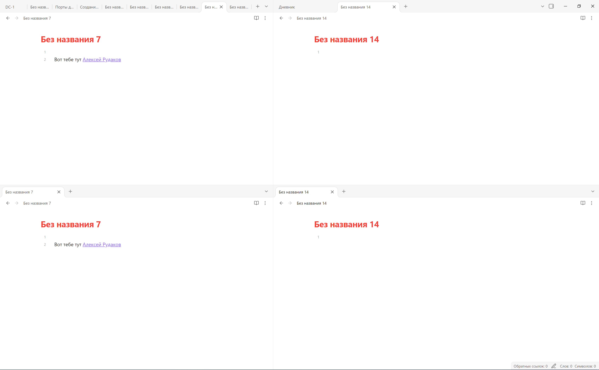
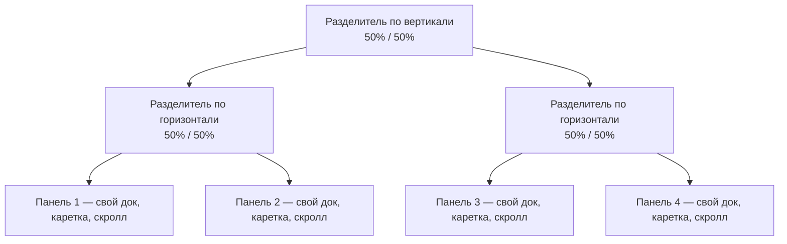

# Что по факту нужно: рабочая область как в Obsidian (4 панели)

> **Назначение:** простыми словами, без архитектуры — что именно должно получиться.
> **Техническая реализация:** `TODO/multi-document-workspace-plan.md` (ред. 3).
> **Основа:** скриншот господина — `TODO/Screenshot_39.png` (раскладка 2×2, 2026-10-17). Ниже — то же самое, но словами и с рисунками.

---

## 1. Эталон: как это выглядит

Эталон — скриншот приложения (лежит рядом с этим документом):



*`Screenshot_39.png`, 3387×2092. То же самое схемой:*

```
┌──────────────────────────────────────────────────────────────────────────┐
│ DC-1  [Без названия 7][Дневник] +  │  [Без названия 14] +        –  □  ✕ │
├────────────────────────────────────┼─────────────────────────────────────┤
│ ← → Без названия 7                 │ ← → Без названия 14                 │
│                                    │                                     │
│  Без названия 7                    │  Без названия 14                    │
│  1                                 │  1                                  │
│  2  Вот тебе тут Алексей Рудаков   │                                     │
│                                    │                                     │
├────────────────────────────────────┼─────────────────────────────────────┤
│ [Без названия 7 ×] +               │ [Без названия 14 ×] +               │
│ ← → Без названия 7                 │ ← → Без названия 14                 │
│  Без названия 7                    │  Без названия 14                    │
│  1                                 │  1                                  │
│  2  Вот тебе тут Алексей Рудаков   │                                     │
└────────────────────────────────────┴─────────────────────────────────────┘
```

Что здесь важно:

- Окно поделено **вертикальным и горизонтальным разделителями** на четыре равные части.
- **Верхний ряд** — вкладки этих панелей живут в **заголовке окна** (слева своя группа, справа своя, между ними разделитель).
- **Нижний ряд** — у каждой панели **своя полоса вкладок** в верхней части панели (`[Без названия 7 ×] +`).
- В каждой панели своя навигация-путь (`← → имя файла`), **свой заголовок документа**, свой текст, **свой скроллбар**.
- Разделители **непрерывны**: начинаются в заголовке окна, проходят сквозь полосы вкладок и уходят вниз через редактор.

Дерево раскладки (то же самое формально):



---

## 2. Что должно работать (по-человечески)

1. **Любое число панелей.** Делю окно вправо, влево, вверх, вниз; панели можно делить дальше — получаются вложенные сплиты. Четыре панели — частный случай, не предел.
2. **У каждой панели своя группа вкладок** и своя активная вкладка. Вкладки одной панели не видны в другой.
3. **Разные документы рядом** — обычное дело. Открыл файл в левой панели — правая не изменилась.
4. **Один документ в двух панелях.** Текст и история правок общие, а **каретка, выделение и прокрутка — свои**. Прокрутил в одной — вторая не поехала.
5. **Правка в одной панели не двигает то, что я вижу в другой.** Пишу в панели A выше по тексту — панель B показывает тот же текст; меняется только ползунок скроллбара.
6. **Если общая строка видна в обеих панелях** — правка в ней видна сразу в обеих.
7. **Одно сохранение, одна история undo/redo** на документ, сколько бы панелей его ни показывали.
8. **Раскладка помнится.** При запуске восстанавливаются: число и пропорции панелей, открытые файлы по панелям, активная панель, позиции просмотра и курсоры.
9. **Закрытие работает предсказуемо.** Закрыл последнюю вкладку панели — панель исчезает, место занимает соседняя. Осталась одна панель — обычный однопанельный режим.
10. **Верхний ряд и нижний ряд равноправны.** Вкладки отличаются только местом (в заголовке окна или внутри панели), поведение одинаковое: `+` создаёт вкладку в этой панели, `×` закрывает, есть контекстное меню и перетаскивание.
11. **Перенос строк корректен при любом числе панелей.** Текст переносится по фактической ширине **своей** панели — с учётом разделителя, gutter и полей; не вылезает за правый край и не наезжает на разделитель. Появился или исчез разделитель — перенос пересчитывается сразу, а не по прежней ширине.
12. **Полоса вкладок — как в однооконном режиме, целиком.** Слева от вкладок — кнопка создания заметки (новая заметка встаёт в начало полосы), дальше вкладки с `×`, справа завершающий `+` и меню скрытых вкладок. В панелях с собственной полосой набор и порядок те же; «упрощённой» полосы без ведущей кнопки быть не должно.
13. **Имя файла над редактором — как сейчас.** Тот же инпут в том же месте, того же вида и размера, с тем же поведением (клик — фокус, Enter — переименование). Он есть в каждой панели, но набираемый текст, каретка и фокус — **у каждого свои**: начал переименовывать в одной панели — в соседней поле не меняется.
14. **Вкладка нажимается по всей высоте полосы, а не по нарисованному телу.** Вкладка нарисована высотой 32 px у нижней кромки, но клик срабатывает и выше неё — вплоть до самой верхней кромки окна: можно ударить курсором в край экрана и всё равно попасть во вкладку. Та же нажимаемая высота у кнопки создания заметки и у `+`. Появились панели — хитбоксы не сжались и не обрезались.
15. **Память не выросла.** В одной панели приложение ест столько же, сколько до сплитов: текст файла лежит в памяти **один раз**, а не двумя копиями. Вторая панель с тем же файлом добавляет только позицию просмотра и каретку, а не второй экземпляр текста. Переключение вкладок не оставляет мусора: вернулся на первую — память та же. И все прежние оптимизации редактора (окно отрисовки, индекс строк, индекс высот) работают в любом режиме, а не только в однооконном.

---

## 3. Что НЕ должно меняться

Это так же важно, как то, что должно работать.

- **Внешний вид — как сейчас.** Редактор, заголовок документа, полоса вкладок, скроллбар, отступы, цвета — те же. Никакого «попутного редизайна».
- **Второй редактор не пишем.** Используется существующий: **одна реализация — много состояний**. Панели не получают «свою копию редактора» в коде, они получают своё *состояние*.
- **Единственное визуальное отличие** от нынешнего однооконного режима — появившиеся разделители и дополнительные полосы вкладок.
- **Одна панель = как сейчас.** Если я не делю окно, всё выглядит и работает точно как сегодня.

---

## 4. Чего мне пока не нужно

- Несколько окон ОС (отдельные окна Windows).
- Совместное редактирование по сети (CRDT).
- Синхронная прокрутка панелей.
- Масштаб шрифта отдельно на панель.
- Сохранение выделения между запусками (курсор и позиция просмотра — да, выделение — нет).

---

## 5. Ключевое поведение в картинке

Один документ в двух панелях, правка выше по тексту:

- панель B показывает строки 3000–3003 и **до**, и **после**;
- меняются только `scroll_top` и длина ползунка;
- каретка и выделение панели B остаются на том же тексте.

(Иллюстрация — в ответе к этому документу; в технической части это требования R4, R5, R6 и раздел 5 плана.)

---

## 6. Связь с планом

| Что нужно здесь | Где в плане |
|---|---|
| Любое число панелей, вложенные сплиты | R1, §3 (ADR-5), §8.2 |
| Своя группа вкладок и своя активная вкладка | R2, §6.3, §8.1 |
| Разные документы рядом | R3, §6.2 |
| Общий буфер, независимые каретка/выделение/скролл | R3, R4, R8, ADR-1, ADR-8, §4 |
| Правка не двигает текст в другой панели | R5, R6, §5 целиком |
| Одно сохранение, одна история undo | R8, §7 |
| Восстановление раскладки и позиций | R9, §9 |
| Закрытие вкладки/схлопывание панели | §8.3 |
| Вкладки верхних и нижних панелей равноправны | §8.2, фаза 11 |
| Панель — независимая единица | R11 |
| Использовать существующий редактор, не писать заново | R12, N5, ADR-6 |
| Внешний вид не меняется | R13, §11.5 |
| Перенос строк по фактической ширине панели | R14, §4.4, §10.2 п.1, §11.1 |
| Полоса вкладок в исходном составе (кнопка заметки слева) | R15, §8.2, §10.2 п.2, §11.5 |
| Инпут с именем файла над редактором в исходном виде | R16, §8.4, §10.2 п.3, §11.1 |
| Хитбоксы вкладок выше нарисованных вкладок | R17, §8.2, §10.2 п.4, §11.5 |
| Текст в памяти один раз, память не выросла | N8, §4.5, §10.2 п.5, §11.4 |
| Оптимизации однооконного режима работают всегда | R18, N9, §11.5 |

---

## 7. Критерий «готово»

- Делю окно на 4 панели, открываю в них 4 разных файла — каждая панель живёт своей жизнью.
- Открываю один файл в двух панелях, прокручиваю их по-разному, печатаю в одной — вторая не дёргается, ползунок честно пересчитывается.
- Закрываю и открываю приложение — раскладка, файлы и позиции просмотра на месте.
- Тяну разделитель — текст в обеих панелях переносится по новой ширине: без обрезки и без наезда на разделитель.
- В любой панели слева от вкладок есть кнопка создания заметки, и она работает.
- Имя файла над редактором выглядит и ведёт себя как сегодня; переименование в одной панели не печатается в поле другой.
- Клик у самой верхней кромки окна попадает во вкладку — и в верхнем ряду, и в полосе нижней панели.
- Открываю тот же файл, что и до сплитов: приложение занимает столько же памяти, сколько раньше; вторая панель с тем же файлом память не удваивает.
- Ни одна панель визуально не отличается от сегодняшнего редактора.
