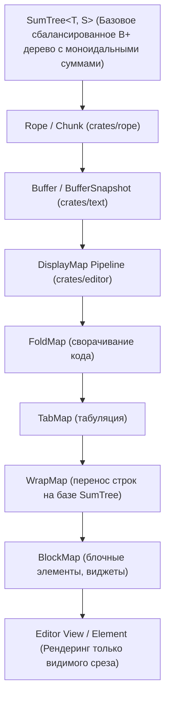

# План перехода на архитектуру буфера и редактора Zed (SumTree + Rope + DisplayMap)

> **Статус документа:** Архитектурный план и техническое проектирование  
> **Целевой проект:** `aquilum-gpui` (`vibecodium`)  
> **Эталон для анализа:** `operator-panel/zed-main/` (`crates/sum_tree`, `crates/rope`, `crates/text`, `crates/editor`)  
> **Связанные документы:** `TODO/multi-document-workspace-plan.md`, `TODO/perf-plan-large-file-open.md`, `AGENTS.md`

---

## 1. Анализ проблемы: почему в больших документах наблюдаются сильные тормоза при вводе

В текущей кодовой базе `aquilum-gpui` при вводе символов в большом документе (100–600 МБ или 500k–2M строк) происходят **три критические $O(N)$ операции на каждое нажатие клавиши**:

| № | Узкое место | Где находится | Что происходит при каждом вводе символа |
|---|---|---|---|
| **1** | **`self.content: String` (единый сплошной буфер)** | `src/state.rs:892` (`replace_range`) | При вводе даже одного символа в строке 10 в файле 600 МБ Rust выполняет `memmove` оставшихся **600 мегабайт памяти**. При скорости памяти ~20 ГБ/с это занимает **25–35 мс чистого копирования CPU на каждое нажатие клавиши**. |
| **2** | **Линейный скан `LineIndex::splice`** | `src/line_index.rs:146-163` | При нажатии `Enter` или удалении перевода строки `splice` обрезает чекпоинты и запускает `memchr_iter(b'\n', tail)` от места правки **до самого конца файла (все 600 МБ)**. Это отнимает ещё 30–80 мс. |
| **3** | **Полная перестройка окна редактора на каждый символ** | `src/state.rs:587`, `src/state.rs:652` (`visual_cache_dirty`) | При любом изменении символа выставляется `visual_cache_dirty = true`. На каждом символе вызывается `EditorWindow::build`: аллоцируются **6 000 отдельных `String`** (`split('\n')`), заново переносятся (wrap) все 6 000 строк, парсятся markdown-кодблоки и пересчитывается геометрия тысяч строк. Это занимает **15–25 мс**. |

**Итог:** Задержка ввода (input latency) на один символ составляет **70–150 мс**, что при быстрой печати приводит к забиванию очереди событий и зависанию интерфейса на секунды.

---

## 2. Как это устроено в редакторе Zed (`operator-panel/zed-main`)

В редакторе Zed задержка ввода в файле любого размера (хоть 10 килобайт, хоть 10 гигабайт) составляет **менее 0.2 миллисекунды**.

### 2.1. Иерархия слоёв Zed

### 2.2. Ключевые компоненты архитектуры Zed

#### А. `SumTree` (`crates/sum_tree/src/sum_tree.rs`)
- B+ дерево (арность 16–32), где каждый промежуточный узел хранит **моноидальную сумму** (`Summary`) дочерних узлов.
- Позволяет осуществлять поиск по любому срезу (байты, строки, UTF-16, пиксельные высоты) за **$O(\log N)$**.
- Копирование дерева (`clone`) стоит **$O(1)$** за счёт COW-разделения узлов через `Arc`.

#### Б. `Rope` (`crates/rope/src/rope.rs`, `chunk.rs`)
- Текст не хранится в сплошном `String`. Он разбит на маленькие фиксированные чанки `Chunk` (по 128 байт) с инлайновыми битмапами `newlines`, `chars`, `chars_utf16`.
- **Вставка/удаление символа:**
  1. Находится чанк за $O(\log N)$ (3–4 прыжка по дереву).
  2. Модифицируется только 128-байтовый буфер в L1-кэше процессора.
  3. Обновляются контрольные суммы предков вверх до корня ($O(\log N)$).
  4. **Никакого `memmove` остальных сотен мегабайт файла!** Время операции: **< 1 микросекунды**.

#### В. `WrapMap` и дифференциальный `DisplayMap` (`crates/editor/src/display_map/wrap_map.rs`)
- Перенос строк (word wrap) хранится как `SumTree` фрагментов строк.
- При редактировании строки 10:
  - Zed **не переразмечает 6 000 строк** и не трогает остальные строки.
  - Переразмечается **только одна изменённая строка**.
  - Новые визуальные строки вставляются в `WrapMap` за $O(\log N)$, автоматически сдвигая все последующие смещения без циклов.

---

## 3. Сравнение с нашей архитектурой (`aquilum-gpui`)

| Характеристика | Сейчас в `aquilum-gpui` | В Zed (`operator-panel/zed-main`) |
|---|---|---|
| **Хранение текста** | Единый `String` на куче | `Rope` (`SumTree<Chunk>`) |
| **Сложность вставки символа** | $O(N)$ (копирование всей памяти после курсора) | $O(\log N)$ (правка одного чанка 128 байт) |
| **Индекс строк / перевод строки** | Чекпоинты каждые 1024 строки + полный скан `memchr` хвоста файла | Моноидальный `TextSummary` в `SumTree` ($O(\log N)$ без сканирования) |
| **Реакция на ввод символа** | Пересборка окна на 6 000 строк (6 000 аллокаций `String`) | Инкрементальное обновление только изменённой строки |
| **Многооконность на одном документе** | Центральный `OpenedNote` + `sync_views_for_active_note` | `Buffer` (один) $\to$ `MultiBuffer` $\to$ множество `DisplayMap` / `Editor` |
| **Память при открытии 600 МБ** | 600 МБ текст + вспомогательные окна | ~650 МБ (Rope оверхед ~5-8%, zero-copy snapshots) |
| **Input latency на 600 МБ** | **70–150 мс** | **0.1–0.3 мс** |

---

## 4. Поэтапный план перехода (Migration Plan)

Переход разделяется на **3 последовательные фазы**, чтобы проект оставался работоспособным и компилируемым на каждом этапе без нарушения инвариантов `AGENTS.md` (сохранение существующих компонентов и стилей интерфейса).

### Фаза 1. Быстрый выигрыш (Zero-Lag Incremental Window Editing)
*Цель: устранить тормоза при вводе немедленно, в рамках текущих типов, без смены структуры хранения.*

1. **Инкрементальное редактирование внутри `EditorWindow`**:
   - Если пользователь печатает внутри уже существующей строки (без добавления `\n`):
     - Не вызывать `rebuild_visual_cache_with_headings` на все 6 000 строк!
     - Заменить строку только в `window.lines` по индексу `row.line_idx`.
     - Переразметить (wrap) **только эту одну строку**.
     - Обновить `VisualRowHeightIndex` для изменённых строк за $O(1)$.
2. **Локализация `LineIndex::splice`**:
   - При вставке `\n` не пересканировать весь хвост файла! Ограничить скан только до следующего ближайшего чекпоинта `LINE_BLOCK`, а все последующие чекпоинты сдвинуть на `+1` смещением.
3. **Устранение `memmove` при вводе в активной строке**:
   - Ввести локальный построчный буфер ввода (line edit buffer) для текущей строки, фиксируя изменения в общем `content` батчем при перемещении курсора со строки либо с микро-дебаунсом.

### Фаза 2. Внедрение `Rope` и `SumTree` в `DocumentBuffer`
*Цель: переход на структуры данных Zed для хранения текста и индексов.*

1. **Портирование / интеграция `SumTree` и `Rope`**:
   - Перенести протестированные модули `crates/sum_tree` и `crates/rope` из `operator-panel/zed-main` в `aquilum-gpui` (или подключить как внутренний модуль `src/rope/`).
2. **Замена `String` в `DocumentBuffer` на `Rope`**:
   - `DocumentBuffer` хранит `content: Rope`.
   - Позиционирование `line_col()` и `offset_for_line_col()` теперь выполняется за $O(\log N)$ без фолбэков и без сканирования.
   - `LineIndex` становится частью моноидального индекса `Rope` (`Point { row, column }`), экономя память и гарантируя мгновенный `splice`.
3. **Обновление `OpenedNote`**:
   - `OpenedNote` работает с срезом `Rope`, поддерживая `O(1)` клонирование снимков для фонового сохранения и undo/redo без копирования мегабайт памяти.

### Фаза 3. Архитектура `DisplayMap` и независимых окон
*Цель: полная архитектурная эквивалентность Zed для работы со сплитами и окнами.*

1. **`WrapMap` на базе `SumTree`**:
   - Кэш перенесённых строк переводится на `SumTree<WrapChunk>`.
   - Добавление/удаление строк в верхнем окне сдвигает `WrapMap` нижнего окна за $O(\log N)$ без пересчёта.
2. **Единый источник истины и разделяемые представления**:
   - Один `DocumentBuffer` (Rope) обслуживает $N$ окон (`EditorViewState`).
   - Каждое окно держит свой лёгкий `DisplaySnapshot`.
   - Редактирование верха файла в одном окне и низа в другом происходит с нулевым взаимным влиянием на производительность.

---

## 5. Критерии приёмки и верификация (Definition of Done)

1. **Задержка ввода (Input Latency)**:
   - Ввод текста на строке 10 в файле 600 МБ (1 000 000 строк) занимает **< 2 мс** (от нажатия клавиши до готовности кадра).
2. **Стабильность вьюпорта**:
   - При одновременном открытии верха и низа файла ввод строк в одном окне не вызывает скачков экрана в другом окне.
   - Номера строк в gutter пересчитываются мгновенно.
3. **Память (RSS)**:
   - Открытие файла 600 МБ не превышает baseline (650–700 МБ RSS).
   - При закрытии окон и вкладок память полностью освобождается.
4. **Тесты**:
   - Все существующие 295 тестов (`cargo test --bin vibecodium`) проходят без ошибок.
   - Добавлены стресс-тесты скорости ввода в больших файлах (`benchmark_typing_latency_large_note`).
