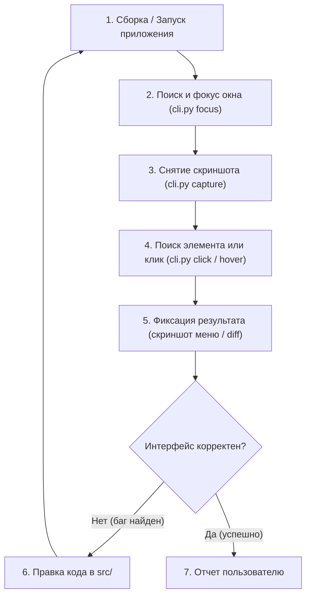

# Руководство для ИИ-Агента (AI Autonomous UI Testing & Debugging)

Этот документ содержит регламент и инструкции для автономного ИИ-агента (Antigravity, Claude, Cursor, Copilot) по использованию инструмента `tools/gui_tester/` для самостоятельного запуска, визуального тестирования, анализа интерфейса и проверки исправлений в коде.

---

## 0. MCP-режим (рекомендуется)

Вместо вызова `cli.py` через shell агент может использовать MCP-сервер `gui-tester`
(`tools/gui_tester/mcp_server.py`). Преимущества: скриншоты приходят **как изображения** (модель их
видит сразу), координаты **относительно окна**, есть OCR, ожидания, assert-ы и пакетный `run_steps`.

Подключение:
```bash
pip install -r tools/gui_tester/requirements.txt
# Claude Code:
claude mcp add gui-tester -e GUI_TESTER_WINDOW=Vibecodium -- python tools/gui_tester/mcp_server.py
# либо положите .mcp.json в корень проекта (пример лежит рядом)
```
Сервер должен работать в той же Windows-сессии, где отображается приложение (не в WSL/SSH).

Цикл агента: `launch_app` -> `screenshot(grid=100)` -> действие (`click_text` / `click_template` / `click` /
`hotkey` / `type_text`) с `screenshot_after=true` -> `wait_for_change` / `wait_until_stable` ->
`assert_visible` / `compare_to_baseline`. При падении приложения — `app_logs` (паники Rust).

| Группа | Инструменты |
|---|---|
| Приложение | `launch_app`, `stop_app`, `app_status`, `app_logs` |
| Окна | `list_windows`, `set_default_window`, `focus_window`, `set_window_geometry` |
| Зрение | `screenshot`, `zoom`, `pixel_color`, `read_text` (OCR), `find_template`, `copy_screenshot_to_clipboard` |
| Действия | `click`, `click_template`, `click_text`, `hover`, `drag`, `scroll`, `type_text` (кириллица ок), `press_key`, `hotkey` |
| Ожидание | `wait_for_change`, `wait_until_stable`, `wait_for_template`, `wait_for_text`, `wait` |
| Тесты | `save_template`, `assert_visible`, `compare_to_baseline`, `diff_images`, `run_steps` |

Правила: не трогайте мышь во время теста (используется реальный ввод); окно должно быть видимым;
для аварийной остановки уведите курсор в угол экрана (pyautogui FAILSAFE).

---

## 1. Роль и назначение инструмента для нейросети

При разработке приложений на **GPUI / Rust** (например, `aquilum-gpui` / `vibecodium`):
* Интерфейс рисуется на GPU, поэтому классические консольные тесты не могут увидеть, как выглядят кнопки, открылось ли меню, не съехала ли верстка и работает ли hover.
* Инструмент `tools/gui_tester/cli.py` выступает «глазами» и «руками» нейросети:
  - Делает скриншоты окон или экрана;
  - Копирует изображения в системный буфер обмена для мгновенной вставки;
  - Находит координаты элементов по изображениям-шаблонам через OpenCV;
  - Нажимает на кнопки, наводит мышь, отправляет хоткеи;
  - Сравнивает состояния интерфейса до и после правок (`diff`).

---

## 2. Автономный цикл работы ИИ (Autonomous Agent Loop)

Когда пользователь ставит задачу «исправь меню / проверь как выглядит кнопка / протестируй интерфейс», агент действует по следующему циклу:



---

## 3. Быстрые команды CLI для агента (Всегда используйте `--json`)

ИИ должен вызывать `cli.py` с флагом `--json`, чтобы сразу парсить вывод:

### Шаг 1: Проверить, запущено ли приложение
```bash
python tools/gui_tester/cli.py list-windows --filter Vibecodium --json
```
Если окно найдено, вернется JSON с координатами `x`, `y`, `width`, `height` и `hwnd`.

### Шаг 2: Запустить, если не запущено
```bash
# Запуск готового бинарника (быстро)
python tools/gui_tester/cli.py launch --cmd "aquilum-gpui/target/debug/vibecodium.exe" --window Vibecodium --wait 3 --json

# Либо через cargo run:
python tools/gui_tester/cli.py launch --cmd "cargo run" --cwd "aquilum-gpui" --window Vibecodium --wait 8 --json
```

### Шаг 3: Снять скриншот окна и скопировать в буфер обмена
```bash
python tools/gui_tester/cli.py capture --window Vibecodium --output tools/gui_tester/screenshots/current_ui.png --to-clipboard --json
```
* **Важно:** Флаг `--to-clipboard` помещает скриншот в буфер обмена Windows (`CF_DIB`). Пользователь или агент может сразу нажать `Ctrl+V` в любом графическом редакторе или чате.
* Сохраненный PNG-файл агент может прочитать через встроенный `read_file` и визуально оценить правильность рендеринга.

### Шаг 4: Найти координаты кнопки/элемента по шаблону
Если в папке `tools/gui_tester/templates/` есть иконка (например, `tab_close.png`):
```bash
python tools/gui_tester/cli.py find-image --template tools/gui_tester/templates/tab_close.png --window Vibecodium --threshold 0.8 --json
```
Ответ агенту:
```json
{
  "found": true,
  "score": 0.965,
  "x": 240,
  "y": 14,
  "width": 20,
  "height": 20,
  "center": [250, 24],
  "success": true
}
```

### Шаг 5: Кликнуть по элементу или координатам
```bash
# Вариант А: по шаблону напрямую:
python tools/gui_tester/cli.py click --template tools/gui_tester/templates/tab_close.png --window Vibecodium --json

# Вариант Б: по вычисленным координатам:
python tools/gui_tester/cli.py click --coords 250 24 --json

# Вариант В: правый клик для контекстного меню:
python tools/gui_tester/cli.py click --coords 250 24 --button right --json
```

### Шаг 6: Наведение (Hover) для проверки всплывающих меню и подсказок
```bash
python tools/gui_tester/cli.py hover --coords 250 24 --duration 0.3 --json
# Снять скриншот состояния hover:
python tools/gui_tester/cli.py capture --window Vibecodium --output tools/gui_tester/screenshots/hover_state.png --json
```

### Шаг 7: Отправка хоткеев и текста
```bash
# Открыть командную палитру:
python tools/gui_tester/cli.py hotkey --keys ctrl p --json

# Вставить из буфера обмена:
python tools/gui_tester/cli.py hotkey --keys ctrl v --json

# Нажать Escape:
python tools/gui_tester/cli.py hotkey --keys esc --json
```

### Шаг 8: Сравнение «Было / Стало» (Visual Diff)
```bash
python tools/gui_tester/cli.py diff --baseline tools/gui_tester/screenshots/baseline.png --current tools/gui_tester/screenshots/current_ui.png --diff-out tools/gui_tester/screenshots/diff_highlighted.png --json
```
Если `diff_ratio > 0`, в файле `diff_highlighted.png` все изменившиеся места будут обведены красным цветом.

---

## 4. Памятка для агента при отладке и создании шаблонов

1. **Создание нового шаблона для поиска**:
   Если нужно нажать на специфическую кнопку, которой еще нет в `templates/`:
   Агент может снять полный скриншот окна, затем через Python вырезать нужный фрагмент (кнопку) и сохранить в `tools/gui_tester/templates/<name>.png`:
   ```python
   from PIL import Image
   img = Image.open("tools/gui_tester/screenshots/current_ui.png")
   # Вырезать область [left, top, right, bottom]
   button = img.crop((100, 20, 140, 50))
   button.save("tools/gui_tester/templates/my_button.png")
   ```
2. **Проверка после исправления Rust кода**:
   После изменения `.rs` файлов:
   - Запустите сценарий `python tools/gui_tester/scenarios/test_vibecodium_ui.py`.
   - Проверьте скриншоты в папке `tools/gui_tester/screenshots/`.
   - Если скриншот соответствует требованиям задачи, задача решена.
