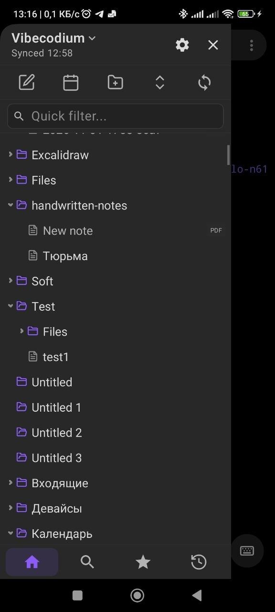

# vibecodium mobile

Android client: a Kotlin/Compose shell over a platform-independent Rust core.

<p align="center">
  
</p>

## Architecture

- **`core/`**: Rust cdylib with the vault, trash, JSON API (open, read, write, search, outline, stats), markdown parser, JNI bridge, and native `SurfaceView` renderers for the editor and file tree.
- **`app/`**: Kotlin/Compose with the header, drawers, tabs, settings, preview, state, and saving.
- **`scripts/`**: `build-core.sh`.

## Features

- Vaults: plain folder or SAF folder.
- Editor: native, with line numbers, markdown and code highlighting, selection, and inertial scrolling.
- Preview: headings, lists, quotes, code, tables, local images.
- Files: folder tree, quick filter, bookmarks, recents, search.
- Dropbox sync (OAuth PKCE, conflict copies, delta listing).
- Settings: appearance, editor, files, sync, advanced.

## Build

Requires JDK 17+, Android SDK 35, NDK `28.2.13676358`, and Rust targets `aarch64-linux-android` and `x86_64-linux-android`.

```bash
bash scripts/build-core.sh
gradle :app:assembleDebug
```

Release builds are signed via `keystore.properties` (git-ignored).

## Limitations

- Text scale doesn't apply to the native editor.
- No soft wrapping or full TalkBack support.
- No filesystem watcher; refresh is manual.
- Dropbox tokens are unencrypted; no background sync.
- No line-by-line conflict merge.

## Next steps

Benchmarks, inline images in the editor, table editing and checkboxes, bookmark groups, line-by-line merge, encrypted token storage, and periodic sync.